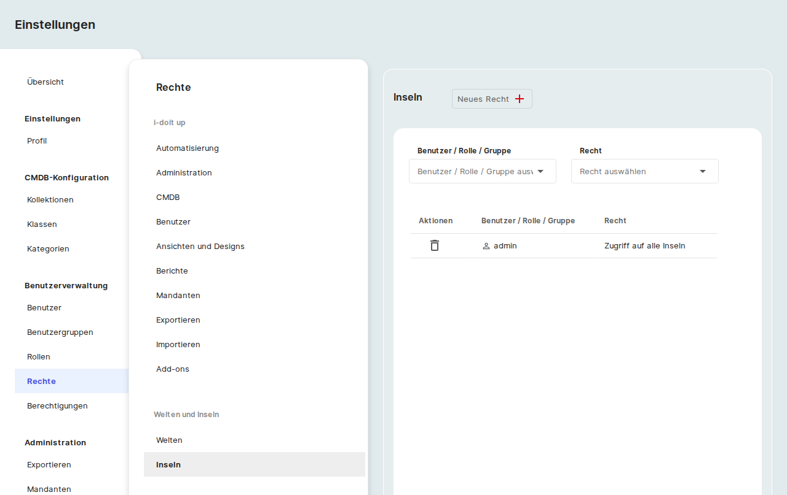

# DMS-Integration

Das DMS-Add-on verbindet i-doit up mit dem Dokumentenmanagementsystem (DMS).
Es bettet das DMS in i-doit up ein, ergänzt die Objektseite um eine Island und ein Widget für Dokumente und meldet i-doit-up-Benutzer ohne eigene Anmeldung im DMS an.
Diese Seite beschreibt, wie das Add-on arbeitet, was es braucht, wie Sie es konfigurieren und registrieren und was Sie prüfen, wenn es nicht funktioniert.
Die Benutzersicht beschreibt [Dokumente (DMS)](../user/dms.md).

!!! info
    Verfügbar ab i-doit up 3.3.0.

## So arbeitet die Integration

Die Integration ist ein externes i-doit-up-Add-on mit dem Hersteller `synetics` und der ID `dms`.
Sie besteht aus einem Add-on-Dienst, der neben dem DMS läuft, und einer Oberfläche, die i-doit up von diesem Dienst lädt.

- i-doit up liest das Add-on-Manifest von `<Add-on-URL>/addon.json` und ruft das Add-on auf, wenn es registriert, aktualisiert, aktiviert, deaktiviert oder abgemeldet wird.
- Alle Anfragen aus dem Browser laufen über i-doit up unter `/a/synetics/dms/` zum Add-on.
  Das Add-on liefert dort die DMS-Oberfläche aus und leitet deren API-Anfragen an das DMS weiter.
  Das eingebettete DMS läuft damit unter der Adresse von i-doit up, und der Browser muss das DMS für die eingebetteten Ansichten nicht direkt erreichen.
- Beim Registrieren meldet das Add-on die i-doit-up-Instanz beim DMS als vertrauenswürdige Anmeldequelle an.
  Abmelden des Add-ons entfernt diese Anmeldung, Deaktivieren sperrt die Anmeldung.

**Anmeldung**

Das Add-on erkennt den Benutzer an der Anfrage von i-doit up und liest E-Mail-Adresse, Name und Mandanten des Benutzers über die i-doit-up-API.
Es meldet den Benutzer mit einem kurzlebigen Token im DMS an.
Das DMS legt den Benutzer beim ersten Aufruf an.

- Benutzer aus i-doit up erhalten im DMS die Rolle *user*, auch i-doit-up-Administratoren.
  **Manage in DMS** meldet ebenfalls als dieser Benutzer an.
- Rechte aus i-doit up werden nicht übertragen.
  Den Zugriff auf jedes Dokument prüft das DMS selbst.
- Das Add-on übergibt die Sprache des Benutzers nicht an das DMS.

**Mandanten und Objekte**

Das DMS hält die Dokumente jeder i-doit-up-Instanz und jedes Mandanten in einem eigenen Arbeitsbereich.
Es legt den Arbeitsbereich bei der ersten Anmeldung aus i-doit up automatisch an.
Ein Administrator, der sich direkt im DMS anmeldet, sieht die Dokumente aus i-doit up nicht, siehe [DMS-Administration](dms/administration.md#administratorkonto).
Die Ansichten zeigen immer den Mandanten, der gerade in i-doit up gewählt ist, sofern der Benutzer Zugriff darauf hat.
Dokumente werden einem Objekt über die Objekt-ID zugeordnet.

## Voraussetzungen

Das DMS-Add-on gibt es für i-doit up Cloud und On-Premises.
In i-doit up Cloud übernimmt die i-doit GmbH die Installation von Add-ons, siehe [Add-ons](addons.md#ein-add-on-installieren).
Wenn Sie das Add-on selbst betreiben, brauchen Sie:

- Ein laufendes DMS, das Sie administrieren.
- i-doit up 3.3.0 oder neuer, in dem Sie Add-ons registrieren können.
- i-doit up läuft mit HTTPS.
  Über HTTP bleiben die eingebetteten DMS-Ansichten leer.
- Docker und Docker Compose auf dem Host des Add-on-Dienstes.
- Netzwerkzugriff:
    - von i-doit up zum Add-on-Dienst,
    - vom Add-on-Dienst zu der i-doit-up-URL, die i-doit up dem Add-on meldet,
    - vom Add-on-Dienst zum DMS-Backend,
    - vom Browser der Benutzer zur öffentlichen DMS-Adresse, für **Manage in DMS**.
- Eine MongoDB-Datenbank für das Add-on, etwa die MongoDB des DMS.

## Add-on-Dienst konfigurieren

Der Add-on-Dienst ist der Container `i-doit-up-addon-backend` im Docker-Compose-Aufbau des DMS.
Er lauscht auf Port `3100` und ist nur innerhalb des Docker-Netzes erreichbar.
Sie konfigurieren ihn mit folgenden Umgebungsvariablen:

| Variable | Pflicht | Beschreibung |
| --- | --- | --- |
| `PORT` | nein | Port des Dienstes, Standard `3100`. |
| `MONGODB_URI` | ja | MongoDB-Verbindung des Add-ons, etwa `mongodb://mongo:27017/dms_addon_i_doit_up`. |
| `IDOIT_UP_VENDOR` | nein | Hersteller des Add-ons, Standard `synetics`. |
| `IDOIT_UP_ADDON_ID` | nein | ID des Add-ons, Standard `dms`. Hersteller und ID ergeben den Pfad `/a/<Hersteller>/<ID>/` in i-doit up. |
| `ADDON_TITLE` | nein | Titel des Add-ons in i-doit up, Standard `DMS Add-on`. |
| `ADDON_VERSION` | nein | Version, die das Add-on an i-doit up meldet. |
| `DMS_BACKEND_URL` | ja | Interne Adresse des DMS-Backends, etwa `http://backend:3000`. |
| `DMS_PUBLIC_URL` | ja | Adresse des DMS, die die Browser Ihrer Benutzer erreichen. **Manage in DMS** öffnet diese Adresse. |
| `DMS_BACKEND_SERVICE_TOKEN` | ja | Persönliches API-Token (`dms_...`) eines DMS-Administrators. Das Add-on meldet damit i-doit-up-Instanzen beim DMS an. |
| `ADDON_SECRETS_KEY` | ja | Schlüssel, der die gespeicherten Anmelde-Secrets verschlüsselt. Erzeugen Sie ihn mit `openssl rand -hex 32` und bewahren Sie ihn auf. |
| `CORS_ORIGIN` | nein | Für i-doit up nicht nötig. Lassen Sie den Wert leer. |

Das DMS kennt keine Dienstkonten.
Das Add-on handelt deshalb mit dem Token des Administrators, der es erzeugt hat.
Verliert dieser Administrator die Administratorrolle oder löscht er das Token, schlagen neue Registrierungen fehl.

Der Dienst bietet die Zustandsprüfungen `/health` und `/health/ready`.

Speichert das DMS Dateien auf einem lokalen Docker-Volume, muss das Upload-Volume dem Benutzer und der Gruppe `101:101` gehören.
Sonst schlagen Uploads mit *Internal server error* fehl.

Das Add-on hat in i-doit up keine Einstellungsseite.

## Add-on in i-doit up registrieren

1. Erzeugen Sie im DMS als Administrator ein persönliches API-Token und tragen Sie es als `DMS_BACKEND_SERVICE_TOKEN` ein.
2. Starten Sie den Add-on-Dienst und prüfen Sie, dass `/health` antwortet.
3. Registrieren Sie das Add-on in i-doit up mit der Add-on-URL, die i-doit up erreicht:

    ```bash
    docu:addons:register https://dms-addon.example.com
    ```

    i-doit up ruft das Add-on auf, und das Add-on meldet die Instanz beim DMS an.

4. Öffnen Sie i-doit up und prüfen Sie, dass **DMS** in der Navigation in der Gruppe **Add-ons** erscheint.

### Rechte für die Island Documents

Die Island erscheint in der Gruppe **Islands** der Objektleiste.
Benutzer brauchen die Island-Rechte, um sie zu sehen.
Seit i-doit up 3.3.0 erhält die Admin-Rolle **Zugriff auf alle Inseln** automatisch, bei neuen Installationen und bei Updates.
Allen anderen Rollen, Gruppen und Benutzern müssen Sie das Recht ausdrücklich vergeben.
Ohne das Recht bleibt die Island unsichtbar.

1. Vergeben Sie unter **Einstellungen** > **Rechte** > **Welten und Inseln** > **Inseln** das Recht **Zugriff auf alle Inseln** (interne Schlüssel `worlds-and-islands`, `islands`, `access-all-islands`) wie in [Rechte und Berechtigungen](rights-and-permissions.md) beschrieben an jede Rolle und jeden Benutzer ohne Admin-Rolle.
2. Laden Sie die Seite im Browser neu.
   Die Island erscheint ohne neue Anmeldung.

[](../img/screenshots/admin/dms/island_rights.png)

## Fehlerbehebung

**Die DMS-Ansicht oder die Island Documents bleibt leer**

Prüfen Sie, dass i-doit up mit HTTPS läuft.
Über HTTP blockiert der Browser das eingebettete DMS, und es erscheint nur der Knopf **Manage in DMS**.

**Die DMS-Ansicht zeigt den Fehler "Could not resolve the calling user"**

Der Add-on-Dienst erreicht i-doit up nicht.
Er ruft i-doit up unter der URL auf, die i-doit up meldet, und `localhost` zeigt in einem Container auf den Container selbst.
Stellen Sie sicher, dass diese URL aus dem Add-on-Container auflösbar und erreichbar ist.

**Die Island Documents fehlt**

Prüfen Sie die Island-Rechte, siehe [Rechte für die Island Documents](#rechte-fur-die-island-documents).
Laden Sie die Seite nach dem Vergeben des Rechts neu.

**Uploads schlagen mit "Internal server error" fehl**

Prüfen Sie den Besitzer des Upload-Volumes des DMS, siehe [Add-on-Dienst konfigurieren](#add-on-dienst-konfigurieren).

**Manage in DMS öffnet eine nicht erreichbare Seite**

Prüfen Sie `DMS_PUBLIC_URL`.
Der Wert muss die Adresse des DMS sein, wie der Browser des Benutzers sie sieht, nicht die interne Adresse.

## Bekannte Einschränkungen

- Rechte aus i-doit up werden nicht an das DMS übertragen.
- Dateien, die außerhalb des DMS an i-doit-up-Objekten hängen, werden nicht abgeglichen.
- Der Menüeintrag **DMS**, die Island **Documents** und das Widget **Documents** sind nur englisch.
- Die Zuordnung eines Dokuments zu einem Objekt ist nur in i-doit up sichtbar, nicht im eigenständigen DMS.
- Island und Widget für Dokumente stehen für alle Objektklassen zur Verfügung.
- Das DMS erkennt i-doit-up-Instanzen nur am Präfix `idoit-up-` ihrer Instanz-ID.

## Siehe auch

- [Dokumente (DMS)](../user/dms.md)
- [DMS-Administration](dms/administration.md)
- [Add-ons](addons.md)
- [Rechte und Berechtigungen](rights-and-permissions.md)
- [Suite+ Bridge](suite-plus.md)
