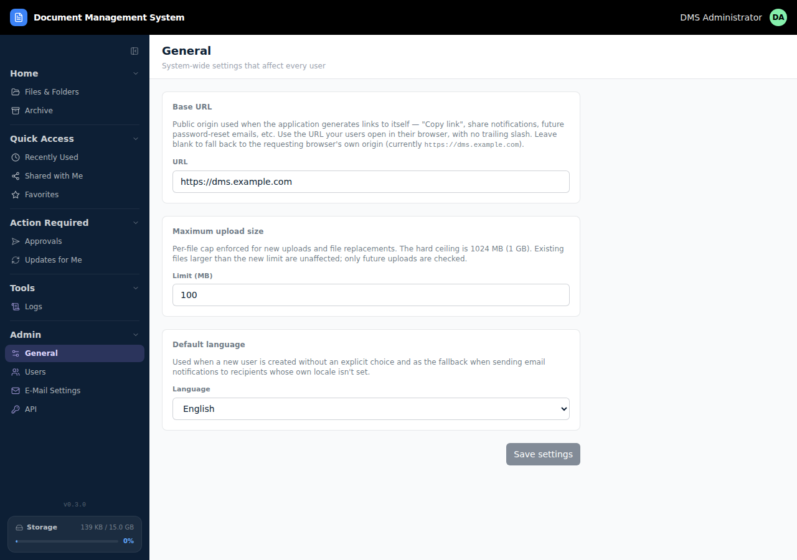
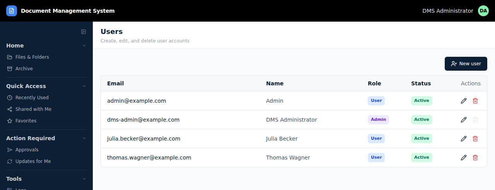

# DMS-Administration

Diese Seite beschreibt die Administration des Dokumentenmanagementsystems (DMS) selbst: das Administratorkonto, die Einstellungen, Benutzer, E-Mail, API-Tokens und den Speicher.
Wie Sie das DMS mit i-doit up verbinden, beschreibt [DMS-Integration](../dms.md).

!!! info
    Verfügbar ab i-doit up 3.3.0.

## Administratorkonto

Das DMS kennt zwei Rollen: **Administrator** und **Benutzer**.
Nur Benutzer mit der Rolle **Administrator** sehen in der Seitenleiste die Gruppe **Administration** mit den Seiten **Allgemein**, **Benutzer**, **E-Mail-Einstellungen** und **API**.

Benutzer, die aus i-doit up kommen, bekommen immer die Rolle **Benutzer**, auch Administratoren von i-doit up.
Sie sehen die Gruppe **Administration** nicht.
Benutzer aus i-doit up werden also keine DMS-Administratoren.

Um das DMS zu administrieren, melden Sie sich auf der Anmeldeseite des DMS (`<DMS-URL>/login`) mit einem lokalen DMS-Administratorkonto an.

Der lokale Administrator arbeitet in einem eigenen Arbeitsbereich des DMS.
Dieser Arbeitsbereich ist unabhängig von den Arbeitsbereichen Ihrer i-doit-up-Mandanten.
Daraus folgt:

- Der lokale Administrator sieht die Dokumente der Benutzer aus i-doit up nicht.
  Seine Liste **Dateien & Ordner** ist leer, solange er dort keine Dokumente anlegt.
- Im Stammordner sieht der Administrator nur **Zugriff verwalten**, ohne **Hochladen** und **Ordner**.
- **Werkzeuge** > **Logs** zeigt dem lokalen Administrator keine Ereignisse der Benutzer aus i-doit up.
  Benutzer aus i-doit up sehen dort ihre eigenen Ereignisse.

## Allgemein

**Administration** > **Allgemein** enthält:

| Einstellung | Beschreibung |
| --- | --- |
| **Basis-URL** | Öffentliche Adresse des DMS. Ist das Feld leer, nutzt das DMS die Adresse, die der Browser zeigt. |
| **Maximale Upload-Größe** | Maximale Größe pro Datei in MB, von 1 bis 1024, Standard 100. |
| **Standardsprache** | Standardsprache der DMS-Oberfläche, English oder Deutsch. |

Der Dialog zum Hochladen zeigt die Grenze in dezimalen Megabytes.
Mit dem Standardwert 100 sehen die Benutzer **Bis zu 104.9 MB pro Datei**.
Dateien über der Grenze lehnt das DMS mit einer Fehlermeldung ab.

Eine Freigabe kann bis zu 10 Freigeber haben.
Diesen Wert können Sie in der Oberfläche nicht ändern.

## Benutzer

**Administration** > **Benutzer** listet alle DMS-Benutzer mit Name, E-Mail-Adresse, Rolle und Status.

- Benutzer können sich nicht selbst registrieren.
  Lokale DMS-Benutzer legt ein Administrator hier an.
- Benutzer aus i-doit up legt das DMS automatisch an, wenn sie das DMS zum ersten Mal aus i-doit up öffnen.
  Sie erscheinen ebenfalls in dieser Liste.
- Jeder Benutzer hat die Rolle **Benutzer** oder **Administrator**.
  Mit **Aktiv (kann sich anmelden)** schalten Sie einen Benutzer aktiv oder inaktiv.
- Sie können Benutzer bearbeiten und löschen.
  Ihr eigenes Konto können Sie nicht löschen und Ihre eigene Rolle nicht ändern.

## E-Mail-Einstellungen

Das DMS verschickt E-Mails, wenn ein Dokument geteilt wird, wenn ein Freigeber entscheiden muss und wenn eine Freigabe abgeschlossen ist.
Dafür richten Sie unter **Administration** > **E-Mail-Einstellungen** einen SMTP-Server ein:

| Feld | Beschreibung |
| --- | --- |
| **Host** und **Port** | SMTP-Server |
| **Verschlüsselung** | **STARTTLS** (Port 587), **SSL/TLS** (Port 465) oder **Keine** |
| **Benutzername** und **Passwort** | Zugangsdaten für den SMTP-Server |
| **Absendername** und **Absender-E-Mail** | Absender der E-Mails |
| **Antwort-an (optional)** | Optionale Antwortadresse |

Mit **Test senden** prüfen Sie die Einstellungen.

## API-Tokens

**Administration** > **API** verwaltet die persönlichen API-Tokens des Administrators.

1. Geben Sie einen Namen für das Token ein.
2. Wählen Sie, wann es abläuft: **Nie**, **In 30 Tagen**, **In 90 Tagen** oder **In 1 Jahr**.
3. Klicken Sie auf **Erstellen** und kopieren Sie das Token.
   Das DMS zeigt das vollständige Token nur einmal.

Die Liste zeigt für jedes Token Name, **Präfix**, **Erstellt**, letzte Verwendung und **Läuft ab**.
**Widerrufen** macht ein Token ungültig.
Der Link **Swagger-Dokumentation** öffnet die Beschreibung der DMS-API.

Das DMS-Add-on für i-doit up braucht ein solches Token, siehe [Add-on-Dienst konfigurieren](../dms.md#add-on-dienst-konfigurieren).

## Speicher und gelöschte Dokumente

Die Seitenleiste des DMS zeigt unter **Speicher** den belegten und den verfügbaren Speicher.

Im Docker-Compose-Setup des DMS liegen die Dateien auf dem lokalen Upload-Volume (`STORAGE_PROVIDER=local`).
Das Volume muss dem Benutzer und der Gruppe `101:101` gehören, siehe [Add-on-Dienst konfigurieren](../dms.md#add-on-dienst-konfigurieren).

Gelöschte Dokumente hebt das DMS eine Aufbewahrungsfrist lang auf und entfernt sie dann endgültig.
Diese Bereinigung läuft jeden Tag um 03:00 Uhr.
Die Aufbewahrungsfrist in Tagen setzen Sie mit der Umgebungsvariable `DOC_PURGE_AFTER_DAYS` des DMS-Backends.
Der Standard ist `30`.
Die Oberfläche hat keinen Papierkorb, Benutzer können gelöschte Dokumente also nicht selbst wiederherstellen.

## Health-Checks

Das DMS-Backend bietet die Health-Checks `/health` und `/health/ready`.

## Siehe auch

- [DMS-Integration](../dms.md)
- [Mit dem DMS arbeiten](../../user/dms/basics.md)
- [Dokumente (DMS)](../../user/dms.md)
