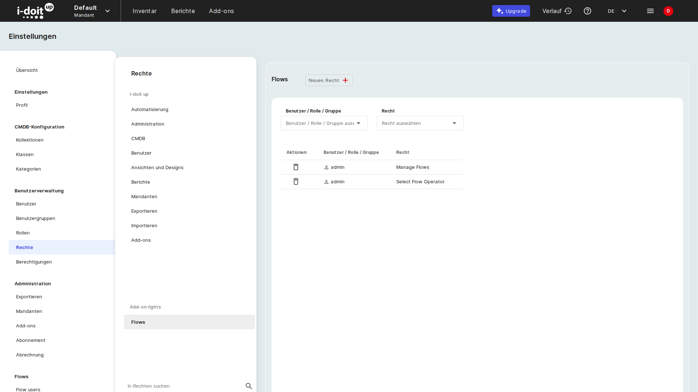
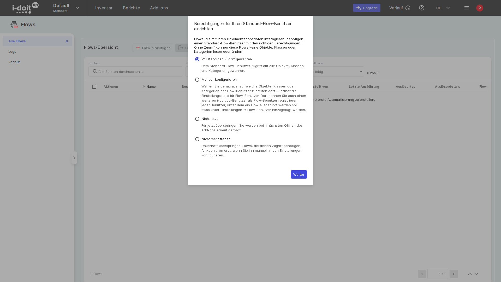
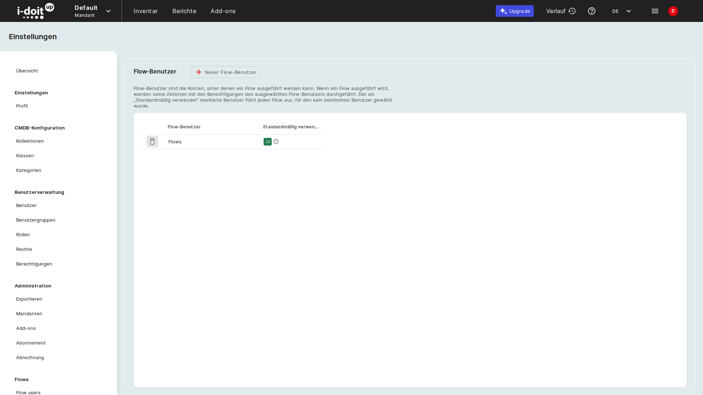

# Rechte und Flow-Benutzer

Zwei Add-on-Rechte steuern, wer Flows nutzen darf und wer den Benutzer wählen darf, als der ein Flow läuft.
Flow-Benutzer sind die i-doit-up-Benutzer, deren Berechtigungen die Aktionen eines Flows nutzen.
Diese Seite beschreibt beides.

!!! info
    Verfügbar ab i-doit up 3.3.0.

## Add-on-Rechte

Flows bringt zwei Add-on-Rechte mit:

| Recht | Wirkung |
| --- | --- |
| **Manage Flows** | Zugriff auf das Add-on. Benutzer ohne dieses Recht sehen **Flows** unter **Add-ons** nicht. |
| **Select Flow Operator** | Erlaubt, für einen Flow einen **Bestimmten Flow-Benutzer** oder einen **Benutzerdefinierten API-Schlüssel** zu wählen und die Seite **Flow users** zu öffnen. |

Die Namen der Rechte sind englisch, auch in der deutschen Oberfläche.

Um ein Recht zu vergeben, öffnen Sie **Einstellungen → Benutzerverwaltung → Rechte**, wählen Sie *Add-on rights → Flows* und klicken Sie auf **Neues Recht**.
Wer alle Rechte des Add-ons erhält, hat beide Rechte.

Bei der Installation von Flows erhält die Admin-Rolle **Manage Flows** und **Select Flow Operator** automatisch.
Alle anderen Rollen, Gruppen und Benutzer erhalten die Rechte wie hier beschrieben.

Benutzer mit **Manage Flows**, aber ohne **Select Flow Operator** können Flows erstellen.
Ihre Flows behalten den aktuellen Flow Operator oder laufen als Standard-Flow-Benutzer.

Die Rechte steuern den Zugriff auf die Oberfläche des Add-ons.
Ein aktiver Flow mit Objekt- oder Kategorie-Auslöser läuft, sobald sein Auslöser auslöst, egal wer das Objekt geändert hat.
Ein Button startet seinen Flow nur, wenn der Flow aktiv oder im Testmodus ist, der Button für dieses Objekt angezeigt wird, die Bedingungen des Flows den Benutzer zulassen und der Benutzer das Objekt lesen darf.
Testläufe erfordern **Manage Flows**.

## Flow-Benutzer

Ein Flow-Benutzer ist ein i-doit-up-Benutzer, als der ein Flow laufen kann.
Die Aktionen des Flows nutzen das API-Token dieses Benutzers, deshalb kann ein Flow nie mehr tun, als dieser Benutzer darf.
Flows führt eine Liste der Flow-Benutzer.

### Standard-Flow-Benutzer

Wenn das Add-on aktiviert wird, legt es den Servicebenutzer "Flows" an und setzt ihn als Standard-Flow-Benutzer.
Jeder Flow läuft als dieser Benutzer, solange kein anderer Flow Operator gewählt ist.

Das Add-on gibt diesem Benutzer keinen Zugriff auf Objekte.
Wenn ein Administrator mit dem Recht **Select Flow Operator** Flows zum ersten Mal öffnet, erscheint der Dialog **Berechtigungen für Ihren Standard-Flow-Benutzer einrichten**:

- **Vollständigen Zugriff gewähren**: gibt dem Standard-Flow-Benutzer Zugriff auf alle Objekte, Objekttypen und Kategorien.
- **Manuell konfigurieren**: öffnet die Seite **Flow users**.
- **Nicht jetzt**: Der Dialog erscheint beim nächsten Mal wieder.
- **Nicht mehr fragen**: Der Dialog erscheint nicht wieder.
  Flows, die Zugriff brauchen, funktionieren nicht, bis Sie ihn einrichten.

Wählen Sie eine Option und klicken Sie auf **Weiter**.
Benutzer, die keine Berechtigungen verwalten dürfen, sehen den Dialog nicht.

### Flow-Benutzer verwalten

Öffnen Sie in den Einstellungen in der Gruppe **Flows** den Eintrag **Flow users**.
Die Seite trägt in der deutschen Oberfläche die Überschrift **Flow-Benutzer** und braucht das Recht **Select Flow Operator**.

- **Standardmäßig verwendet** kennzeichnet den aktuellen Standard-Flow-Benutzer.
  **Als Standard festlegen** macht einen anderen Flow-Benutzer zum Standard.
- **Neuer Flow-Benutzer** fügt einen vorhandenen i-doit-up-Benutzer hinzu.
  Das Add-on erstellt für diesen Benutzer ein API-Token und speichert es verschlüsselt.
  Um Benutzer hinzuzufügen, brauchen Sie das Recht, Benutzer zu verwalten und API-Token zu erstellen.
- **Entfernen** nimmt einen Benutzer von der Liste und widerruft das Token, das das Add-on erstellt hat.
  Der i-doit-up-Benutzer wird nicht gelöscht.
  Den Standard-Flow-Benutzer können Sie nicht entfernen.
  Flows, die einen entfernten Benutzer genutzt haben, laufen als Standard-Flow-Benutzer.

Tokens werden nie angezeigt.

## Weiterführende Informationen

-   [Flows-Add-on](../flows.md)
-   [Rechte und Berechtigungen](../rights-and-permissions.md)
-   [Flows erstellen und bearbeiten](../../user/flows/create.md#flow-operator)
