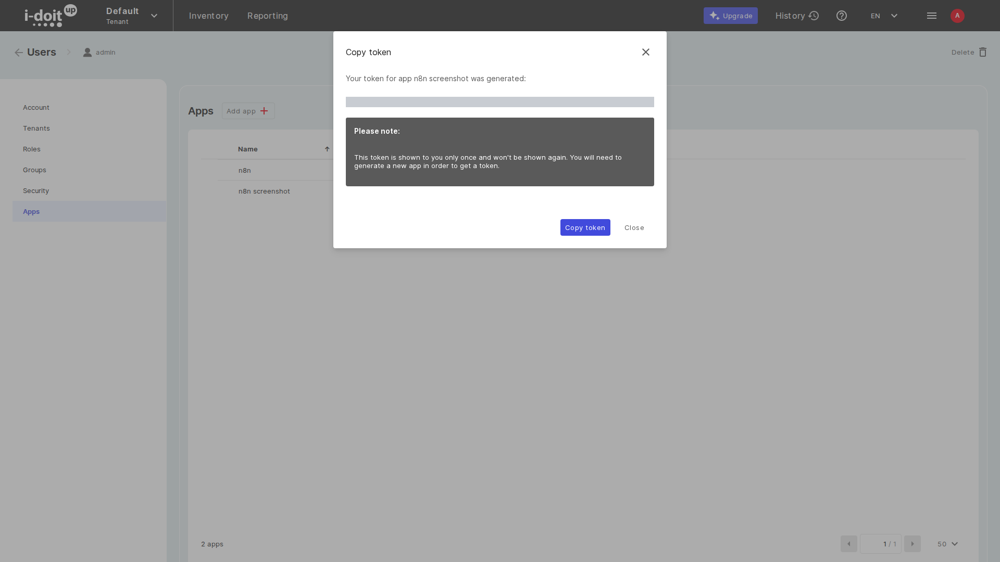

# n8n-Integration

[n8n](https://n8n.io) ist ein Werkzeug zur Workflow-Automatisierung, das Anwendungen über visuelle Workflows verbindet.
Diese Seite beschreibt, wie Sie n8n an i-doit up anbinden: die i-doit-up-Nodes in n8n installieren, ein App-Token erstellen und das Credential in n8n einrichten.

## Was die Integration leistet

Die i-doit-up-Nodes für n8n rufen aus einem Workflow die i-doit-up-API auf, zum Beispiel um ein Objekt aus einem anderen System in Ihre CMDB zu übertragen.
Jeder Aufruf läuft über die i-doit-up-API mit einem App-Token, daher sieht der Workflow genau die Daten und hat genau die Rechte des Benutzers, dem das Token gehört.
Der Node **i-doit up Actions** bietet die folgenden Aktionen:

- **Push Object** legt ein Objekt an oder aktualisiert es.
- **Find objects** sucht Objekte.
- **Get tenants** listet die Mandanten auf, auf die der Token-Benutzer zugreifen kann.
- **Create user** legt einen i-doit-up-Benutzer an.

## Voraussetzungen

- Eine bestehende, selbst betriebene n8n-Instanz, die Sie verwalten, zum Beispiel n8n in Docker.
  In n8n Cloud sind die i-doit-up-Nodes derzeit nicht verfügbar.
- Node.js 22 oder neuer mit npm auf dem Rechner, auf dem Sie das Node-Paket bauen.
- Netzwerkzugriff von n8n auf Ihre i-doit-up-URL.
- Ein i-doit-up-Benutzer, dessen Rechte alles abdecken, was der Workflow tun soll, siehe [Rechte und Berechtigungen](rights-and-permissions.md).

## Die i-doit-up-Nodes in n8n installieren

Die i-doit-up-Nodes sind ein n8n-Node-Paket mit dem Namen `i-n8n-nodes`.
n8n lädt das Paket als eigene Erweiterung (Custom Extension) aus einem Ordner, auf den die Umgebungsvariable `N8N_CUSTOM_EXTENSIONS` zeigt.

1. Bauen Sie das Paket im Ordner des Pakets mit `npm ci`, `npm run build` und `npm pack`.
   Das Ergebnis ist die Datei `i-n8n-nodes-1.0.0.tgz`.
2. Entpacken Sie die Datei in einen Ordner, den n8n lesen kann, zum Beispiel `/home/node/i-n8n-nodes`.
   Das Archiv enthält einen Ordner `package`, dessen Inhalt in diesen Ordner gehört.
3. Setzen Sie die Umgebungsvariable `N8N_CUSTOM_EXTENSIONS` auf diesen Ordner.
4. Starten Sie n8n neu.

Für n8n in Docker bauen Sie ein eigenes Image auf Basis des offiziellen n8n-Images.
Speichern Sie das folgende Dockerfile neben der Datei `i-n8n-nodes-1.0.0.tgz`.
Ersetzen Sie `stable` durch die n8n-Version, die Sie aktuell betreiben.

```dockerfile
FROM n8nio/n8n:stable
USER root
COPY i-n8n-nodes-1.0.0.tgz /tmp/i-n8n-nodes.tgz
RUN tar -xzf /tmp/i-n8n-nodes.tgz -C /tmp \
 && mv /tmp/package /home/node/i-n8n-nodes \
 && chown -R node:node /home/node/i-n8n-nodes \
 && rm /tmp/i-n8n-nodes.tgz
USER node
ENV N8N_CUSTOM_EXTENSIONS=/home/node/i-n8n-nodes
```

Bauen Sie das Image in diesem Ordner mit `docker build -t n8n-idoit-up .`.
Starten Sie das neue Image anschließend mit demselben Volume und denselben Umgebungsvariablen wie Ihren bisherigen n8n-Container, damit Ihre Workflows und Credentials erhalten bleiben.

Suchen Sie nach dem Neustart im Node-Bereich von n8n nach *i-doit up*.
Im Node-Bereich heißt der Eintrag **i-doit up Action Selector**, auf der Arbeitsfläche heißt der Node **i-doit up Actions**.
Der Credential-Typ heißt **i-doit up API**.

## App-Token erstellen

n8n authentifiziert sich mit einem **App-Token** von i-doit up.
Ein Token gehört zu genau einem Benutzer und trägt dessen Rechte, erstellen Sie es also auf dem Konto, als das n8n handeln soll.

1. Öffnen Sie oben rechts das Benutzermenü und wählen Sie **Einstellungen**.
2. Wählen Sie **Benutzerverwaltung → Benutzer** und öffnen Sie den Benutzer, als der n8n handeln soll.
3. Wählen Sie in der linken Navigation des Benutzers **Apps** und klicken Sie auf **App hinzufügen**.
4. Geben Sie einen Namen ein, zum Beispiel *n8n*, und klicken Sie auf **Speichern**.
5. Kopieren Sie das Token im folgenden Dialog und bewahren Sie es sicher auf.




Das Token wird **nur einmal** angezeigt.
Wenn Sie es verlieren, löschen Sie die App und legen Sie eine neue an.

Um n8n den Zugriff später zu entziehen, fahren Sie auf der Seite **Apps** mit der Maus über die App, klicken Sie auf das Papierkorb-Symbol und bestätigen Sie das Löschen.


Da das Token die Rechte des Benutzers trägt, verwenden Sie besser einen dedizierten Benutzer mit nur den Rechten, die der Workflow braucht, statt eines Administratorkontos.

## Credential in n8n anlegen

1. Klicken Sie in n8n oben links auf **+** und wählen Sie **New credential**.
   Alternativ öffnen Sie die **Overview**, wechseln auf den Reiter **Credentials** und klicken auf **Create credential**.
   In einer neuen n8n-Instanz erscheint der Reiter **Credentials** erst, wenn ein Workflow oder ein Credential existiert.
2. Suchen Sie nach **i-doit up API**, wählen Sie den Eintrag aus und klicken Sie auf **Continue**.
3. Geben Sie unter **URL** die Basis-URL Ihrer i-doit-up-Instanz ohne abschließenden Schrägstrich ein, zum Beispiel `https://your-instance.example.com`.
4. Fügen Sie unter **API Token** das App-Token ein.
5. Klicken Sie auf **Save**.

n8n testet das Credential beim Speichern.
Der Test liest einen Mandanten über die i-doit-up-API, und n8n zeigt *Connection tested successfully* an, wenn URL und Token stimmen.
Schlägt der Test fehl, zeigt n8n *Couldn't connect with these settings* an, und unter **More details** steht die Fehlermeldung.

Der Screenshot zeigt im Feld **URL** die Adresse eines Testsystems.
Tragen Sie dort stattdessen die URL Ihrer eigenen i-doit-up-Instanz ein.


Der Node sendet das Token bei jeder Anfrage im Header `X-API-TOKEN`.

## Hinweise zu den Aktionen

**Push Object**

- Tragen Sie unter **Class** die ID der Klasse ein, nicht ihren Namen.
  Die ID finden Sie, indem Sie **Find objects** für ein vorhandenes Objekt dieser Klasse ausführen, sie steht im Ergebnis im Feld `classification.id`.
- **Data** enthält je Kategorie einen Eintrag mit einer Strategie und den zu schreibenden Einträgen, jeweils unter einer Referenz-ID des Eintrags:

    ```json
    {
        "cmdb.general": {
            "strategy": "overwrite",
            "data": {
                "main": {
                    "description": "Imported from the inventory tool"
                }
            }
        }
    }
    ```

- Führen Sie die Aktion zweimal mit derselben **Reference ID** und demselben **Reference Type** aus, aktualisiert sie das Objekt, statt ein Duplikat anzulegen.

**Find objects**

- **Criteria** erwartet einen Filter als JSON. `field` nennt Kategorie und Attribut, `type` ist `eq` oder `neq`, zum Beispiel:

    ```json
    {"type": "eq", "field": "cmdb.general.title", "value": "web-01"}
    ```

    Lassen Sie `{}` stehen, um alle Objekte zu erhalten.
- **Categories** schränkt das Ergebnis auf eine oder mehrere Kategorien ein, zum Beispiel `cmdb.general`.
  Eine Kennung, die i-doit up nicht kennt, stoppt den Node nicht, der Node liefert dann keine Items.
- Jedes Item enthält ein Feld `_paging` mit `offset`, `perPage` und `total`.

## Webhook-Aufrufe aus i-doit up prüfen

i-doit up kann bei einem Ereignis die URL eines n8n-Nodes **Webhook** aufrufen, zum Beispiel wenn ein Objekt angelegt wird.
Webhooks werden über die [API](../dev/api.md) mit `POST /api/v2/webhook` registriert.
Die Antwort enthält die ID und das **Secret** des Webhooks. Bewahren Sie das Secret auf, es wird nur einmal angezeigt.

Jeder Aufruf trägt den Header `X-Signature`.
Er enthält den HMAC-SHA256 des unveränderten Anfrage-Bodys, berechnet mit dem Secret des Webhooks, als Hexadezimal-Zeichenkette.
Um einen Aufruf zu prüfen, aktivieren Sie im Node **Webhook** die Option **Raw Body** und berechnen den HMAC-SHA256 über diesen unveränderten Body.
Berechnen Sie ihn nicht über das geparste JSON, denn beim erneuten Serialisieren kann sich der Body ändern, und die Signatur passt dann nicht mehr.

## Fehlerbehebung

| Symptom | Ursache und Lösung |
|---|---|
| Der Test des Credentials schlägt mit *Unauthorized* fehl. | Das Token ist falsch oder die App wurde gelöscht. Legen Sie eine neue App an und fügen Sie das neue Token ein. |
| Der Test des Credentials schlägt mit *Not Found* oder *ERR_INVALID_URL* fehl. | Die URL ist falsch. Geben Sie nur die Basis-URL Ihrer i-doit-up-Instanz mit Protokoll ein, zum Beispiel `https://your-instance.example.com`, ohne API-Pfad. |
| Der Test des Credentials schlägt mit einem Verbindungsfehler wie *EHOSTUNREACH*, *ENOTFOUND*, *ECONNREFUSED* oder *ETIMEDOUT* fehl. | n8n erreicht Ihre i-doit-up-Instanz nicht. Prüfen Sie Hostnamen und Port in der URL und ob eine Firewall oder ein Proxy die Verbindung vom n8n-Server zu Ihrer i-doit-up-URL blockiert. |
| Der Test des Credentials ist erfolgreich, aber die i-doit-up-Nodes melden *The resource you are requesting could not be found*. | Die URL zeigt auf einen anderen Dienst. Geben Sie die Basis-URL Ihrer i-doit-up-Instanz ein. Schrägstriche am Ende sind nicht die Ursache, die Nodes entfernen sie aus der URL. |
| **Push Object** meldet *Unable to find class with id ...*. | Unter **Class** steht ein Klassenname wie `server` statt einer Klassen-ID. Tragen Sie die ID der Klasse ein, siehe [Hinweise zu den Aktionen](#hinweise-zu-den-aktionen). |
| **Find objects** liefert keine Items, obwohl passende Objekte existieren. | Unter **Categories** steht eine Kennung, die i-doit up nicht kennt. Prüfen Sie die Schreibweise, zum Beispiel `cmdb.general`. |
| Die i-doit-up-Nodes erscheinen nicht im Node-Bereich. | n8n hat das Paket nicht geladen. Prüfen Sie, ob `N8N_CUSTOM_EXTENSIONS` auf den Ordner zeigt, der die Datei `package.json` des Pakets enthält, und starten Sie n8n neu. |

## Siehe auch

- [API](../dev/api.md): Authentifizierung und die eingebaute API-Referenz Ihrer Instanz.
- [Benutzerverwaltung](user-management.md): hier wird das App-Token auf einem Benutzerkonto erstellt.
- [Rechte und Berechtigungen](rights-and-permissions.md): regeln, was der Token-Benutzer und damit der Workflow tun darf.
- [Model Context Protocol (MCP)](mcp.md): eine weitere Integration, die App-Tokens verwendet.
- [n8n-Dokumentation](https://docs.n8n.io): Workflows in n8n bauen, veröffentlichen und ausführen.
