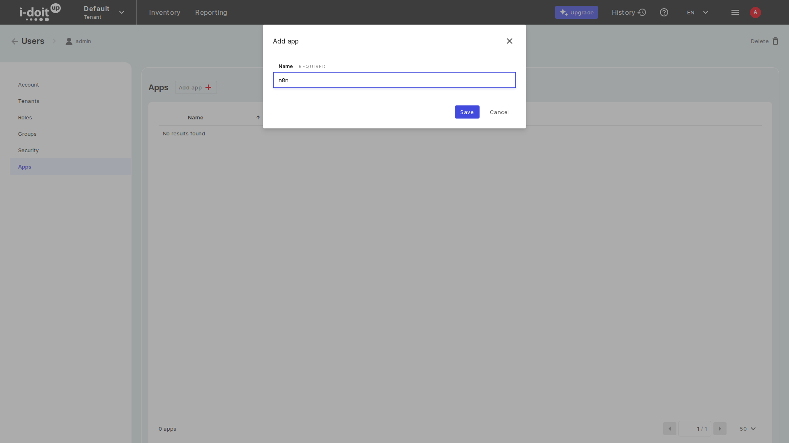
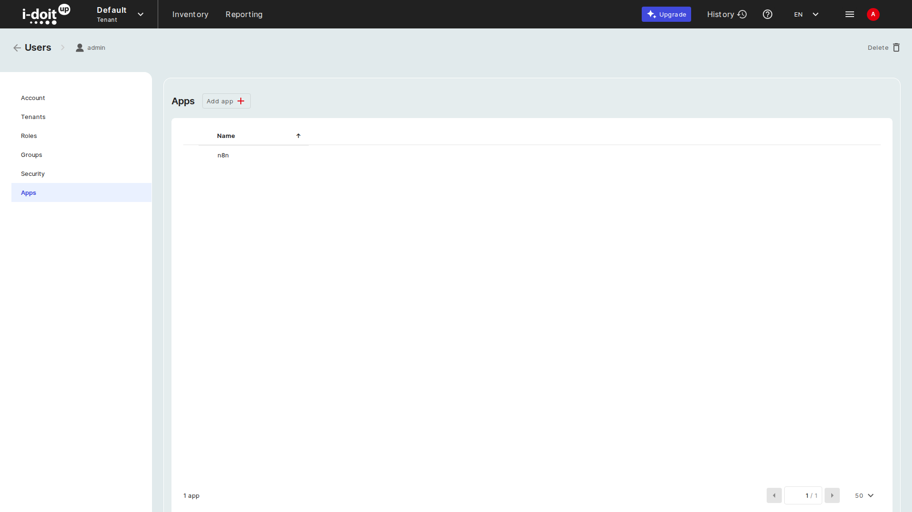
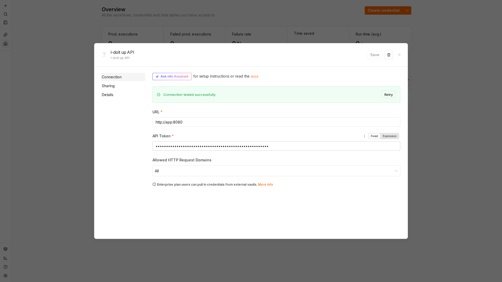

# n8n-Integration

[n8n](https://n8n.io) ist ein Werkzeug zur Workflow-Automatisierung, das Anwendungen über visuelle Workflows verbindet.
Diese Seite beschreibt, wie Sie n8n an i-doit up anbinden: die i-doit-up-Nodes in n8n installieren, ein App-Token erstellen und das Credential in n8n einrichten.

## Was die Integration leistet

Die i-doit-up-Nodes für n8n rufen aus einem Workflow die i-doit-up-API auf, zum Beispiel um ein Objekt aus einem anderen System in Ihre CMDB zu übertragen.
Jeder Aufruf läuft über die i-doit-up-API mit einem App-Token, daher sieht der Workflow genau die Daten und hat genau die Rechte des Benutzers, dem das Token gehört.
Der Node **i-doit up Actions** bietet die folgenden Aktionen:

- **Push Object** legt ein Objekt an oder aktualisiert es.
- **Find objects** sucht Objekte.
- **Get tenants** listet die Mandanten auf, auf die der Token-Benutzer zugreifen kann.
- **Create user** legt einen i-doit-up-Benutzer an.

## Voraussetzungen

- Eine n8n-Instanz, die Sie selbst verwalten und die eigene Nodes laden kann, zum Beispiel ein selbst betriebenes n8n in Docker.
- Netzwerkzugriff von n8n auf Ihre i-doit-up-URL.
- Ein i-doit-up-Benutzer, dessen Rechte alles abdecken, was der Workflow tun soll, siehe [Rechte und Berechtigungen](rights-and-permissions.md).

## Die i-doit-up-Nodes in n8n installieren

Die i-doit-up-Nodes sind ein n8n-Community-Node-Paket mit dem Namen `i-n8n-nodes`.
Installieren Sie es als eigene Erweiterung (Custom Extension) in Ihrer n8n-Instanz.

Für n8n in Docker bauen Sie ein eigenes Image auf Basis des offiziellen n8n-Images und kopieren das Paket hinein:

1. Bauen Sie das Paket mit `npm ci`, `npm run build` und `npm pack`.
   Das Ergebnis ist eine Datei wie `i-n8n-nodes-1.0.0.tgz`.
2. Entpacken Sie die Datei in einen Ordner im n8n-Image, zum Beispiel `/home/node/i-n8n-nodes`.
3. Setzen Sie die Umgebungsvariable `N8N_CUSTOM_EXTENSIONS` auf diesen Ordner.
4. Starten Sie n8n mit dem neuen Image.

```dockerfile
FROM n8nio/n8n:stable
USER root
COPY i-n8n-nodes-1.0.0.tgz /tmp/i-n8n-nodes.tgz
RUN tar -xzf /tmp/i-n8n-nodes.tgz -C /tmp \
 && mv /tmp/package /home/node/i-n8n-nodes \
 && chown -R node:node /home/node/i-n8n-nodes \
 && rm /tmp/i-n8n-nodes.tgz
USER node
ENV N8N_CUSTOM_EXTENSIONS=/home/node/i-n8n-nodes
```

Suchen Sie nach dem Neustart im Node-Bereich von n8n nach *i-doit up*.
Der Node heißt **i-doit up Actions**, und der Credential-Typ heißt **i-doit up API**.

## App-Token erstellen

n8n authentifiziert sich mit einem **App-Token** von i-doit up.
Ein Token gehört zu genau einem Benutzer und trägt dessen Rechte, erstellen Sie es also auf dem Konto, als das n8n handeln soll.

1. Gehen Sie zu **Einstellungen → Benutzer** und öffnen Sie den Benutzer, als der n8n handeln soll.
2. Wechseln Sie auf den Reiter **Apps** und klicken Sie auf **Add app**.
3. Geben Sie einen Namen ein, zum Beispiel *n8n*, und klicken Sie auf **Save**.
4. Klicken Sie im Dialog *Copy token* auf **Copy token** und bewahren Sie das Token sicher auf.




Das Token wird **nur einmal** angezeigt.
Wenn Sie es verlieren, löschen Sie die App und legen Sie eine neue an.

Um n8n den Zugriff später zu entziehen, fahren Sie im Reiter **Apps** mit der Maus über die App, klicken Sie auf das Papierkorb-Symbol und bestätigen Sie *Delete Application*.



Da das Token die Rechte des Benutzers trägt, verwenden Sie besser einen dedizierten Benutzer mit nur den Rechten, die der Workflow braucht, statt eines Administratorkontos.

## Credential in n8n anlegen

1. Öffnen Sie in n8n die **Overview**, wechseln Sie auf den Reiter **Credentials** und klicken Sie auf **Create credential**.
2. Suchen Sie nach **i-doit up API** und wählen Sie den Eintrag aus.
3. Geben Sie unter **URL** die Basis-URL Ihrer eigenen i-doit-up-Instanz ein, zum Beispiel `https://your-instance.example.com`.
4. Fügen Sie unter **API Token** das App-Token ein.
5. Klicken Sie auf **Save**.

n8n testet das Credential beim Speichern.
Der Test liest einen Mandanten über die i-doit-up-API, und n8n zeigt *Connection tested successfully* an, wenn URL und Token stimmen.

Der Screenshot zeigt im Feld **URL** die Adresse eines Testsystems.
Tragen Sie dort stattdessen die URL Ihrer eigenen i-doit-up-Instanz ein.



Der Node sendet das Token bei jeder Anfrage im Header `X-API-TOKEN`.

## Fehlerbehebung

| Symptom | Ursache und Lösung |
|---|---|
| Der Test des Credentials schlägt mit *Unauthorized* fehl. | Das Token ist falsch oder die App wurde gelöscht. Legen Sie eine neue App an und fügen Sie das neue Token ein. |
| Der Test des Credentials schlägt fehl, obwohl das Token stimmt. | Die URL ist falsch. Geben Sie nur die Basis-URL Ihrer i-doit-up-Instanz mit Protokoll ein, zum Beispiel `https://your-instance.example.com`, ohne API-Pfad. |
| Der Test des Credentials schlägt mit einem Verbindungsfehler wie *EHOSTUNREACH*, *ENOTFOUND* oder einer Zeitüberschreitung fehl. | n8n erreicht Ihre i-doit-up-Instanz nicht. Prüfen Sie, ob eine Firewall oder ein Proxy die Verbindung vom n8n-Server zu Ihrer i-doit-up-URL blockiert. |
| Der Test des Credentials ist erfolgreich, aber die i-doit-up-Nodes melden *The resource you are requesting could not be found*. | Die URL zeigt auf einen anderen Dienst oder endet mit mehr als einem Schrägstrich. Geben Sie die Basis-URL Ihrer i-doit-up-Instanz mit höchstens einem abschließenden Schrägstrich ein. |

## Siehe auch

- [API](../dev/api.md): Authentifizierung und die eingebaute API-Referenz Ihrer Instanz.
- [Benutzerverwaltung](user-management.md): hier wird das App-Token auf einem Benutzerkonto erstellt.
- [Rechte und Berechtigungen](rights-and-permissions.md): regeln, was der Token-Benutzer und damit der Workflow tun darf.
- [Model Context Protocol (MCP)](mcp.md): eine weitere Integration, die App-Tokens verwendet.
- [n8n-Dokumentation](https://docs.n8n.io): Workflows in n8n bauen, veröffentlichen und ausführen.
