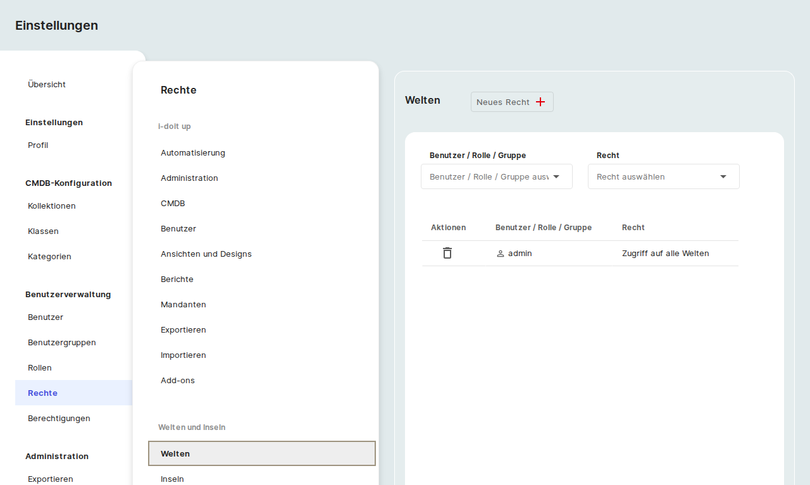
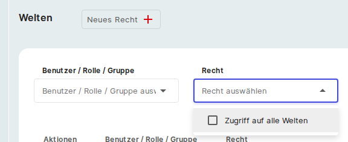

# Rechte und Berechtigungen

i-doit up nutzt zwei sich ergänzende Konzepte, um zu steuern, was Benutzer tun können.

- **Rechte** sind globale Kennzeichen, die festlegen, auf welche Benutzeroberflächen und Massenaktionen ein Benutzer zugreifen darf.
    Beispiele: *Benutzer verwalten*, *Mandanten verwalten*, *Kategorien verwalten*, *Konfiguration bearbeiten*.
    Sie werden Rollen, Gruppen oder einzelnen Benutzern zugewiesen.
- **Berechtigungen** sind Regeln auf Objekt- und Klassenebene, die festlegen, was ein Benutzer an den Daten selbst lesen, bearbeiten, archivieren oder löschen darf.
    Sie werden bei jeder Aktion ausgewertet und mit den Rechten kombiniert.

## Wo man sie verwaltet

Beide Oberflächen finden Sie unter **Einstellungen ▸ Benutzerverwaltung** in der Seitenleiste (zu öffnen über das Benutzermenü oben rechts):

| Seite | Zweck |
|---|---|
| Benutzer | Benutzer anlegen, bearbeiten, deaktivieren; Rollen, Gruppen und Standard-Tenant zuweisen. |
| Benutzergruppen | Sammlungen von Benutzern; einer Gruppe gewährte Rechte gelten für jedes Mitglied. |
| Rollen | Wiederverwendbare, benannte Rechtebündel. Die Zuweisung einer Rolle an einen Benutzer (direkt oder über eine Gruppe) gewährt alle Rechte der Rolle. |
| Rechte | Die flache Liste aller Rechte in der Instanz. Verwenden Sie sie, um einzelne Rechte einer Rolle oder direkt einem Benutzer zu gewähren. |
| Berechtigungen | Bereichsspezifische Regeln (z. B. *Benutzer X kann den Objektlebenszyklus für alle Objekte lesen*), die detaillierte Berechtigungstabelle pro Objekt. |

Informationen zu den täglichen Arbeitsabläufen finden Sie unter [Benutzerverwaltung](user-management.md).

## Wie sie sich ergänzen

Ein Benutzer darf etwas tun, wenn **alle** der folgenden Bedingungen zutreffen:

1. Der Benutzer verfügt über das **Recht**, das die Aktion ermöglicht (z. B. *Kategorien verwalten*, um den Kategorie-Generator zu öffnen).
2. Die entsprechende **Berechtigung** erlaubt die Aktion im jeweiligen Objektbereich (z. B. *Lesen* im Bereich *Alle Objekte* oder für ein bestimmtes Objekt).

Rechte sind kumulativ; sie ergeben sich aus direkten Zuweisungen, Gruppenzugehörigkeiten und Rollen.
Es gibt keine Möglichkeit, die Verweigerung außer Kraft zu setzen.

## Beispiel für Vererbung

Die Benutzerin *Jane* ist Mitglied der Gruppe *Netzwerktechniker*, der die Rolle *Admin* zugewiesen ist.
Jane erhält über die Gruppe *Netzwerktechniker* alle Rechte der Rolle *Admin*.
Eine direkte Zuweisung von Rechten ist nicht erforderlich.

## Geltungsbereich für Mandant

Berechtigungen und Rechte werden innerhalb des **derzeit aktiven Mandanten** geprüft: siehe [Mandanten](tenants.md) und [Zwischen Mandanten wechseln](../user/basics/tenant-switcher.md).
Ein Benutzer, der in Mandant A über bestimmte Rechte verfügt, hat nicht automatisch dieselben Rechte in Mandant B.

## Rechte für Welten und Inseln

[Welten und Inseln](../user/worlds-and-islands.md) sind durch zwei Rechte im Bereich **Welten und Inseln** geschützt:

| Methode | Recht | Gewährt |
|---|---|---|
| Welten | Zugriff auf alle Welten | Den Menüpunkt **Worlds** und jede Welt, zum Beispiel die Lizenz-Welt. |
| Inseln | Zugriff auf alle Inseln | Die Gruppe **Islands** in der Seitenleiste von Objekten und jede Insel, zum Beispiel die Lizenz-Insel. |

Rechte für einzelne Welten oder einzelne Inseln gibt es nicht.
Ein Benutzer mit **Zugriff auf alle Inseln** sieht jede Insel, die zur Klasse des geöffneten Objekts gehört, auch Inseln von Add-ons.

!!! info "Zuerst die Rechte vergeben"
    i-doit up vergibt diese Rechte an niemanden, auch nicht an den Administrator.
    Das gilt für neue Installationen und für Updates.
    Vergeben Sie die Rechte, bevor Sie oder Ihre Benutzer mit Welten und Inseln arbeiten.

So vergeben Sie ein Recht:

1. Öffnen Sie **Einstellungen** über das Benutzermenü und gehen Sie zu **Benutzerverwaltung** > **Rechte**.
2. Klicken Sie unter **Welten und Inseln** auf **Welten** oder **Inseln**.
3. Klicken Sie auf **Neues Recht**.
4. Wählen Sie unter **Benutzer / Rolle / Gruppe** den Benutzer, die Rolle oder die Gruppe.
5. Wählen Sie unter **Recht** das Recht.

Die Liste **Recht** bietet je Methode nur ein Recht an.

Vergeben und Entziehen dieser Rechte wirkt, sobald der Benutzer die Seite neu lädt.
Eine neue Anmeldung ist nicht nötig.
Ohne **Zugriff auf alle Welten** verschwindet der Menüpunkt **Worlds**, und eine Welt-Seite zeigt eine Meldung, die mit "You shall not see!" beginnt.
Ohne **Zugriff auf alle Inseln** verschwindet die Gruppe **Islands** aus der Seitenleiste von Objekten.

## Siehe auch

- [Benutzerverwaltung](user-management.md)
- [Mandanten](tenants.md)
- [Zwischen Mandanten wechseln](../user/basics/tenant-switcher.md)
- [Welten und Inseln](../user/worlds-and-islands.md)
