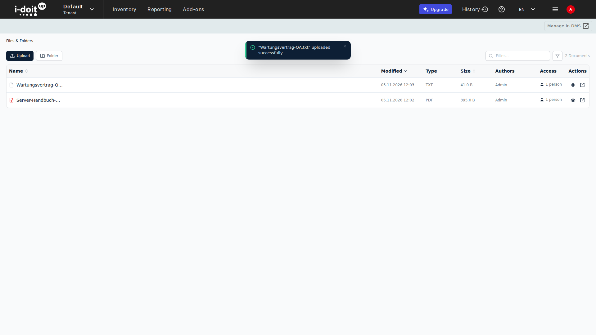
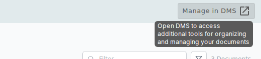
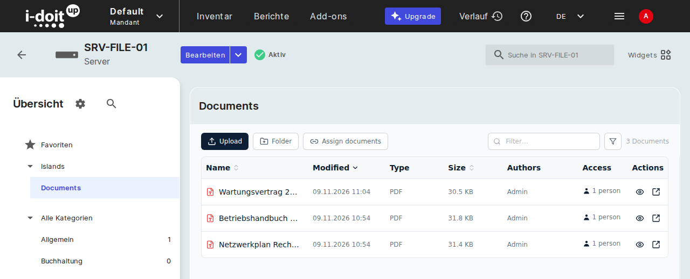
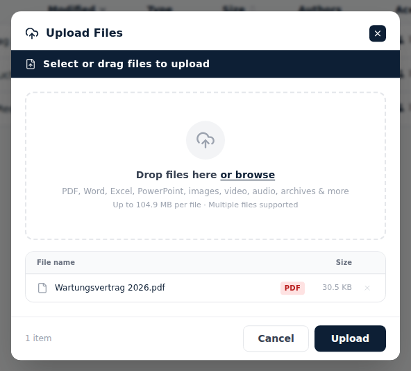
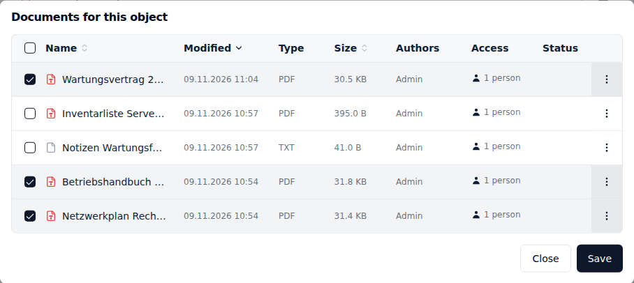
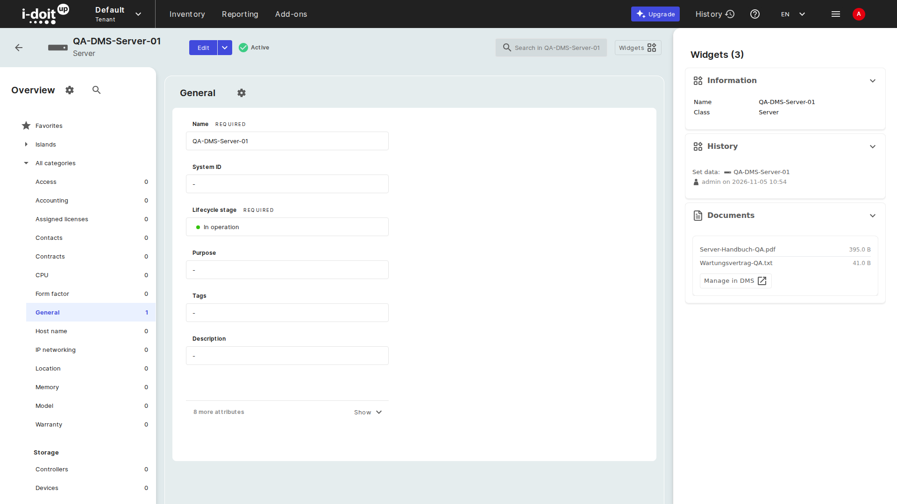

# Dokumente (DMS)

Das DMS-Add-on bringt das Dokumentenmanagementsystem (DMS) in i-doit up.
Sie können das gesamte DMS in i-doit up durchsuchen, die Dokumente eines Objekts direkt auf der Objektseite sehen und zuordnen und bei Bedarf in das eigenständige DMS wechseln.
Diese Seite beschreibt, was Sie als Benutzer sehen und wie Sie mit Dokumenten an Objekten arbeiten.
Installation und Konfiguration beschreibt [DMS-Integration](../admin/dms.md).

!!! info
    Verfügbar ab i-doit up 3.3.0.

## Was das DMS-Add-on bietet

Nachdem ein Administrator das Add-on installiert hat, zeigt i-doit up das DMS an drei Stellen:

- **DMS** in der Navigation, Gruppe **Add-ons**: das vollständige DMS in i-doit up.
- Island **Documents** auf der Objektseite: alle dem Objekt zugeordneten Dokumente, mit Hochladen und Zuordnen.
- Widget **Documents** auf der Objektseite: eine kurze Liste der dem Objekt zugeordneten Dokumente.

Alle drei öffnen das DMS mit Ihrem i-doit-up-Konto.
Eine eigene DMS-Anmeldung brauchen Sie nicht.
Wenn Sie das DMS zum ersten Mal aus i-doit up öffnen, legt das DMS Ihr Benutzerkonto automatisch an.

Die Texte des Add-ons sind englisch.
Das Add-on übergibt die Sprache, die Sie in i-doit up gewählt haben, nicht an das DMS.

## Das DMS in i-doit up öffnen

Wählen Sie in der Navigation in der Gruppe **Add-ons** den Eintrag **DMS**.
i-doit up zeigt das DMS mit seinen Ordnern und Dokumenten im Hauptbereich.
Sie arbeiten mit Ordnern und Dokumenten wie im eigenständigen DMS, siehe [Mit dem DMS arbeiten](dms/basics.md).

i-doit up merkt sich den geöffneten Ordner in der Adresse der Seite.
Wenn Sie die Seite neu laden oder als Lesezeichen speichern, öffnet sich derselbe Ordner wieder.

## Das eigenständige DMS öffnen

Einige DMS-Funktionen gibt es nur im eigenständigen DMS.
Klicken Sie oben in der DMS-Ansicht oder im Widget auf **Manage in DMS**, um das eigenständige DMS in einem neuen Browser-Tab zu öffnen.
Sie sind dort automatisch mit Ihrem i-doit-up-Konto angemeldet.
Während der Link vorbereitet wird, zeigt der Knopf **Opening DMS…**.

Der Anmeldelink gilt nur etwa zwei Minuten, deshalb erzeugt i-doit up ihn erst beim Klick.

## Dokumente an einem Objekt

### Die Island Documents

1. Öffnen Sie ein Objekt.
2. Wählen Sie in der linken Leiste des Objekts in der Gruppe **Islands** den Eintrag **Documents**.

Die Island zeigt alle Dokumente, die diesem Objekt zugeordnet sind.
Hier können Sie:

- neue Dokumente hochladen, die sofort dem Objekt zugeordnet werden,
- Ordner anlegen,
- vorhandene DMS-Dokumente mit **Assign documents** dem Objekt zuordnen.

Die Tabelle zeigt Name, Änderungsdatum, Typ, Größe, Autoren und Zugriff jedes Dokuments.
Die Spalte **Actions** hat zwei Symbole: **View details** und **Manage in DMS**, das das Dokument im eigenständigen DMS öffnet.
Dokumente ohne Zugriff haben keine Aktionen.

Zum Hochladen klicken Sie auf **Upload** und wählen die Dateien im Dialog **Upload Files**.
Eine Datei darf bis zu 104,9 MB groß sein.

Die Zuordnung zum Objekt ist nur in i-doit up sichtbar.
Das eigenständige DMS zeigt das Dokument, aber nicht das Objekt, zu dem es gehört.

!!! note
    Fehlt die Island, fehlen Ihnen möglicherweise die Island-Rechte.
    Wenden Sie sich an Ihren Administrator, siehe [DMS-Integration](../admin/dms.md#rechte-fur-die-island-documents).

### Vorhandene Dokumente zuordnen

1. Klicken Sie in der Island auf **Assign documents**.
2. Wählen Sie im Dialog **Documents for this object** die Dokumente, die zum Objekt gehören.
3. Klicken Sie auf **Save**. i-doit up bestätigt das Speichern.

Fehlt Ihnen der Zugriff auf einige der gewählten Dokumente, speichert das DMS die übrigen und meldet, wie viele übersprungen wurden.

### Das Widget Documents

Das Widget **Documents** steht auf der Objektseite aller Objektklassen zur Verfügung.
Sie öffnen es mit **Widgets** oben rechts auf der Objektseite.
Es listet bis zu 25 Dokumente des Objekts mit Titel und Größe.
Ein Klick auf den Titel öffnet die Datei in einem neuen Tab.
PDF-Dateien, Bilder und Textdateien öffnen sich im Browser, andere Dateien werden heruntergeladen.

Sind keine Dokumente zugeordnet, zeigt das Widget *No documents assigned to this object.* (Keine Dokumente zugeordnet.)
Unter der Liste öffnet **Manage in DMS** das eigenständige DMS.
Auf einer Seite ohne Objekt zeigt das Widget nur den Knopf **Manage in DMS**.

## Wer welche Dokumente sieht

i-doit up teilt dem DMS mit, wer Sie sind und in welchem Mandanten Sie arbeiten.
Was Sie mit einem Dokument tun dürfen, entscheidet das DMS selbst.
Ihre Rechte aus i-doit up werden nicht an das DMS übertragen.

- Die Dokumente eines Objekts teilen sich alle, die im selben Mandanten arbeiten.
- Die Liste eines Objekts zeigt **alle** ihm zugeordneten Dokumente, auch Dokumente anderer Benutzer.
- Zum Öffnen, Herunterladen oder Ändern brauchen Sie im DMS Zugriff auf das Dokument.
  Dokumente ohne Zugriff erscheinen mit Titel, grau dargestellt, mit dem Vermerk **No access** (kein Zugriff) und ohne Link und Aktionen.

Wenn Sie in i-doit up den Mandanten wechseln, zeigen die DMS-Ansichten die Dokumente dieses Mandanten.

## Bekannte Einschränkungen

- Ist Ihre DMS-Sitzung während eines Uploads in der Island abgelaufen, wird der Upload nicht wiederholt.
  Laden Sie die Datei erneut hoch.
- Ist die Sitzung des eingebetteten DMS abgelaufen, zeigt das DMS die englische Meldung *This embedded session has expired.*
  Klicken Sie auf **Try again** oder öffnen Sie die Ansicht erneut.
- Dateien, die außerhalb des DMS an i-doit-up-Objekten hängen, werden nicht mit dem DMS abgeglichen.

## Siehe auch

- [Mit dem DMS arbeiten](dms/basics.md)
- [DMS-Integration](../admin/dms.md) für Administratoren
- [Add-ons](../admin/addons.md)
- [Suite+ Bridge](../admin/suite-plus.md)
