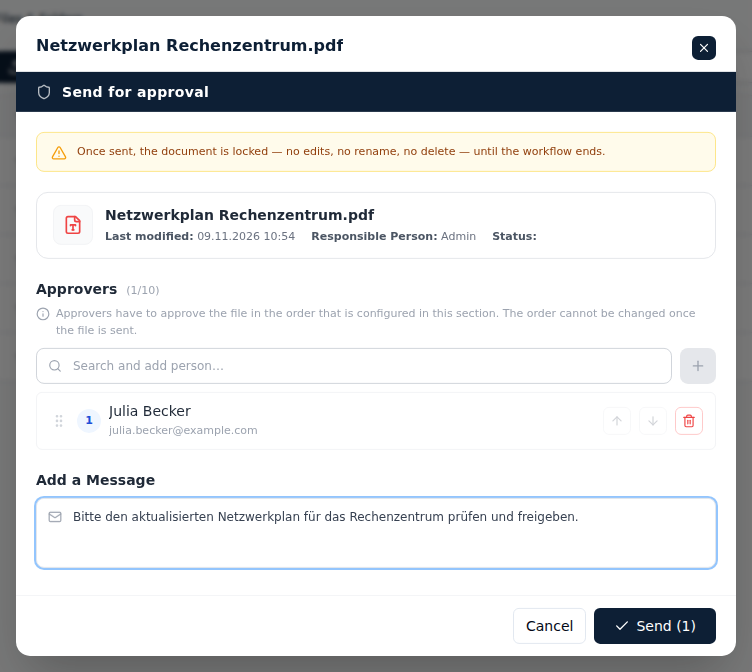
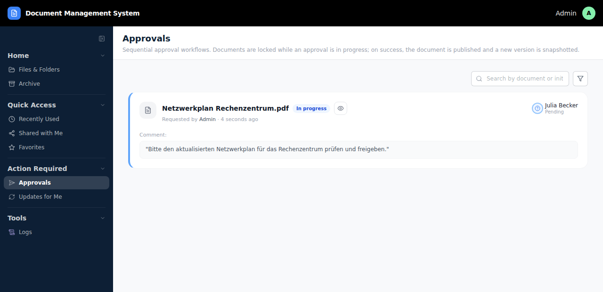

# Freigaben

Bei einer Freigabe prüfen eine oder mehrere Personen ein Dokument und geben es frei oder lehnen es ab.
Das Ergebnis zeigt das DMS als Status des Dokuments.

!!! info
    Verfügbar ab i-doit up 3.3.0.

## Status eines Dokuments

| Status | Bedeutung |
| --- | --- |
| kein Status | Neue Dokumente haben keinen Status. |
| **In Bearbeitung** | Eine Freigabe läuft. Das Dokument ist gesperrt. |
| **Freigabe** | Alle Freigeber haben das Dokument freigegeben. |
| **Abgelehnt** | Ein Freigeber hat das Dokument abgelehnt. |
| **Entwurf** | Das Dokument ist ein Entwurf. |

Solange ein Dokument **In Bearbeitung** ist, kann niemand es bearbeiten, umbenennen, verschieben, ersetzen, archivieren oder löschen.

## Ein Dokument zur Freigabe senden

Sie brauchen die Rolle **Besitzer** für das Dokument.
Freigaben gibt es für Dateien, nicht für Ordner.

1. Wählen Sie im Aktionsmenü des Dokuments **Zur Freigabe senden**.
2. Fügen Sie die Freigeber mit **Person suchen und hinzufügen…** hinzu.
   Der Zähler **Freigeber** zeigt, wie viele Sie hinzugefügt haben und wie viele erlaubt sind, standardmäßig 10.
3. Geben Sie bei Bedarf unter **Nachricht hinzufügen** eine Nachricht an die Freigeber ein.
4. Klicken Sie auf **Senden**.

Die Freigeber entscheiden nacheinander in der Reihenfolge, in der Sie sie hinzugefügt haben.
Nach dem Senden lässt sich die Reihenfolge nicht mehr ändern.
Wenn Ihr DMS-Administrator den E-Mail-Versand eingerichtet hat, bekommt jeder Freigeber eine E-Mail, sobald er an der Reihe ist, und Sie bekommen eine E-Mail, wenn die Freigabe abgeschlossen ist.

Wenn Sie eine laufende Freigabe abbrechen, ist das Dokument wieder entsperrt und hat keinen Status mehr.

## Freigeben oder ablehnen

**Aktion erforderlich** > **Freigaben** in der Seitenleiste listet die Freigaben, an denen Sie beteiligt sind, mit Dokument, Antragsteller, Freigeber, Nachricht und Stand.
Mit dem Suchfeld und dem Filterknopf über der Liste finden Sie eine Freigabe.

Wählen Sie bei der Freigabe **Freigeben** oder **Ablehnen**.
Sie können einen Kommentar hinzufügen.
Beim Ablehnen ist der Kommentar Pflicht.

## Änderungen nach der Freigabe

Ersetzt jemand die Datei eines freigegebenen Dokuments, verliert das Dokument den Status **Freigabe**.
Senden Sie es bei Bedarf erneut zur Freigabe.

## Siehe auch

- [Dateien und Ordner](files.md)
- [Bearbeiten und Versionen](editing.md)
- [Teilen und Zugriff](sharing.md)
