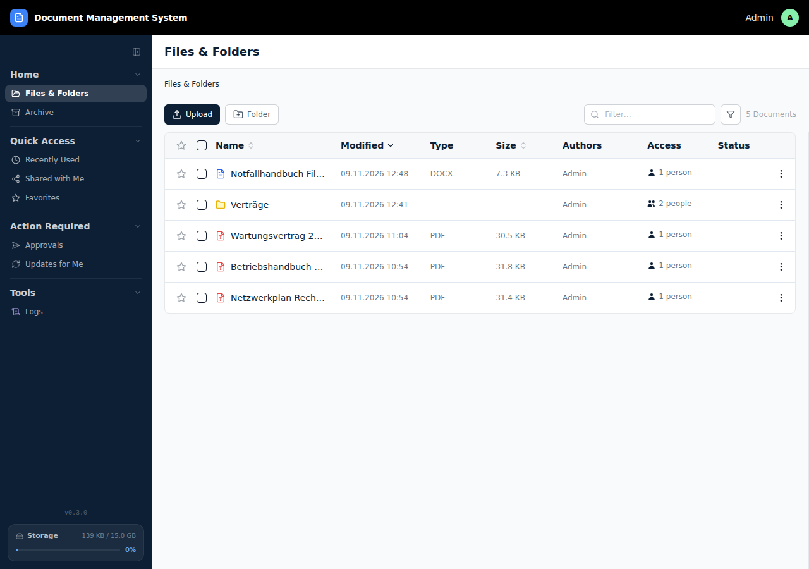
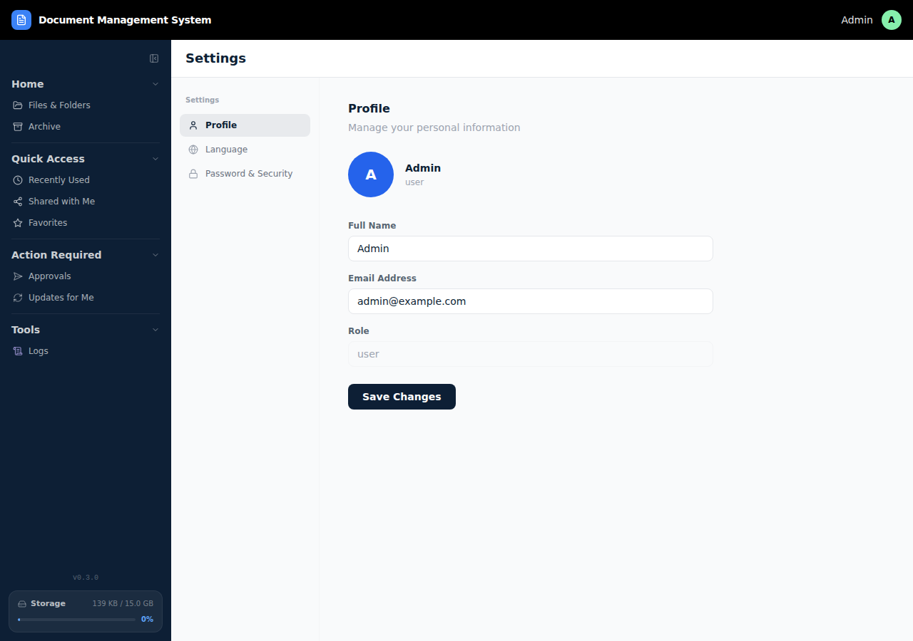

# Mit dem DMS arbeiten

Das Dokumentenmanagementsystem (DMS) speichert und ordnet Ihre Dokumente.
Diese Seite erklärt, wie Sie das eigenständige DMS öffnen, wie seine Oberfläche aufgebaut ist und wie Sie Ihre persönlichen Einstellungen ändern.
Wie Sie mit dem DMS in i-doit up und mit den Dokumenten eines Objekts arbeiten, beschreibt [DMS in i-doit up](../dms.md).

!!! info
    Verfügbar ab i-doit up 3.3.0.

## Das DMS öffnen

Klicken Sie in i-doit up auf **Manage in DMS**, siehe [Das eigenständige DMS öffnen](../dms.md#das-eigenstandige-dms-offnen).
Das DMS öffnet sich in einem neuen Browser-Tab, und Sie sind mit Ihrem i-doit-up-Konto angemeldet.
Sie sehen die Dokumente des i-doit-up-Mandanten, in dem Sie gerade arbeiten.

Ein eigenes DMS-Passwort brauchen Sie nicht.
Die lokale Anmeldeseite des DMS ist für den DMS-Administrator gedacht, siehe [DMS-Administration](../../admin/dms/administration.md).

## Die Oberfläche

Die Kopfzeile zeigt den Titel **Dokumentenmanagementsystem** und Ihren Avatar.
Das Avatar-Menü hat die Einträge **Settings** und **Sign Out**.

Die Seitenleiste links hat diese Gruppen:

| Gruppe | Eintrag | Inhalt |
| --- | --- | --- |
| **Start** | **Dateien & Ordner** | Alle Ordner und Dokumente, auf die Sie Zugriff haben, siehe [Dateien und Ordner](files.md) |
| | **Archiv** | Archivierte Dokumente und Ordner |
| **Schnellzugriff** | **Zuletzt verwendet** | Dokumente, die Sie zuletzt verwendet haben |
| | **Mit mir geteilt** | Dokumente und Ordner, die andere Benutzer mit Ihnen geteilt haben |
| | **Favoriten** | Dokumente und Ordner, die Sie als Favoriten markiert haben |
| **Aktion erforderlich** | **Freigaben** | Freigaben, an denen Sie beteiligt sind, siehe [Freigaben](approvals.md) |
| | **Updates für mich** | Änderungen, die Sie betreffen, zum Beispiel neue Freigaben oder geteilte Dokumente |
| **Werkzeuge** | **Logs** | Ihre eigenen Aktivitäten im DMS |

Die Einträge **Freigaben** und **Updates für mich** zeigen einen Zähler mit der Anzahl offener Einträge.
Unten zeigt die Seitenleiste die Version des DMS und den Balken **Speicher** mit dem belegten und dem verfügbaren Speicher.

## Favoriten

Um ein Dokument oder einen Ordner als Favoriten zu markieren, klicken Sie auf den Stern vor dem Namen oder wählen im Aktionsmenü der Zeile **Zu Favoriten hinzufügen**.
**Aus Favoriten entfernen** oder ein zweiter Klick auf den Stern nimmt die Markierung wieder weg.
**Favoriten** in der Seitenleiste listet alle Ihre Favoriten.

## Logs

**Werkzeuge** > **Logs** listet die Ereignisse der Dokumente, mit denen Sie gearbeitet haben, zum Beispiel Hochladen, Teilen, Zugriffsänderungen und Umbenennen.
Die Liste hat die Spalten **Datum und Uhrzeit**, **Dokument**, **Typ**, **Aktion**, **Beschreibung** und **Benutzer**.
Als Benutzer sehen Sie nur Ihre eigenen Ereignisse.

## Persönliche Einstellungen

Wählen Sie im Avatar-Menü **Settings**.
Die Seite hat drei Reiter:

- **Profil**: Ihr vollständiger Name, Ihre E-Mail-Adresse und Ihre DMS-Rolle.
  Um Ihre E-Mail-Adresse zu ändern, brauchen Sie Ihr aktuelles Passwort.
- **Sprache**: die Sprache der DMS-Oberfläche, English oder Deutsch.
- **Passwort & Sicherheit**: Ihr DMS-Passwort ändern.
  Ein Passwort braucht mindestens 8 Zeichen.
  Wenn Sie das DMS nur aus i-doit up öffnen, brauchen Sie kein DMS-Passwort.

Das Avatar-Menü selbst ist immer englisch.

## Abmelden

Wählen Sie im Avatar-Menü **Sign Out**.

## Siehe auch

- [DMS in i-doit up](../dms.md)
- [Dateien und Ordner](files.md)
- [Bearbeiten und Versionen](editing.md)
- [Teilen und Zugriff](sharing.md)
- [Freigaben](approvals.md)
