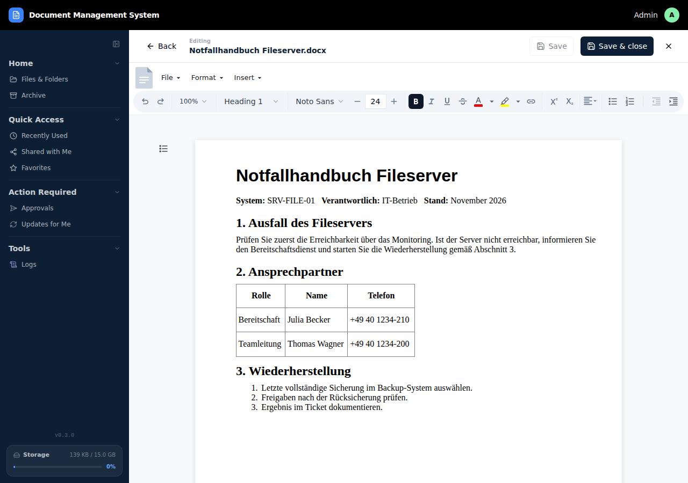
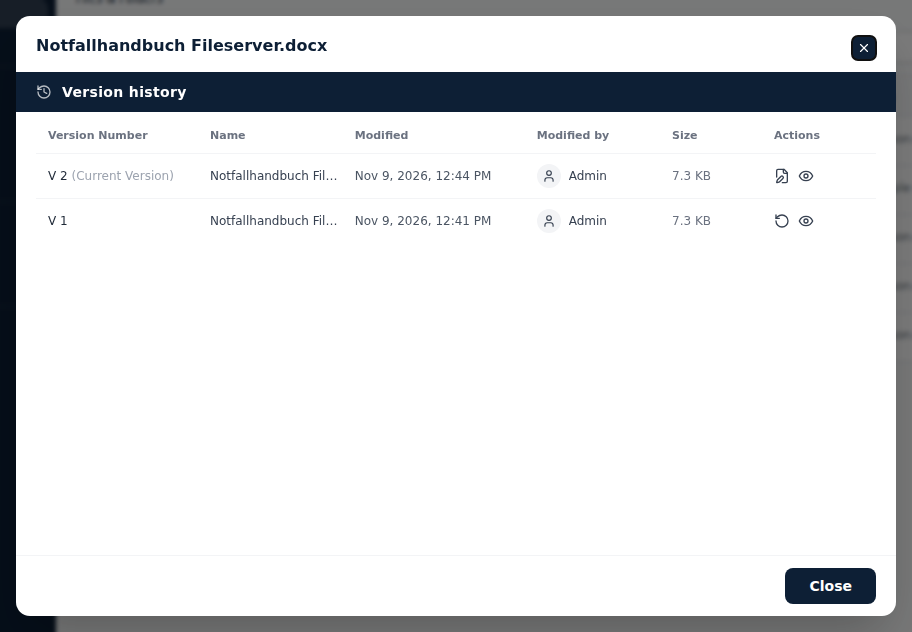

# Bearbeiten und Versionen

Das DMS hebt jede Änderung einer Datei als Version auf.
Sie können Word-Dokumente im Browser bearbeiten, jede Datei durch eine neue ersetzen und zu einer älteren Version zurückkehren.
Dafür brauchen Sie die Rolle **Bearbeiten** oder **Besitzer** für das Dokument, siehe [Teilen und Zugriff](sharing.md#rollen).

!!! info
    Verfügbar ab i-doit up 3.3.0.

## Ein Word-Dokument im Browser bearbeiten

Im Browser bearbeiten lassen sich nur Word-Dokumente im Format `.docx`.

1. Wählen Sie im Aktionsmenü des Dokuments **Datei öffnen** > **Im Editor öffnen**.
2. Bearbeiten Sie das Dokument.
3. Klicken Sie auf **Speichern**, um weiterzuarbeiten, oder auf **Speichern & schließen**, um zur Liste zurückzukehren.

Jedes Speichern legt eine neue Version des Dokuments an.

Andere Dateitypen laden Sie herunter, bearbeiten sie auf Ihrem Rechner und laden sie mit **Datei ersetzen** wieder hoch.

## Eine Datei ersetzen

1. Wählen Sie im Aktionsmenü des Dokuments **Datei ersetzen**.
2. Wählen Sie die neue Datei.

Das DMS speichert die neue Datei als neue Version.
Das Dokument übernimmt dabei den Namen der neuen Datei.
Wenn Sie den alten Namen behalten wollen, benennen Sie das Dokument danach mit **Umbenennen** um.

Hatte das Dokument den Status **Freigabe**, entfernt das Ersetzen diesen Status.

## Versionsverlauf

Wählen Sie im Aktionsmenü einer Datei **Versionsverlauf**.
Der Dialog listet alle Versionen mit Nummer, Name, Änderungsdatum und dem Benutzer, der die Änderung gemacht hat.

In der Spalte **Aktionen** öffnen Sie eine Version oder stellen sie wieder her.
Das Wiederherstellen löscht keine neueren Versionen.
Das DMS legt den wiederhergestellten Stand als neue, aktuelle Version an.

## Siehe auch

- [Dateien und Ordner](files.md)
- [Freigaben](approvals.md)
