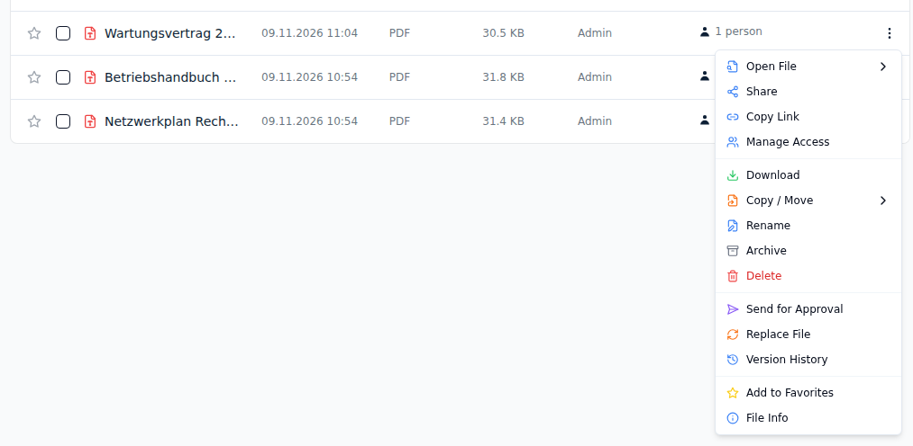
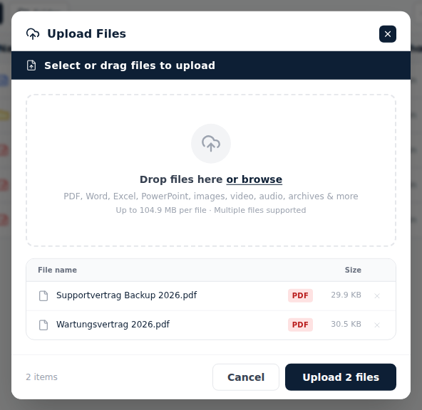
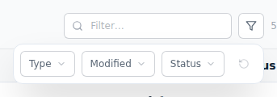
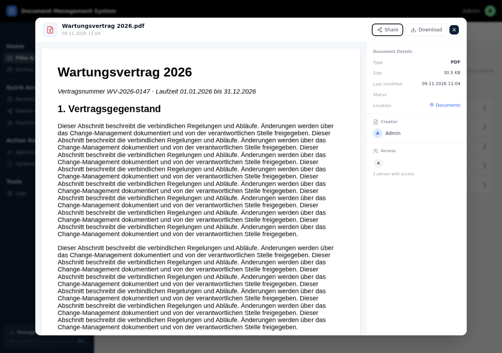
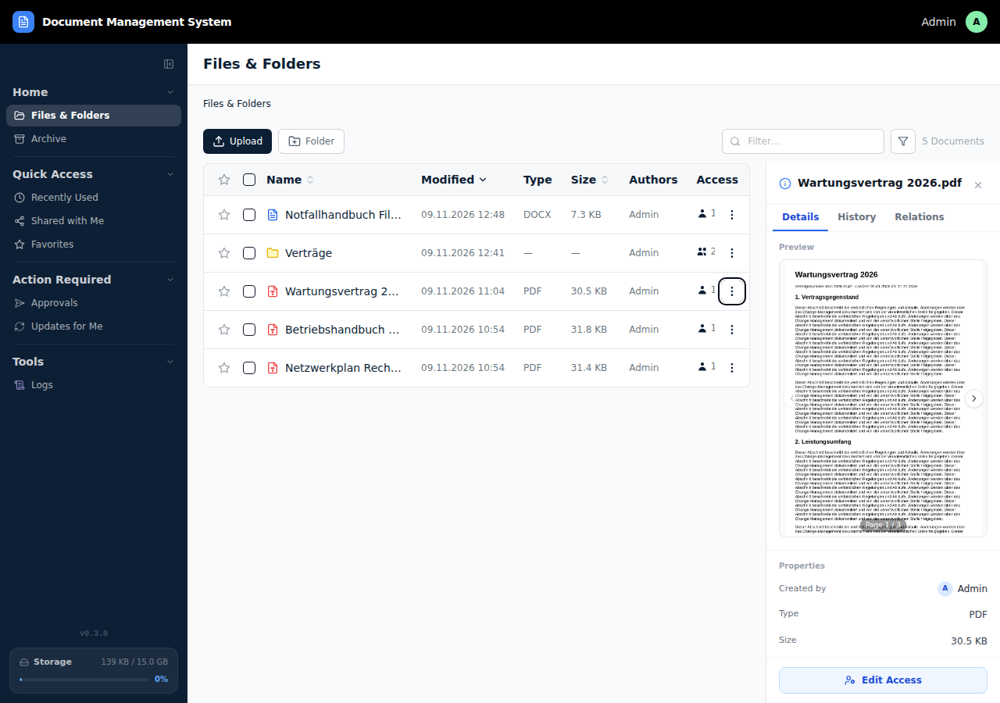

# Dateien und Ordner

In **Dateien & Ordner** laden Sie Dokumente hoch, finden, öffnen und ordnen sie.
Was Sie mit einem Dokument tun dürfen, hängt von Ihrer Rolle für das Dokument ab, siehe [Teilen und Zugriff](sharing.md#rollen).

!!! info
    Verfügbar ab i-doit up 3.3.0.

## Die Liste

**Dateien & Ordner** zeigt die Ordner und Dokumente des aktuellen Ordners.
Für jeden Eintrag zeigt die Liste Name, Änderungsdatum, Typ, Größe, Autoren, Zugriff und Status.
Die Spalte für den Zugriff zeigt, wie viele Personen Zugriff haben.
Klicken Sie auf einen Ordner, um ihn zu öffnen.

Jede Zeile hat rechts ein Aktionsmenü (**⋮**).
Es zeigt nur die Aktionen, die Ihre Rolle erlaubt.

## Dateien hochladen

Dateien hochladen und Ordner anlegen können Sie dort, wo Sie die Rolle **Bearbeiten** oder **Besitzer** haben.
Fehlt Ihnen diese Rolle, fehlen die Knöpfe **Hochladen** und **Ordner**.

1. Öffnen Sie den Ordner, in den die Dateien sollen.
2. Klicken Sie auf **Hochladen**.
3. Ziehen Sie die Dateien in den Dialog **Dateien hochladen**, oder klicken Sie auf **oder durchsuchen** und wählen Sie sie aus.
   Sie können mehrere Dateien auf einmal wählen.
4. Klicken Sie auf **_n_ Dateien hochladen**.

Der Dialog zeigt die maximale Größe pro Datei.
Mit der Standardeinstellung zeigt er **Bis zu 104.9 MB pro Datei**.
Diese Grenze legt Ihr DMS-Administrator fest.

Das DMS nimmt unter anderem diese Dateitypen an:

| Art | Endungen |
| --- | --- |
| Office | pdf, doc, docx, xls, xlsx, ppt, pptx, odt, ods, odp, odg, odf |
| Text | txt, csv, tsv, rtf, xml, json, yaml, yml, html, htm, md |
| Bilder | jpg, jpeg, png, gif, bmp, tiff, tif, webp, svg, ico |
| Video | mp4, mov, avi, mkv, wmv, flv, webm |
| Audio | mp3, wav, aac, ogg, flac, m4a |
| Archive | zip, rar, 7z, tar, gz |

## Einen Ordner anlegen

1. Öffnen Sie den Ordner, in dem der neue Ordner entstehen soll.
2. Klicken Sie auf **Ordner** und geben Sie einen Namen ein.

Wer Zugriff auf einen Ordner hat, hat auch Zugriff auf seinen Inhalt, siehe [Teilen und Zugriff](sharing.md#ordner).

## Dokumente finden

Tippen Sie in das Feld **Filter…** über der Liste, um nur Einträge zu zeigen, deren Name den Text enthält.
Groß- und Kleinschreibung spielen keine Rolle.
Der Filter durchsucht nur die Namen, nicht den Inhalt der Dokumente.

Der Filterknopf neben dem Feld schränkt die Liste nach **Typ**, **Geändert** und **Status** ein.
**Zurücksetzen** löscht die Filter.

## Öffnen und herunterladen

Im Aktionsmenü hat **Datei öffnen** zwei Einträge:

- **Vorschau** zeigt das Dokument im Browser.
- **Im Editor öffnen** öffnet ein Word-Dokument zum Bearbeiten, siehe [Bearbeiten und Versionen](editing.md).

Die Vorschau unterstützt diese Dateitypen:

| Art | Endungen | Vorschau |
| --- | --- | --- |
| PDF | pdf | Seiten des Dokuments |
| Bilder | png, jpg, jpeg, gif, webp, svg, bmp, ico, tiff, tif | Bild |
| Text | txt, md, xml, json, html, htm, log, yaml, yml, toml, ini, env | Text |
| Tabellen | csv, tsv | Tabelle |
| Word | docx, doc, odt | Dokument, nur lesend |
| Excel | xlsx, xls, ods | Tabellenblatt |

PowerPoint-Dateien und andere Dateitypen haben keine Vorschau.
Stattdessen bietet die Vorschau einen Download an.

**Herunterladen** im Aktionsmenü speichert die Datei auf Ihrem Rechner.

## Datei-Info

**Datei-Info** im Aktionsmenü öffnet eine Seitenleiste mit den Reitern **Details**, **Verlauf** und **Beziehungen**.
**Details** zeigt eine Vorschau und die Eigenschaften des Dokuments, zum Beispiel wer es angelegt hat, Typ, Größe und Zugriff.
**Verlauf** listet, was mit dem Dokument geschehen ist.

## Dokumente und Ordner ordnen

| Aktion | Wo | Nötige Rolle |
| --- | --- | --- |
| Umbenennen | **Umbenennen** | Bearbeiten |
| In einen anderen Ordner kopieren | **Kopieren / Verschieben** > **Kopieren** | Bearbeiten |
| Kopie im selben Ordner anlegen | **Kopieren / Verschieben** > **Duplizieren** | Bearbeiten |
| In einen anderen Ordner verschieben | **Kopieren / Verschieben** > **Verschieben** | Besitzer |
| Archivieren | **Archivieren** | Besitzer |
| Löschen | **Löschen** | Besitzer |

Solange ein Dokument in einer Freigabe ist, ist es gesperrt.
Sie können es erst nach dem Ende der Freigabe umbenennen, verschieben, ersetzen, archivieren oder löschen, siehe [Freigaben](approvals.md).

Um mehrere Einträge auf einmal zu bearbeiten, wählen Sie ihre Kontrollkästchen.
Es erscheint eine Leiste mit **Kopieren**, **Verschieben**, **Teilen**, **Archivieren**, **Löschen** und **Auswahl aufheben**.

### Archivieren

Archivierte Dokumente und Ordner verschwinden aus **Dateien & Ordner**.
**Archiv** in der Seitenleiste listet sie.
Wählen Sie dort **Wiederherstellen**, um einen Eintrag zurückzuholen.

### Löschen

Gelöschte Dokumente und Ordner verschwinden aus allen Ansichten.
Das DMS hat keinen Papierkorb, den Sie öffnen können.
Das DMS entfernt gelöschte Einträge nach einer Aufbewahrungsfrist endgültig, standardmäßig nach 30 Tagen.
Wenn Sie ein Dokument vielleicht noch einmal brauchen, archivieren Sie es, statt es zu löschen.

## Siehe auch

- [Mit dem DMS arbeiten](basics.md)
- [Bearbeiten und Versionen](editing.md)
- [Teilen und Zugriff](sharing.md)
- [Freigaben](approvals.md)
