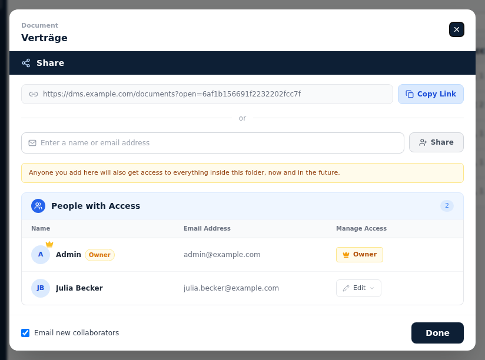
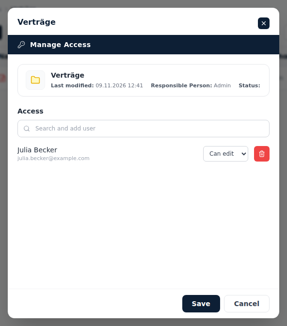

# Teilen und Zugriff

Jedes Dokument und jeder Ordner im DMS hat eine eigene Liste der Personen, die darauf zugreifen dürfen.
Rechte aus i-doit up werden nicht an das DMS übertragen.

!!! info
    Verfügbar ab i-doit up 3.3.0.

## Rollen

| Rolle | Erlaubt |
| --- | --- |
| **Ansehen** | das Dokument öffnen, in der Vorschau ansehen und herunterladen |
| **Bearbeiten** | zusätzlich: umbenennen, kopieren, duplizieren, die Datei ersetzen, Word-Dokumente bearbeiten, in einen Ordner hochladen |
| **Besitzer** | zusätzlich: teilen, Zugriff verwalten, verschieben, archivieren, löschen, zur Freigabe senden |

Der Dialog **Zugriff verwalten** nennt die Rollen **Kann ansehen**, **Kann bearbeiten** und **Besitzer**.
Der Dialog **Teilen** nennt sie **Ansehen**, **Bearbeiten** und **Besitzer**.

## Ein Dokument oder einen Ordner teilen

Sie brauchen die Rolle **Besitzer**.

1. Wählen Sie im Aktionsmenü des Dokuments oder Ordners **Teilen**.
2. Suchen Sie eine Person nach Name oder E-Mail-Adresse und fügen Sie sie hinzu.
3. Wählen Sie die Rolle jeder Person.
4. Lassen Sie **Neue Mitarbeiter per E-Mail benachrichtigen** gewählt, wenn die neuen Personen eine E-Mail bekommen sollen.
   Dafür muss Ihr DMS-Administrator den E-Mail-Versand eingerichtet haben.

Um einer Person den Zugriff zu nehmen, wählen Sie als Rolle **Zugriff entfernen**.

Die hinzugefügten Personen sehen das Dokument unter **Mit mir geteilt**.
Öffentliche Links gibt es nicht: nur Personen mit Zugriff können ein Dokument öffnen.

## Zugriff verwalten

Sie brauchen die Rolle **Besitzer**.
Wählen Sie im Aktionsmenü **Zugriff verwalten**, oder klicken Sie in der Werkzeugleiste eines geöffneten Ordners auf **Zugriff verwalten**.
Der Dialog listet alle Personen mit Zugriff und ihre Rolle.
Dort ändern Sie eine Rolle oder entfernen eine Person.

## Ordner

Der Zugriff auf einen Ordner gilt auch für alles darin, jetzt und künftig.
Der Dialog **Teilen** eines Ordners weist darauf hin.

Der Dialog **Zugriff verwalten** eines Dokuments listet nur die Personen, die direkt auf dieses Dokument Zugriff haben.
Personen, die über einen übergeordneten Ordner Zugriff haben, stehen dort nicht.

## Siehe auch

- [Dateien und Ordner](files.md)
- [Wer welche Dokumente sieht](../dms.md#wer-welche-dokumente-sieht)
