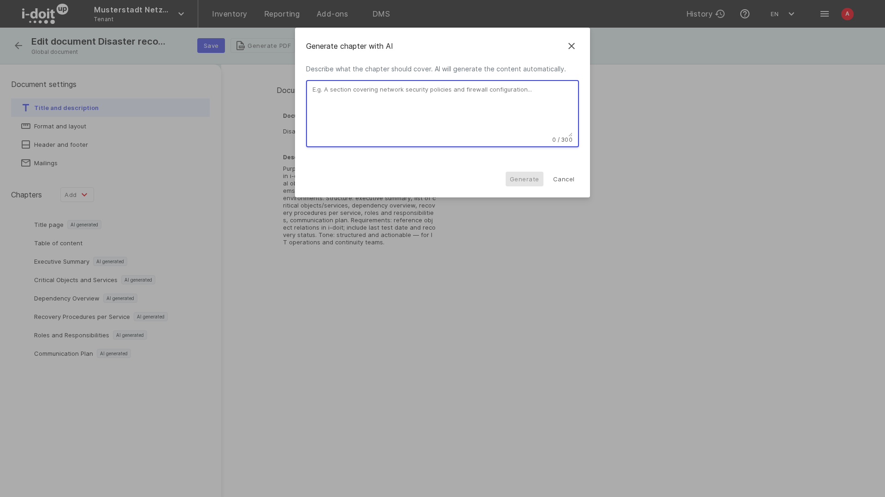

# Documents Creator mit KI

Der [Documents Creator](documents-creator.md) kann ein KI-Modell nutzen, um aus einer kurzen Beschreibung ein ganzes Dokument zu entwerfen, einem bestehenden Dokument ein Kapitel hinzuzufügen und einen von Ihnen geschriebenen Text zu verbessern.
Die generierten Kapitel sind gewöhnliche Kapitel mit Markdown-Abschnitten, Sie bearbeiten, sortieren und exportieren sie also wie jeden anderen Inhalt.
Alles, was die KI geschrieben hat, bleibt als solches gekennzeichnet, in der Dokumentübersicht, im Editor und im PDF.

Diese Seite beschreibt die drei KI-Funktionen, wie KI-generierte Inhalte gekennzeichnet werden, was Sie für die Funktionen benötigen und wie Nutzungslimits funktionieren.

## Was die KI-Funktionen leisten

- **Mit KI erstellen** baut die Struktur und die Kapitel eines neuen Dokuments aus Ihrer Beschreibung auf.
- **Mit KI generieren** fügt einem bestehenden Dokument ein Kapitel mit Inhalt hinzu.
- **Mit KI verbessern** formuliert den Text eines Markdown-Abschnitts nach Ihrer Anweisung um, zum Beispiel präziser oder formeller.

Die KI liest die Klassen und Kategorien Ihrer CMDB, um Markdown-Abschnitte zu schreiben, die Ihre Objekte abfragen, sodass die generierten Tabellen und Listen beim Erzeugen des PDFs aus Ihren Daten gefüllt werden.
Die KI ändert nie CMDB-Daten.

## Voraussetzungen

Die KI-Funktionen erscheinen nur, wenn beide Bedingungen erfüllt sind:

- **KI ist für Ihre Instanz verfügbar.**
    In der i-doit up Cloud ist KI Teil Ihres Tarifs.
    Auf einer selbst betriebenen Instanz ist der Dienst des Documents Creator mit einem OpenAI-kompatiblen Endpunkt konfiguriert, siehe [KI auf einer selbst betriebenen Instanz konfigurieren](#ki-auf-einer-selbst-betriebenen-instanz-konfigurieren).
- **Sie besitzen das Recht _Use AI features_** des Documents Creator.

Ohne KI legt die Schaltfläche **Hinzufügen** direkt ein leeres Dokument an, und die Schaltflächen **Mit KI generieren** und **Verbessern** werden nicht angezeigt.

### Recht vergeben

1. Öffnen Sie das Benutzermenü (Avatar oben rechts) und wählen Sie **Einstellungen**.
2. Gehen Sie zu **Benutzerverwaltung > Rechte**.
3. Wählen Sie unter _Add-on-Rechte_ den Eintrag **Documents Creator** und klicken Sie auf **Neues Recht**.
4. Wählen Sie den Benutzer, die Rolle oder die Gruppe, wählen Sie das Recht **Use AI features** und speichern Sie.

Die Rechte _Herunterladen_, _Dokumente verwalten_ und _Mailing verwalten_ behalten ihre Bedeutung, siehe [Documents Creator](documents-creator.md#rechte).
Wer KI nutzen, aber keine Dokumente verwalten darf, kann keine Dokumente anlegen oder ändern, vergeben Sie also auch _Dokumente verwalten_.

### KI auf einer selbst betriebenen Instanz konfigurieren

Auf einer selbst betriebenen Instanz läuft der Documents Creator als eigener Dienst neben i-doit up.
Setzen Sie drei Umgebungsvariablen an diesem Dienst:

| Variable | Wert |
|---|---|
| `AI_MODEL_BASE_URL` | Basis-URL einer OpenAI-kompatiblen Chat-Completions-API |
| `AI_MODEL_KEY` | API-Schlüssel für diesen Endpunkt |
| `AI_MODEL_NAME` | Name des zu verwendenden Modells |

Alle drei sind erforderlich.
Solange eine davon leer ist, meldet der Dienst KI als nicht verfügbar, und die KI-Funktionen bleiben ausgeblendet.
Der Schlüssel gelangt nie in den Browser.

## Dokument mit KI erstellen

1. Öffnen Sie **Reporting > Documents Creator** und wählen Sie **Globale Dokumente** oder die Dokumente eines Mandanten.
2. Klicken Sie auf **Hinzufügen**.
    Der Dialog **Dokument erstellen** bietet **Leere Vorlage** und **Mit KI erstellen** an.

    

3. Wählen Sie **Mit KI erstellen** und klicken Sie auf **Weiter**.
4. Geben Sie einen **Dokumenttitel** ein.
5. Beschreiben Sie das Dokument unter **Was möchten Sie erstellen?**.
    Das Feld nimmt bis zu 3.000 Zeichen auf.
    Nennen Sie Zweck, Umfang, Struktur, Anforderungen wie Normen und die Tonalität.
    Alternativ klicken Sie auf einen der Vorschläge unter dem Feld, zum Beispiel _Notfallwiederherstellungsplan_ oder _IT-Onboarding-Leitfaden_, der eine vollständige Beschreibung einträgt, die Sie anpassen können.

    

6. Klicken Sie auf **Generieren**.

Die KI plant zuerst die Struktur und schreibt dann die Kapitel nacheinander.
Der Dialog zeigt den Fortschritt.
Wenn die Generierung abgeschlossen ist, öffnet sich das neue Dokument im Editor.
Die eingegebene Beschreibung wird als Dokumentbeschreibung gespeichert.

Jedes generierte Kapitel enthält eine Überschrift und einen Markdown-Abschnitt.
Wo es sinnvoll ist, enthält das Markdown eine Abfrage, die Objekte aus Ihrer CMDB liest, zum Beispiel eine Tabelle aller Services mit Zweck und Status.
Prüfen Sie die Kapitel, ändern Sie die Texte und entfernen Sie, was Sie nicht brauchen, wie bei einem manuell erstellten Dokument.

## Kapitel mit KI generieren

1. Öffnen Sie ein Dokument im Editor.
2. Klicken Sie neben **Kapitel** auf **Hinzufügen** und wählen Sie **Mit KI generieren**.

    

3. Beschreiben Sie in bis zu 300 Zeichen, was das Kapitel abdecken soll.

    

4. Klicken Sie auf **Generieren**.

Das Kapitel wird am Ende der Kapitelliste angefügt.
Verschieben Sie es mit **Reihenfolge ändern** wie jedes andere Kapitel.

## Text mit KI verbessern

1. Öffnen Sie ein Kapitel im Editor.
2. Klicken Sie in einem **Markdown**-Abschnitt auf **Verbessern**.
    Der Dialog **Mit KI verbessern** zeigt den aktuellen Text unter **Original**.

    

3. Klicken Sie auf einen der Chips, zum Beispiel **Präziser formulieren**, oder schreiben Sie eine eigene Anweisung mit bis zu 1.000 Zeichen.
4. Klicken Sie auf **Generieren**.
    Der umformulierte Text erscheint unter **Ergebnis**.
5. Klicken Sie auf **Speichern**, um das Ergebnis zu übernehmen, oder auf **Schließen**, um das Original zu behalten.

**Verbessern** formuliert nur den Text um.
Abfragen und Platzhalter im Markdown bleiben erhalten.
Die Funktion steht für Markdown-Abschnitte zur Verfügung, nicht für Objektdetails oder benutzerdefinierte Tabellen.

## So werden KI-generierte Inhalte gekennzeichnet

Der Documents Creator hält für jedes Kapitel und jeden Abschnitt fest, ob die KI ihn geschrieben hat:

- **KI-generiert** kennzeichnet Inhalte, die die KI geschrieben hat und die seitdem niemand geändert hat.
- **KI-gestützt** kennzeichnet Inhalte, die die KI geschrieben und ein Benutzer anschließend bearbeitet hat.

Die Abzeichen erscheinen in der Spalte **KI** der Dokumentliste, neben den Kapiteln im Editor und unter jedem Abschnitt.
Zeigen Sie mit der Maus auf ein Abzeichen, um die Begründung zu sehen: Die KI-Verordnung der EU verlangt, dass KI-generierte Inhalte als solche gekennzeichnet werden.

Ein Dokument gilt als _KI-generiert_, wenn sein gesamter Inhalt von der KI stammt, und als _KI-gestützt_, wenn KI-Inhalte und Benutzerinhalte gemischt sind.
Das erzeugte PDF trägt einen entsprechenden Hinweis.
Inhalte, die Sie selbst schreiben, tragen kein Abzeichen.

## Markdown-Abschnitte mit CMDB-Abfragen

Kapitel, die die KI schreibt, verwenden den Abschnitt **Markdown**.
Neben Markdown versteht dieser Abschnitt eine Vorlagensyntax, mit der Sie beim Erzeugen des Dokuments Objekte aus der CMDB lesen:

- Variablen wie Dokumenttitel, Ersteller und Erstellungsdatum.
- Der Objektabfrage-Builder `object.find`, der Objekte nach Klasse oder Kategorie auswählt und die benötigten Felder liest.
- Filterhelfer wie `f.eq` oder `f.and`, um das Ergebnis einzugrenzen.

Klicken Sie in einem Markdown-Abschnitt auf **Syntax-Hilfe** für die vollständige Referenz mit Beispielen, etwa eine Tabelle aller Server mit ihren CPU-Details.
Klicken Sie auf **Markdown-Editor**, um den Abschnitt mit Symbolleiste und Vorschau zu bearbeiten; dort öffnet **edit query** einen visuellen Editor für die Abfrage.

## Nutzungslimits

In der i-doit up Cloud werden die KI-Funktionen nach Anfragen und Tokens pro Tag und pro Woche gemessen.
Die Dokumentübersicht zeigt Ihre aktuelle Nutzung unter **KI-Nutzung**, sobald Limits gelten.

Ist ein Limit erreicht, erscheint anstelle der KI-Funktion der Dialog **KI-Nutzungslimit erreicht**.
Tägliche Limits werden um Mitternacht zurückgesetzt, wöchentliche Limits am Montag.
Auf einer selbst betriebenen Instanz gelten die Limits Ihres KI-Anbieters.

## Weiterführende Themen

- [Documents Creator](documents-creator.md), Kapitel, Abschnitte, Mailings und die Rechte des Add-ons.
- [Rechte und Berechtigungen](../admin/rights-and-permissions.md), wo das Recht _Use AI features_ vergeben wird.
- [Add-ons](../admin/addons.md), der Documents Creator ist ein Add-on Ihrer i-doit up Instanz.
- [Model Context Protocol (MCP)](../admin/mcp.md), einen KI-Client anbinden, der Ihre CMDB liest und schreibt.
