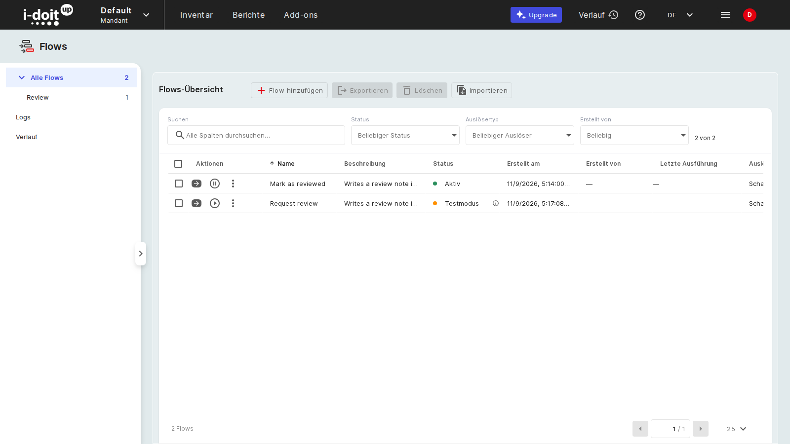

# Flows

Das Add-on Flows automatisiert wiederkehrende Aufgaben in i-doit up.
Ein Flow reagiert auf einen Auslöser, zum Beispiel einen Button an einem Objekt, einen Zeitplan oder eine Änderung in der CMDB, und führt dann eine oder mehrere Aktionen aus, zum Beispiel ein Objekt erstellen oder eine E-Mail senden.
Diese Seite erklärt die Bausteine eines Flows und wie Sie Ihre Flows finden und verwalten.
Installation und Rechte beschreibt [Flows-Add-on](../admin/flows.md).

!!! info
    Verfügbar ab i-doit up 3.3.0.

## Bausteine eines Flows

Jeder Flow besteht aus drei Teilen:

1. **Auslöser**: was den Flow startet. Ein Flow braucht genau einen Auslöser.
2. **Bedingungen**: zusätzliche Voraussetzungen, die erfüllt sein müssen. Bedingungen sind optional.
3. **Aktionen**: was der Flow tut. Ein Flow braucht mindestens eine Aktion.

Jeder Flow läuft als **Flow Operator**, also als i-doit-up-Benutzer, dessen Berechtigungen die Aktionen verwenden.
Ein Flow kann nie mehr tun, als sein Flow Operator darf.

Ein Flow hat einen von drei Zuständen:

- **Aktiv**: Der Flow läuft, sobald sein Auslöser auslöst.
- **Testmodus**: Der Auslöser löst aus und die Bedingungen werden geprüft, die Aktionen werden aber nur simuliert und in die Logs geschrieben.
- **Inaktiv**: Der Flow läuft nicht.

Flows starten Sie nicht von Hand aus der Liste.
Ein aktiver Flow läuft von selbst, sobald sein Auslöser auslöst.

## Sprache

Die Oberfläche des Add-ons folgt der Sprache, die Sie in i-doit up eingestellt haben, Deutsch oder Englisch.
Eine eigene Spracheinstellung hat das Add-on nicht.
Ihre eigenen Inhalte, etwa Flow-Namen, Beschreibungen und Objektnamen, erscheinen so, wie Sie sie eingegeben haben.

## Flows öffnen

Nachdem ein Administrator das Add-on installiert hat, erscheint **Flows** in der Navigation unter **Add-ons**.
Zum Öffnen brauchen Sie das Recht **Manage Flows**, siehe [Rechte und Flow-Benutzer](../admin/flows/rights.md).

Der linke Bereich von Flows zeigt:

- **Alle Flows** mit der Gesamtzahl der Flows. Ein Klick zeigt alle Flows.
- Ihre **Flow-Gruppen**, eingerückt unter **Alle Flows**, jeweils mit der Zahl ihrer Flows.
- **Logs**: die Ausführungen der Flows, siehe [Logs und Verlauf](flows/logs-history.md).
- **Verlauf**: die Änderungen an Flows, siehe [Logs und Verlauf](flows/logs-history.md#verlauf).

Die Adresse im Browser zeigt die aktuelle Ansicht.
Sie können einen Link auf die Übersicht, eine Flow-Gruppe, die Logs oder einen einzelnen Flow als Lesezeichen speichern oder weitergeben.

## Flows-Übersicht

Die Übersicht listet Ihre Flows mit diesen Spalten: **Name**, **Beschreibung**, **Status**, **Erstellt am**, **Erstellt von**, **Letzte Ausführung**, **Auslöser** und **Flow-Gruppen**.

- **Status** ist grün für **Aktiv**, gelb für **Testmodus** und rot für **Inaktiv**.
- **Letzte Ausführung** zeigt, wann der Flow zuletzt lief.
  Ein Symbol neben der Zeit öffnet den passenden Log-Eintrag.
- **Flow-Gruppen** bearbeiten Sie direkt in der Tabelle: Klicken Sie in die Zelle, wählen oder erstellen Sie Gruppen und bestätigen Sie mit dem Häkchen.

Über der Tabelle bietet eine Filterleiste ein Suchfeld und die Filter **Status**, **Auslösertyp** und **Erstellt von**.
Alle Filter müssen zutreffen.
**Filter zurücksetzen** setzt sie zurück.
Die Übersicht behält Filter und Sortierung, solange Sie in derselben Sitzung zwischen den Ansichten wechseln.
Ein vollständiges Neuladen der Seite setzt sie zurück.

Unter der Tabelle wählen Sie, wie viele Flows pro Seite erscheinen: 10, 25, 50, 100, 500 oder 1000.

## Aktionen an einem Flow

Jede Zeile hat diese Aktionen:

- **Öffnen**: zeigt den Flow, siehe [Flows erstellen und bearbeiten](flows/create.md).
- **Aktivieren** oder **Deaktivieren**: schaltet den Flow ein oder aus.
  **Aktivieren** steht nur zur Verfügung, wenn der Flow einen Auslöser und eine Aktion hat.
- Das Menü **Weitere Aktionen** (⋮) mit **Bearbeiten**, **Duplizieren** und je nach Status **In Testmodus wechseln** oder **Deaktivieren**.

**Duplizieren** öffnet das Formular für einen neuen Flow, ausgefüllt mit der Konfiguration des ursprünglichen Flows und dem Namen "*Name des Flows* (Copy)".
Der Zusatz "(Copy)" ist auch in der deutschen Oberfläche englisch.
Die Kopie entsteht erst, wenn Sie auf **Speichern** klicken.
Sie startet als **Inaktiv**.
Logs und Verlauf des ursprünglichen Flows werden nicht kopiert.

Um mehrere Flows auf einmal zu bearbeiten, markieren Sie sie über die Kontrollkästchen und klicken Sie auf **Löschen**, **Deaktivieren** oder **Exportieren**.
Das Kontrollkästchen im Tabellenkopf markiert alle Flows der aktuellen Seite.
Gemeinsam aktivieren lassen sich Flows nicht: Sie aktivieren sie einzeln.

**Flow hinzufügen** legt einen neuen Flow an.
**Importieren** lädt Flows aus einer Datei, siehe [Export und Import](flows/export-import.md).

## Flow-Gruppen

Flow-Gruppen ordnen Ihre Flows.
Ein Flow kann zu keiner, einer oder mehreren Gruppen gehören.
Gruppen weisen Sie im Flow selbst oder in der Spalte **Flow-Gruppen** der Übersicht zu.

- Klicken Sie im linken Bereich auf eine Gruppe, um nur ihre Flows zu sehen.
  Wenn Sie bei geöffneter Gruppe auf **Flow hinzufügen** klicken, ist der neue Flow dieser Gruppe zugeordnet.
- Bei geöffneter Gruppe benennt ein Stiftsymbol neben dem Namen die Gruppe um, ein Papierkorbsymbol löscht sie.
  Beim Löschen wird die Gruppe aus allen ihren Flows entfernt.
  Die Flows selbst bleiben erhalten.
- Eine Gruppe bleibt im linken Bereich, auch wenn kein Flow sie mehr nutzt.

Die Zahl neben **Alle Flows** ist die Gesamtzahl der Flows, nicht die Summe der Gruppenzahlen.

## Weiterführende Informationen

-   [Flows erstellen und bearbeiten](flows/create.md)
-   [Auslöser](flows/triggers.md)
-   [Bedingungen](flows/conditions.md)
-   [Aktionen und Platzhalter](flows/actions.md)
-   [Logs und Verlauf](flows/logs-history.md)
-   [Export und Import](flows/export-import.md)
-   [Flows-Add-on](../admin/flows.md)
