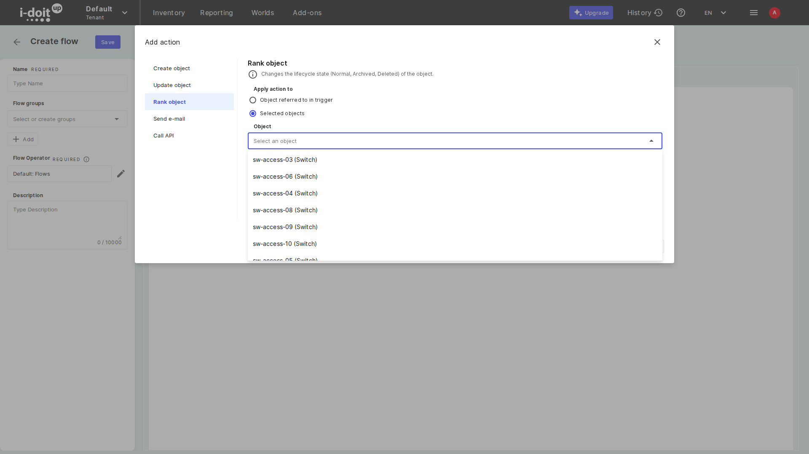
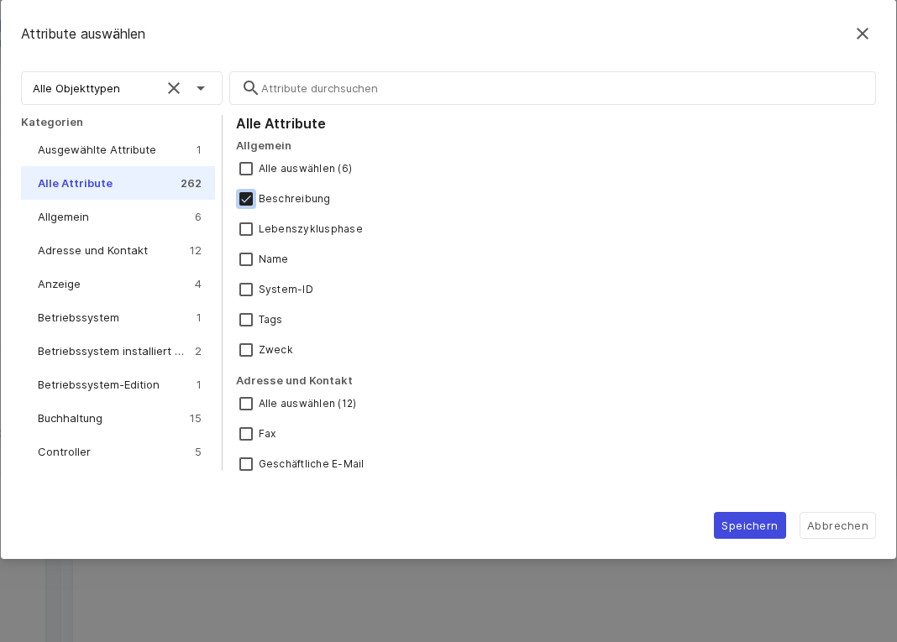
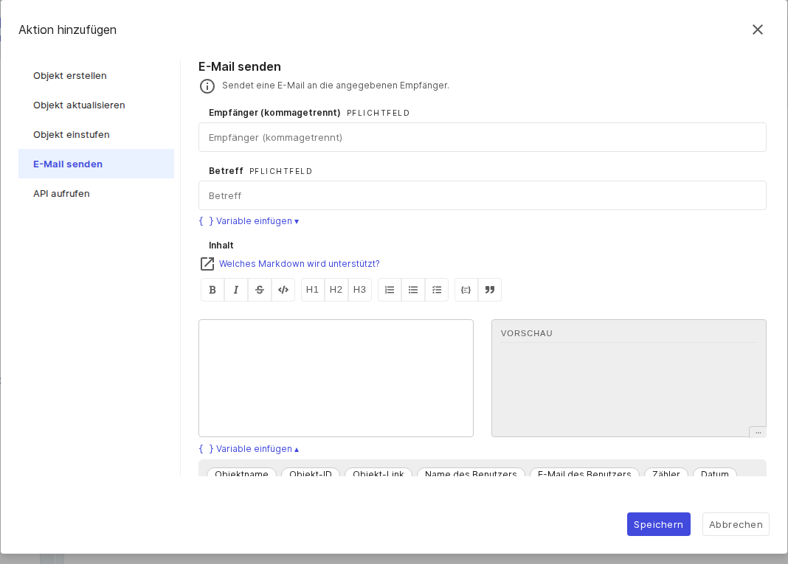

# Aktionen und Platzhalter

Aktionen sind das, was ein Flow tut.
Ein Flow braucht mindestens eine Aktion.
Diese Seite beschreibt die fünf Aktionstypen und die Platzhalter, die Sie in ihren Feldern nutzen können.

!!! info
    Verfügbar ab i-doit up 3.3.0.

## Aktionstypen

| Aktion | Was sie tut |
| --- | --- |
| **Objekt erstellen** | Erstellt ein neues Objekt des ausgewählten Typs und setzt seine Attribute. |
| **Objekt aktualisieren** | Aktualisiert Attribute am Objekt des Auslösers oder an einem ausgewählten Objekt. |
| **Objekt einstufen** | Ändert den Lebenszyklus-Status (Normal, Archiviert, Gelöscht) des Objekts. |
| **E-Mail senden** | Sendet eine E-Mail an die angegebenen Empfänger. |
| **API aufrufen** | Sendet eine HTTP-Anfrage an eine externe API. |

Um eine Aktion hinzuzufügen, öffnen Sie den Flow und klicken Sie auf **Aktion hinzufügen**.
Ein Flow kann mehrere Aktionen haben.
Sie laufen der Reihe nach, von oben nach unten.

Jede Aktion läuft mit den Berechtigungen des [Flow Operators](create.md#flow-operator).

## Objekt erstellen

1. Wählen Sie den **Objekttyp**.
2. Geben Sie den **Objekttitel** ein.
    Er kann [Platzhalter](#platzhalter) enthalten, zum Beispiel `{{object-name}}-{{counter}}`.
3. Klicken Sie auf **Attribute hinzufügen**, um zu wählen, welche Attribute die Aktion setzt, siehe [Attribute auswählen](#attribute-auswahlen).
4. Geben Sie für jedes ausgewählte Attribut einen Wert ein.

## Objekt aktualisieren

Unter **Aktion anwenden auf** wählen Sie das Objekt:

- **Im Auslöser referenziertes Objekt**: das Objekt, das den Flow gestartet hat.
    Das ist die Voreinstellung.
- **Ausgewählte Objekte**: ein Objekt, das Sie auswählen.

Wählen Sie dann mit **Attribute hinzufügen** die Attribute und geben Sie die Werte ein, siehe [Attribute auswählen](#attribute-auswahlen).

Bei einer Kategorie mit einem Eintrag ändert die Aktion den vorhandenen Eintrag.
Bei einer Kategorie mit mehreren Einträgen fügt jede Ausführung einen neuen Eintrag hinzu.

## Objekt einstufen

Die Aktion ändert den Lebenszyklus-Status (Normal, Archiviert, Gelöscht) eines Objekts.

1. Unter **Aktion anwenden auf** wählen Sie das Objekt:
    - **Im Auslöser referenziertes Objekt**: das Objekt, das den Flow gestartet hat.
        Das ist die Voreinstellung.
    - **Ausgewählte Objekte**: ein Objekt, das Sie im Feld **Objekt** auswählen.
2. Unter **Status setzen auf** wählen Sie **Normal**, **Archiviert** oder **Gelöscht**.
    Voreingestellt ist **Archiviert**.

## E-Mail senden

- **Empfänger (kommagetrennt)**: Pflichtfeld.
- **Betreff**: Pflichtfeld.
- **Inhalt**: die Nachricht in Markdown.
    Die **Vorschau** neben dem Editor zeigt das Ergebnis.
    **Welches Markdown wird unterstützt?** erklärt die Syntax.

Das Add-on sendet E-Mails über den Mailserver, den Ihr Administrator eingerichtet hat.
Im Flow gibt es keine Mail-Einstellungen.

## API aufrufen

- **Methode**: GET, POST, PUT, PATCH oder DELETE.
    Voreingestellt ist POST.
- **URL**: die Adresse der externen API.
- **Inhalt (optional)**: der Inhalt der Anfrage.

## Attribute auswählen

**Attribute hinzufügen** öffnet die Attributauswahl:

- Die Seitenleiste zeigt **Ausgewählte Attribute**, **Alle Attribute** und alle Kategorien mit der Zahl ihrer Attribute.
- Der Typfilter oben beschränkt die Kategorien auf einen Objekttyp.
    Bei **Objekt erstellen** steht er zu Beginn auf dem Objekttyp der Aktion.
    Der Filter ändert nur die Anzeige, nicht die Aktion.
- Wählen Sie Attribute über die Kontrollkästchen aus.
    **Alle auswählen** wählt alle Attribute einer Kategorie aus.

Es erscheinen nur Attribute, die ein Flow schreiben kann.

Nachdem Sie auf **Speichern** geklickt haben, erscheinen die ausgewählten Attribute nach Kategorie gruppiert.
Sie können eine Kategorie einklappen, ein einzelnes Attribut oder eine ganze Kategorie entfernen und **Attribute hinzufügen** erneut öffnen.
Bereits eingegebene Werte bleiben erhalten.

Jedes Attribut nutzt denselben Feldtyp wie am Objekt, zum Beispiel eine Datumsauswahl oder eine Auswahlliste.
Bei Datumsfeldern schreibt **Ausführungsdatum verwenden** das Datum der Ausführung statt eines festen Datums.
Datei- und Bildfelder sind hier einfache Textfelder.

## Platzhalter

Platzhalter werden bei der Ausführung des Flows durch aktuelle Werte ersetzt.
Sie können sie miteinander und mit eigenem Text kombinieren, zum Beispiel `Ticket für {{object-name}} (#{{object-id}})`.

| Platzhalter | Wert |
| --- | --- |
| `{{object-name}}` | Name des Objekts, mit dem der Flow arbeitet |
| `{{object-id}}` | ID dieses Objekts |
| `{{object-link}}` | Link auf die Übersichtsseite dieses Objekts |
| `{{users-name}}` | Vor- und Nachname des Benutzers, der den Flow ausgelöst hat |
| `{{users-e-mail}}` | E-Mail-Adresse dieses Benutzers |
| `{{counter}}` | Eine Zahl, die bei jeder Verwendung um eins steigt. Sie beginnt bei 1. |
| `{{date}}` | Datum der Ausführung |
| `{{time}}` | Uhrzeit der Ausführung |
| `{{date-time}}` | Datum und Uhrzeit der Ausführung |

Platzhalter funktionieren in diesen Feldern:

- **Objekttitel** von **Objekt erstellen**
- Textwerte von **Objekt aktualisieren**
- **Betreff** und **Inhalt** von **E-Mail senden**
- **Inhalt** von **API aufrufen**

Unter jedem dieser Felder listet **Variable einfügen** die Platzhalter.
Ein Klick auf einen Platzhalter fügt ihn an der Cursorposition ein.
**Was bedeutet das?** erklärt jeden Platzhalter mit einem Beispiel.

Flows kennt keine Twig-Syntax und keine Aktion, die Befehle ausführt.

## Weiterführende Informationen

-   [Auslöser](triggers.md)
-   [Bedingungen](conditions.md)
-   [Logs und Verlauf](logs-history.md)
