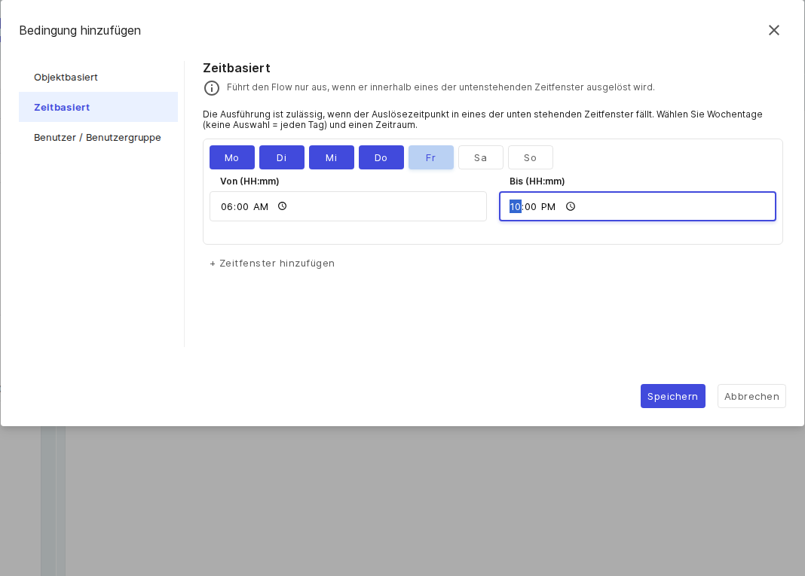

# Bedingungen

Bedingungen schränken ein, wann ein Flow läuft.
Sie sind optional.
Diese Seite beschreibt die drei Bedingungstypen und wie Bedingungen Buttons an Objekten beeinflussen.

!!! info
    Verfügbar ab i-doit up 3.3.0.

## So wirken Bedingungen

Alle Bedingungen eines Flows müssen erfüllt sein.
Ist eine nicht erfüllt, wird die Ausführung übersprungen.
Die Logs zeigen die übersprungene Ausführung mit dem Grund, siehe [Logs und Verlauf](logs-history.md).

Um eine Bedingung hinzuzufügen, öffnen Sie den Flow und klicken Sie auf **Bedingung hinzufügen**.

## Bedingungstypen

**Objektbasiert**

Der Flow läuft nur, wenn das Objekt des Auslösers den Regeln entspricht, die Sie unter **Einschränken auf Objekte, die übereinstimmen mit:** anlegen, zum Beispiel einem bestimmten CMDB-Status.
i-doit up prüft die Regeln am Objekt des Auslösers.

**Zeitbasiert**

Der Flow läuft nur, wenn er innerhalb eines der Zeitfenster ausgelöst wird.
Wählen Sie für jedes Fenster Wochentage und einen Zeitraum mit **Von (HH:mm)** und **Bis (HH:mm)**.
Ohne ausgewählte Wochentage gilt das Fenster für jeden Tag.
**+ Zeitfenster hinzufügen** fügt ein weiteres Fenster hinzu.

**Benutzer / Benutzergruppe**

Der Flow läuft nur, wenn ihn einer der ausgewählten Benutzer oder ein Mitglied einer der ausgewählten Benutzergruppen auslöst.

Nur ein Button-Auslöser hat einen auslösenden Benutzer.
Bei zeitbasierten Auslösern, Objektereignissen und Kategorieereignissen hat diese Bedingung keinen Benutzer zum Prüfen, deshalb wird die Ausführung übersprungen.

## Bedingungen und Buttons

Bei Flows mit Button-Auslöser wirken Bedingungen auch auf den Button am Objekt:

- **Benutzer / Benutzergruppe**: Benutzer, die die Bedingung nie zulässt, sehen den Button nicht.
- **Objektbasiert** und **Zeitbasiert**: Der Button ist sichtbar, aber deaktiviert, solange die Bedingung nicht erfüllt ist.
  Ein Tooltip nennt den Grund, zum Beispiel "Die zeitbasierte Bedingung ist nicht erfüllt, um diesen Flow auszuführen.".

Beim Klick auf den Button werden alle Bedingungen erneut geprüft.

## Weiterführende Informationen

-   [Auslöser](triggers.md)
-   [Aktionen und Platzhalter](actions.md)
