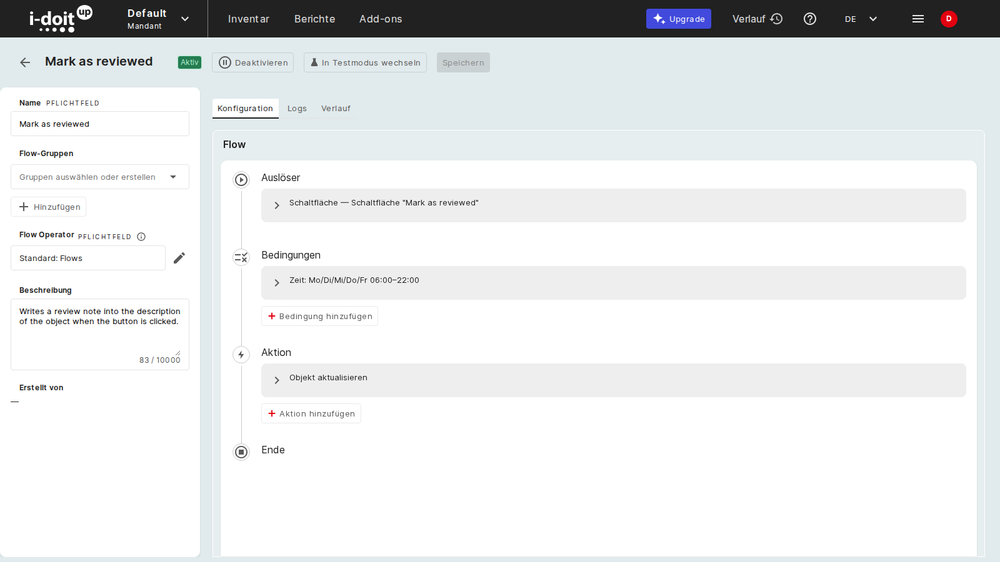
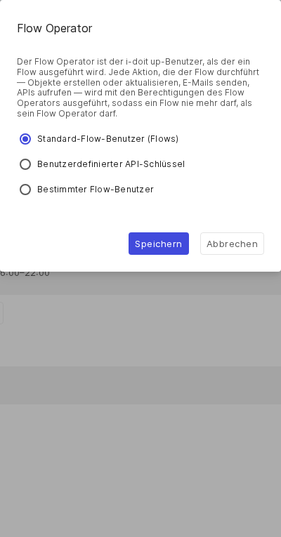

# Flows erstellen und bearbeiten

Diese Seite beschreibt, wie Sie einen Flow erstellen, wie die Flow-Ansicht aufgebaut ist und wie Sie einen Flow zwischen den Zuständen **Aktiv**, **Testmodus** und **Inaktiv** wechseln.
Die Teile eines Flows beschreiben [Auslöser](triggers.md), [Bedingungen](conditions.md) und [Aktionen und Platzhalter](actions.md).

!!! info
    Verfügbar ab i-doit up 3.3.0.

## Einen Flow erstellen

1. Klicken Sie in der Übersicht auf **Flow hinzufügen**.
2. Geben Sie einen **Name** ein.
    **Beschreibung** (bis zu 10.000 Zeichen) und **Flow-Gruppen** sind optional.
3. Fügen Sie mit **Auslöser hinzufügen** einen Auslöser hinzu, optional mit **Bedingung hinzufügen** Bedingungen und mit **Aktion hinzufügen** eine oder mehrere Aktionen.
    Jeder dieser Buttons öffnet einen Dialog mit den verfügbaren Typen links und dem Formular rechts.
4. Klicken Sie auf **Speichern**.

Sie können auch einen Flow speichern, der noch nicht fertig ist.
Er wird als **Inaktiv** gespeichert.
Pflichtfelder werden beim Klick auf **Speichern** geprüft: Ein leeres Pflichtfeld wird rot umrandet und mit einem kurzen Hinweis markiert.

Wenn Sie einen inaktiven Flow mit Auslöser und mindestens einer Aktion speichern, fragt ein Dialog, wie es weitergeht: **Jetzt aktivieren**, **Testen** oder den Flow inaktiv lassen.

Ein neuer Flow läuft als **Standard-Flow-Benutzer**.
Wie Sie das ändern, steht unter [Flow Operator](#flow-operator).

## Die Flow-Ansicht

**Öffnen** in der Übersicht und **Bearbeiten** im Menü **Weitere Aktionen** öffnen dieselbe Ansicht.
Eine eigene Bearbeitungsseite gibt es nicht.

- Links stehen die Einstellungen des Flows: **Name**, **Flow-Gruppen**, **Beschreibung**, **Flow Operator** und **Erstellt von**.
- Oben stehen der Status des Flows und die Buttons, um ihn zu ändern.
- Rechts stehen die Reiter **Konfiguration**, **Logs** und **Verlauf**.
    **Konfiguration** zeigt den Flow als **Auslöser → Bedingungen → Aktion → Ende**.
    **Logs** und **Verlauf** zeigen nur die Ausführungen und Änderungen dieses Flows, siehe [Logs und Verlauf](logs-history.md).

Jeder Auslöser, jede Bedingung und jede Aktion erscheint als Karte.
Ein Klick auf den Kopf der Karte klappt sie auf und zeigt alle Details.
Wenn Sie mit der Maus über eine Karte fahren, erscheinen **Bearbeiten** und **Entfernen**.

## Änderungen speichern

Nichts wird automatisch gespeichert.
Alle Änderungen in der Flow-Ansicht, auch das Entfernen eines Auslösers, einer Bedingung oder einer Aktion, bleiben offen, bis Sie oben auf **Speichern** klicken.
**Speichern** ist nur aktiv, wenn sich etwas geändert hat.

Wenn Sie den Flow mit ungespeicherten Änderungen verlassen, fragt i-doit up nach: **Trotzdem verlassen** oder **Weiter bearbeiten**.
Dasselbe gilt, wenn Sie einen Dialog schließen, in dem Sie etwas geändert haben.

Wenn Sie aus einem aktiven Flow oder einem Flow im Testmodus den Auslöser oder die letzte Aktion entfernen und speichern, wird der Flow auf **Inaktiv** gesetzt.
Ein Hinweis informiert Sie darüber.

## Flow Operator

Der Flow Operator ist der Benutzer, als der ein Flow läuft.
Die Aktionen des Flows nutzen die Berechtigungen dieses Benutzers.
Um ihn zu ändern, klicken Sie auf den Bearbeiten-Button neben **Flow Operator** und wählen Sie eine dieser Optionen:

- **Standard-Flow-Benutzer**: der Servicebenutzer "Flows", den das Add-on automatisch anlegt.
    Neue Flows nutzen diese Option.
- **Bestimmter Flow-Benutzer**: ein Benutzer aus der Liste der Flow-Benutzer.
    Diese Option braucht das Recht **Select Flow Operator**.
- **Benutzerdefinierter API-Schlüssel**: Der Flow nutzt einen API-Schlüssel, den Sie eingeben.
    Diese Option braucht das Recht **Select Flow Operator** und steht erst zur Verfügung, wenn der Flow gespeichert ist.
    Der Schlüssel wird verschlüsselt gespeichert und nicht wieder angezeigt.
    Ein benutzerdefinierter API-Schlüssel hat Vorrang vor dem Flow-Benutzer.

Änderungen in diesem Dialog wirken erst, wenn Sie auf **Speichern** klicken.
Flow-Benutzer und Rechte beschreibt [Rechte und Flow-Benutzer](../../admin/flows/rights.md).

## Einen Flow aktivieren

Ein Flow läuft nur, wenn er **Aktiv** ist.
Um ihn zu aktivieren, klicken Sie in der Übersicht oder in der Flow-Ansicht auf **Aktivieren** oder nach dem Speichern im Dialog auf **Jetzt aktivieren**.
i-doit up fragt nach (**Flow aktivieren?**), weil ein aktiver Flow seine Aktionen ausführt, sobald sein Auslöser auslöst.

**Aktivieren** steht nur zur Verfügung, wenn der Flow einen Auslöser und mindestens eine Aktion hat.
Beim Aktivieren in der Flow-Ansicht werden offene Änderungen mitgespeichert.

Um einen Flow abzuschalten, klicken Sie auf **Deaktivieren** und bestätigen Sie **Flow deaktivieren?**.

## Testmodus

Mit dem Testmodus prüfen Sie einen Flow, ohne Daten zu ändern.
Solange ein Flow im Testmodus ist:

- löst sein Auslöser wie gewohnt aus,
- werden seine Bedingungen wie gewohnt geprüft,
- werden seine Aktionen nur simuliert: Nichts wird erstellt, aktualisiert, eingestuft, gesendet oder aufgerufen,
- wird jede Ausführung mit einer Beschreibung dessen, was passiert wäre, in die Logs geschrieben, zum Beispiel "Would create object …".
    Diese Beschreibung ist auch in der deutschen Oberfläche englisch.

Um einen Flow in den Testmodus zu versetzen, wählen Sie bei einem aktiven oder inaktiven Flow im Menü **Weitere Aktionen** den Eintrag **In Testmodus wechseln** oder nach dem Speichern im Dialog **Testen** und bestätigen Sie **Flow in Testmodus versetzen?**.
Aus dem Testmodus heraus können Sie den Flow aktivieren oder deaktivieren.

## Weiterführende Informationen

-   [Flows](../flows.md)
-   [Auslöser](triggers.md)
-   [Logs und Verlauf](logs-history.md)
