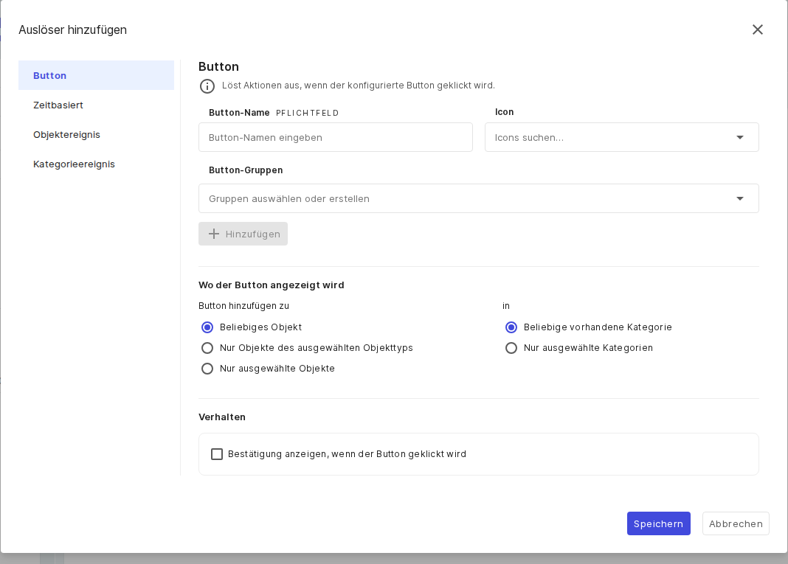
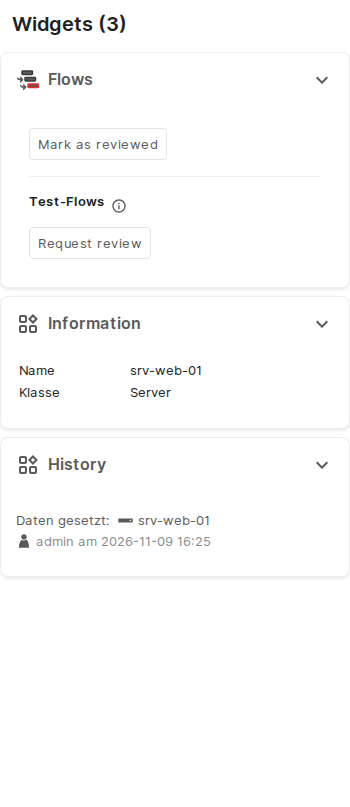
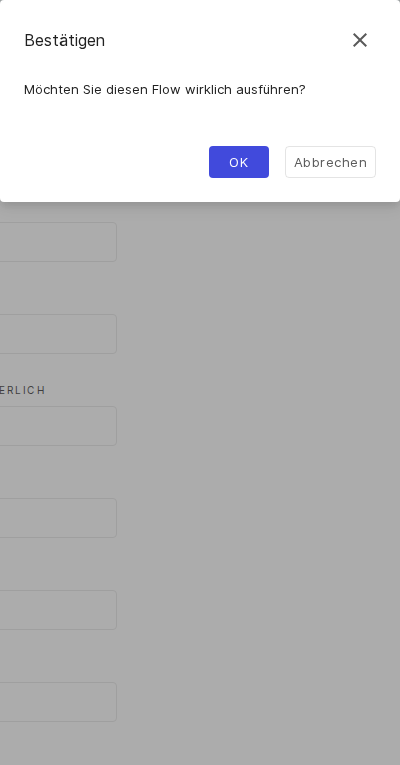
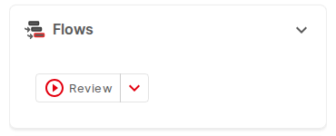

# Auslöser

Der Auslöser entscheidet, wann ein Flow startet.
Jeder Flow hat genau einen Auslöser.
Diese Seite beschreibt die vier Auslösertypen und wie Buttons an Objekten erscheinen.

!!! info
    Verfügbar ab i-doit up 3.3.0.

## Auslösertypen

| Auslöser | Der Flow startet, wenn … |
| --- | --- |
| **Button** | ein Benutzer an einem Objekt auf den Button des Flows klickt. |
| **Zeitbasiert** | das eingestellte Datum und die Uhrzeit erreicht sind, einmal oder wiederholt. |
| **Objektereignis** | ein Objekt erstellt, aktualisiert, gelöscht, archiviert oder wiederhergestellt wird. |
| **Kategorieereignis** | ein Kategorieeintrag erstellt, aktualisiert oder gelöscht wird. |

Der Auslösertyp **Button** heißt im Auslöser-Dialog "Button", in der Übersicht und in der Flow-Ansicht "Schaltfläche".

Um einen Auslöser hinzuzufügen, öffnen Sie den Flow und klicken Sie auf **Auslöser hinzufügen**.
Wählen Sie links den Typ und füllen Sie rechts das Formular aus.

## Button

Ein Button-Auslöser fügt Objekten einen Button hinzu.
Ein Benutzer klickt auf den Button, um den Flow für dieses Objekt auszuführen.

- **Button-Name**: die Beschriftung, die Benutzer sehen.
- **Icon**: optional.
  Suchen Sie nach dem Namen.
  Die Liste enthält allgemeine Icons und die Icons der Objekttypen.
- **Button-Gruppen**: optional, siehe [Button-Gruppen](#button-gruppen).
- **Button hinzufügen zu**: wo der Button erscheint.
    - **Beliebiges Objekt**: an jedem Objekt.
    - **Nur Objekte des ausgewählten Objekttyps**: nur an Objekten der ausgewählten Objekttypen.
    - **Nur ausgewählte Objekte**: nur an den ausgewählten Objekten.
      Wählen Sie sie unter **Objekte** oder mit **Objekte durchsuchen** aus.
- **in**: **Beliebige vorhandene Kategorie** zeigt den Button überall, **Nur ausgewählte Kategorien** beschränkt ihn auf die ausgewählten Kategorien.
- **Bestätigung anzeigen, wenn der Button geklickt wird**: optional.
  Ist die Option eingeschaltet, erscheint vor der Ausführung ein Dialog mit **OK** und **Abbrechen**.
  Unter **Bestätigungstext (optional)** können Sie einen eigenen Text eingeben.
  Ohne eigenen Text zeigt der Dialog "Möchten Sie diesen Flow wirklich ausführen?".

Bei den beiden Optionen "Nur ..." müssen Sie mindestens einen Objekttyp oder ein Objekt auswählen.

### Das Flows-Widget am Objekt

Buttons aktiver Flows und von Flows im Testmodus erscheinen im Widget **Flows** im Widget-Bereich eines Objekts.
Buttons inaktiver Flows erscheinen nicht.

- Buttons aktiver Flows stehen oben.
- Buttons von Flows im Testmodus stehen unter einer Trennlinie mit der Überschrift **Test-Flows**.
  Ein Klick auf einen solchen Button führt den Flow im Testmodus aus: Er zeigt, was der Flow tun würde, ohne Daten zu ändern.

Nach dem Klick zeigt eine Meldung unten links auf der Seite das Ergebnis, zum Beispiel dass ein Objekt aktualisiert wurde.

Ist der Widget-Bereich ausgeblendet, blenden Sie ihn über den Widget-Schalter der Objektansicht ein.
Erscheint das Widget **Flows** gar nicht, wenden Sie sich an Ihren Administrator, siehe [Flows-Add-on](../../admin/flows.md#fehlerbehebung).

Ein Button kann auch wegen einer Bedingung des Flows deaktiviert oder ausgeblendet sein, siehe [Bedingungen](conditions.md#bedingungen-und-buttons).

### Button-Gruppen

Ein Button kann zu einer oder mehreren Button-Gruppen gehören.
Wählen Sie vorhandene Gruppen aus oder geben Sie einen neuen Namen ein und klicken Sie auf **Hinzufügen**.

Teilen sich zwei oder mehr Buttons eine Gruppe, zeigt das Widget **Flows** sie als einen Button mit dem Namen der Gruppe:

- Ein Klick auf den Gruppen-Button führt alle Flows der Gruppe aus.
- Ein Klick auf den Pfeil am Gruppen-Button zeigt die einzelnen Buttons.
  Ein Klick auf einen davon führt nur diesen Flow aus.

**Gruppen-Icon** legt das Icon des Gruppen-Buttons fest.
Das Gruppen-Icon gilt für die ganze Gruppe: Ändern oder leeren Sie es an einem Button, ändert es sich für alle Buttons der Gruppe.
Ohne Gruppen-Icon zeigt der Gruppen-Button ein Play-Icon.

## Zeitbasiert

Ein zeitbasierter Auslöser startet den Flow nach Zeitplan.

- **Datum der ersten Ausführung** und **Uhrzeit der Ausführung**: wann der Flow zum ersten Mal läuft.
- **Nicht wiederholen**: Der Flow läuft einmal.
- **Wiederholt sich alle**: Der Flow wiederholt sich alle *n* Tage, Wochen, Monate oder Jahre.
  Bei Wochen wählen Sie unter **Wiederholen an** die Wochentage.

## Objektereignis

Ein Objektereignis-Auslöser startet den Flow, wenn sich irgendwo in i-doit up ein Objekt ändert.
Wählen Sie das Ereignis: **Erstellt**, **Aktualisiert**, **Gelöscht**, **Archiviert** oder **Wiederhergestellt**.
Das Objekt des Ereignisses ist das Objekt, mit dem der Flow arbeitet.

Unter **Ereignis hinzufügen zu** wählen Sie, auf welche Objekte der Auslöser reagiert:

- **Beliebiges Objekt**
- **Nur Objekte des ausgewählten Objekttyps**
- **Nur ausgewählte Objekte**.
  Diese Option steht für **Erstellt** nicht zur Verfügung, weil das Objekt noch nicht existiert.

## Kategorieereignis

Ein Kategorieereignis-Auslöser startet den Flow, wenn ein Kategorieeintrag eines Objekts erstellt, aktualisiert oder gelöscht wird.

1. Wählen Sie unter **Ausführen, wenn ein Kategorieeintrag…** ein oder mehrere Ereignisse.
2. Wählen Sie optional **Kategorien**.
   Ohne Auswahl gilt der Auslöser für alle Kategorien.
   **Alle Kategorien** wählt alle Kategorien auf einmal.
3. Wählen Sie optional **Attribute**.
   Der Flow startet dann nur, wenn sich eines dieser Attribute geändert hat.
   Dieses Feld steht zur Verfügung, sobald Sie mindestens eine Kategorie gewählt haben.
   Für gelöschte Einträge gilt es nicht.

!!! warning "Schleifen vermeiden"
    Ein Flow, der bei einem Objekt- oder Kategorieereignis Objekte erstellt oder aktualisiert, erzeugt selbst neue Ereignisse.
    Das Add-on ignoriert die Änderung, die es gerade selbst gemacht hat, damit ein Flow sich nicht immer wieder selbst auslöst.
    Planen Sie solche Flows trotzdem sorgfältig und nutzen Sie [Bedingungen](conditions.md), damit sie nur dann handeln, wenn sie sollen.

## Wer den Flow ausgelöst hat

Die Logs zeigen, wer eine Ausführung ausgelöst hat:

- **Button**: der Benutzer, der auf den Button geklickt hat.
- **Zeitbasiert**, **Objektereignis** und **Kategorieereignis**: kein Benutzer ("-").

Das ist wichtig für die Bedingung **Benutzer / Benutzergruppe**, siehe [Bedingungen](conditions.md).

## Weiterführende Informationen

-   [Bedingungen](conditions.md)
-   [Aktionen und Platzhalter](actions.md)
-   [Logs und Verlauf](logs-history.md)
