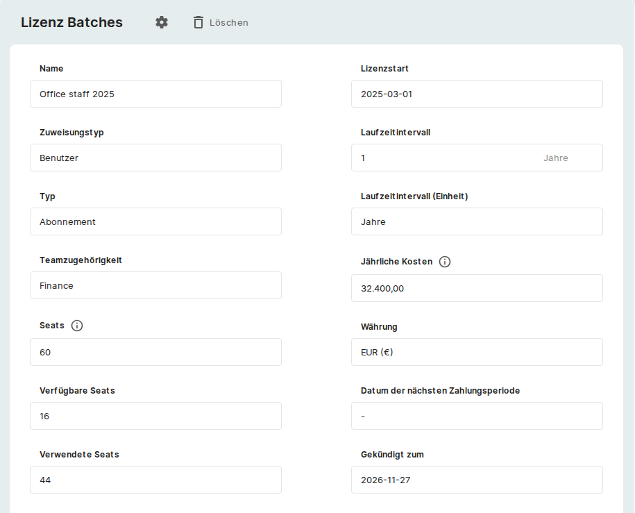
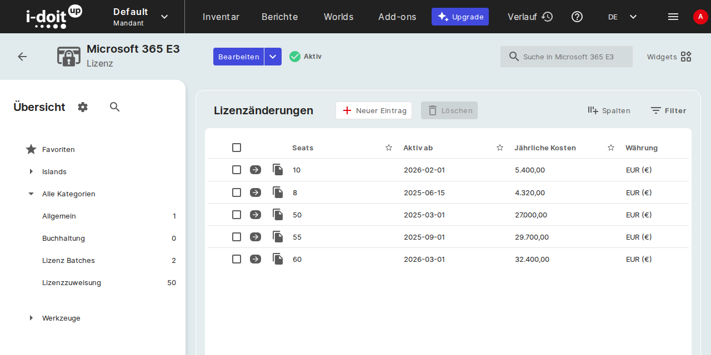
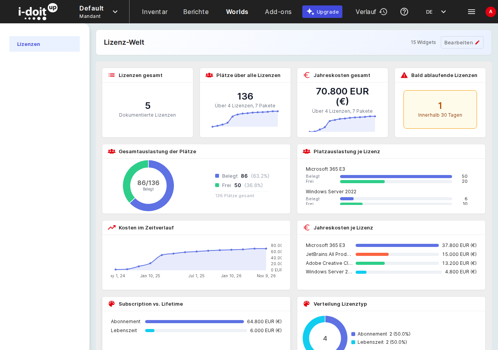
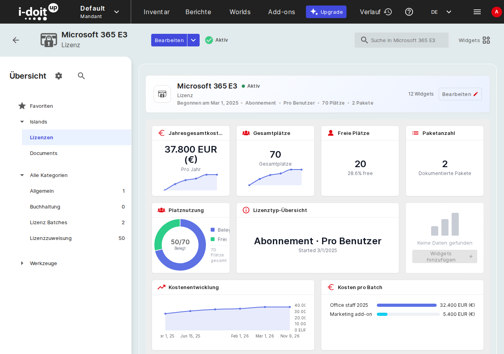
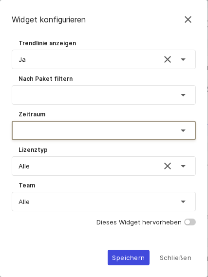
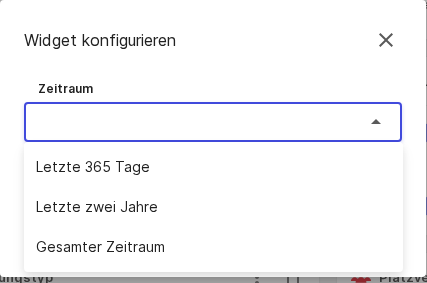

# Lizenz-Welt und Lizenz-Insel

Die **Lizenz-Welt** gibt Ihnen einen Überblick über alle Lizenzen Ihres Mandanten: Plätze, Kosten und anstehende Termine.
Die **Lizenz-Insel** zeigt dieselbe Art von Informationen für ein einzelnes Lizenzobjekt.

Wie Sie beide öffnen, das Layout bearbeiten und Widgets hinzufügen oder entfernen, beschreibt [Welten und Inseln](worlds-and-islands.md).
Um sie zu sehen, brauchen Sie die Rechte **Zugriff auf alle Welten** und **Zugriff auf alle Inseln**, siehe [Rechte für Welten und Inseln](../admin/rights-and-permissions.md#rechte-fur-welten-und-inseln).

## Daten, die die Widgets nutzen

Die Widgets lesen die folgenden Daten Ihrer Lizenzobjekte.

### Klasse und Batches

Eine Lizenz ist ein Objekt der Klasse **Lizenz**.
Jede Lizenz hat einen oder mehrere Batches in der Kategorie **Lizenz Batches**.
Ein Batch beschreibt einen Kauf, zum Beispiel 60 Plätze für ein Jahr.

| Feld | Bedeutung |
|---|---|
| Name | Name des Batches, zum Beispiel *Office staff 2025*. |
| Status | **Aktiv** oder **Inaktiv**. |
| Zuweisungstyp | **Installation** oder **Benutzer**. |
| Typ | **Abonnement** oder **Lebenszeit**. |
| Teamzugehörigkeit | Das Team, zu dem der Batch gehört. Team-Widgets und der Teamfilter nutzen dieses Feld. |
| Seats | Zahl der gekauften Plätze. |
| Verfügbare Seats, Verwendete Seats | Berechnet i-doit up, siehe unten. |
| Lizenzstart | Startdatum des Batches. |
| Laufzeitintervall, Laufzeitintervall (Einheit) | Dauer einer Zahlungsperiode, zum Beispiel 1 Jahre. |
| Jährliche Kosten, Währung | Kosten des Batches pro Jahr. |
| Datum der nächsten Zahlungsperiode | Datum der nächsten Zahlung. Sie tragen es selbst ein. |
| Gekündigt zum | Datum, an dem der Batch endet. |

**Verwendete Seats** ist die Zahl der Einträge in der Kategorie **Lizenzzuweisung**, die auf diesen Batch zeigen.
Diese Einträge legen Sie bei den Objekten an, die die Lizenz nutzen.
**Verfügbare Seats** ist **Seats** minus **Verwendete Seats**.

Eine Lizenz ohne Batches zählt bei **Lizenzen gesamt** mit, aber nicht bei den Batch-Zahlen.

### Verlauf von Kosten und Plätzen

Die Kategorie **Lizenzänderungen** eines Lizenzobjekts speichert den Verlauf von Plätzen und Kosten.
i-doit up legt automatisch einen Eintrag an, wenn Sie einen Batch ändern.
Um selbst einen Eintrag anzulegen, klicken Sie auf **Neuer Eintrag** und geben Seats, das Startdatum, **Jährliche Kosten** und **Währung** ein.
Die Widgets **Kosten im Zeitverlauf** und **Kostenentwicklung** zeichnen ihre Kurven aus diesem Verlauf.

## Lizenz-Welt

Öffnen Sie in der oberen Navigation **Worlds** und klicken Sie in der linken Seitenleiste auf **Lizenzen**.
Die Seite trägt den Titel **Lizenz-Welt**.

Die Lizenz-Welt nutzt alle Objekte aller Klassen, die die Kategorie **Lizenz Batches** haben.

Das Standardlayout enthält diese 15 Widgets.
Die Spalte "Englische Oberfläche" nennt den Titel in der englischen Oberfläche.

| Widget | Englische Oberfläche | Zeigt | Standardgröße |
|---|---|---|---|
| Lizenzen gesamt | Total licenses | Zahl der Lizenzobjekte | klein |
| Plätze über alle Lizenzen | Total seats across all licenses | Summe aller Plätze, mit der Zahl der Lizenzen und Batches | klein |
| Jahreskosten gesamt | Total yearly cost | Summe der jährlichen Kosten | klein |
| Bald ablaufende Lizenzen | Licenses expiring soon | Batches, die in den nächsten 30 Tagen enden | klein |
| Gesamtauslastung der Plätze | Overall seat utilization | Belegte und freie Plätze über alle Lizenzen | mittel |
| Platzauslastung je Lizenz | Seat utilization per license | Belegte und freie Plätze je Lizenz | mittel |
| Kosten im Zeitverlauf | Cost over time | Kostenverlauf über alle Lizenzen | mittel |
| Jahreskosten je Lizenz | Yearly cost per license | Jährliche Kosten je Lizenz | mittel |
| Subscription vs. Lifetime | Subscription vs lifetime cost | Kosten nach Lizenztyp | mittel |
| Verteilung Lizenztyp | License type distribution | Zahl der Abonnement- und Lebenszeit-Lizenzen | mittel |
| Verteilung Zuordnungstyp | Assignment type distribution | Pro Installation im Vergleich zu pro Nutzer | mittel |
| Platzverteilung je Team | Seat distribution per team | Plätze je Team | mittel |
| Kostenverteilung je Team | Cost distribution per team | Kosten je Team | mittel |
| Bevorstehende Zahlungen | Upcoming payments | Nächste Zahlungstermine | mittel |
| Bevorstehende Kündigungen | Upcoming terminations | Nächste Kündigungstermine | mittel |

## Lizenz-Insel

Öffnen Sie ein Objekt der Klasse **Lizenz** und klicken Sie in der linken Seitenleiste in der Gruppe **Islands** auf **Lizenzen**.
Der Kopf zeigt Name und Status der Lizenz, ihre Klasse und eine Zusammenfassung, zum Beispiel *Begonnen am Mar 1, 2025 · Abonnement · Pro Benutzer · 70 Plätze · 2 Pakete*.

Die Lizenz-Insel nutzt das geöffnete Lizenzobjekt und seine Batches.

Das Standardlayout enthält diese 12 Widgets.

| Widget | Englische Oberfläche | Zeigt | Standardgröße |
|---|---|---|---|
| Platznutzung | Seat usage | Belegte und freie Plätze | klein |
| Sitzplätze pro Batch | Seat Number per Batch | Belegte und freie Plätze je Batch | mittel |
| Gesamtplätze | Total seats | Summe der Plätze aller Batches | klein |
| Freie Plätze | Free seats | Nicht zugewiesene Plätze mit dem Anteil freier Plätze, zum Beispiel *28.6% free* (auch in der deutschen Oberfläche englisch) | klein |
| Jahresgesamtkosten | Total yearly cost | Summe der jährlichen Kosten | klein |
| Kosten pro Batch | Cost per Batch | Jährliche Kosten je Batch | mittel |
| Platznutzung pro Team | Seat usage per team | Plätze je Team | mittel |
| Lizenztyp-Übersicht | License type overview | Lizenztyp und Zuordnungstyp mit Startdatum, zum Beispiel *Abonnement · Pro Benutzer*; bei unterschiedlichen Batches *Mixed across batches* | mittel |
| Bevorstehende Zahlungstermine | Upcoming payment dates | Nächste Zahlungstermine | mittel |
| Bevorstehende Kündigungen | Upcoming terminations | Nächste Kündigungstermine | mittel |
| Kostenentwicklung | Cost Trend | Kostenverlauf der Lizenz | mittel |
| Paketanzahl | Batch count | Zahl der Batches | klein |

Ein leeres Feld im Raster zeigt **Keine Daten gefunden** und den Knopf **Widgets hinzufügen**.
Es markiert freien Platz für ein weiteres Widget.

## Terminlisten

Die Widgets mit bevorstehenden Zahlungen und Kündigungen listen die nächsten Termine:

- Termine innerhalb von 30 Tagen erscheinen rot,
- Termine innerhalb von 60 Tagen erscheinen gelb,
- Kündigungen in der Vergangenheit erscheinen nicht.

## Filter

Viele Widgets haben Filter.
Sie setzen sie je Widget im Dialog **Widget konfigurieren** (im Bearbeitungsmodus, Menü des Widgets, **Konfigurieren**).
Ein Filter gilt nur für dieses Widget und wird mit Ihrem persönlichen Layout gespeichert.

| Filter | Optionen |
|---|---|
| Zeitraum | **Letzte 365 Tage**, **Letzte zwei Jahre**, **Gesamter Zeitraum**. Standardmäßig ist keine Option gewählt. |
| Team | Ein oder mehrere Teams aus dem Feld **Teamzugehörigkeit** der Batches. Standard: alle Teams. |
| Lizenztyp | **Alle**, **Subscription**, **Lifetime**. |
| Zuordnungstyp | **Alle**, **Pro Installation**, **Pro Nutzer**. |
| Nach Paket filtern | Batches der Lizenz. |

Welche Filter ein Widget anbietet, hängt vom Widget ab, zum Beispiel:

- **Gesamtauslastung der Plätze**: Zuordnungstyp, Lizenztyp, Team.
- **Kosten im Zeitverlauf**: Nach Paket filtern, Zeitraum, Lizenztyp, Team.
- **Bevorstehende Zahlungen** und **Bevorstehende Kündigungen**: nur Zeitraum.

Bei **Bevorstehende Zahlungen** und **Bevorstehende Kündigungen** zählt der Zeitraum ab heute nach vorn.
**Letzte 365 Tage** zeigt die Termine der nächsten 365 Tage.

## Siehe auch

- [Welten und Inseln](worlds-and-islands.md)
- [Rechte für Welten und Inseln](../admin/rights-and-permissions.md#rechte-fur-welten-und-inseln)
- [Kategorien und Attribute](basics/categories-and-attributes.md)
