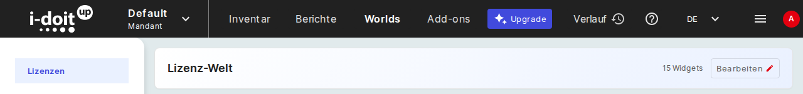
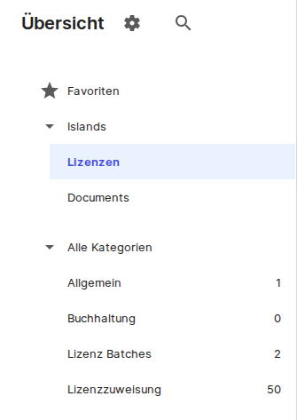
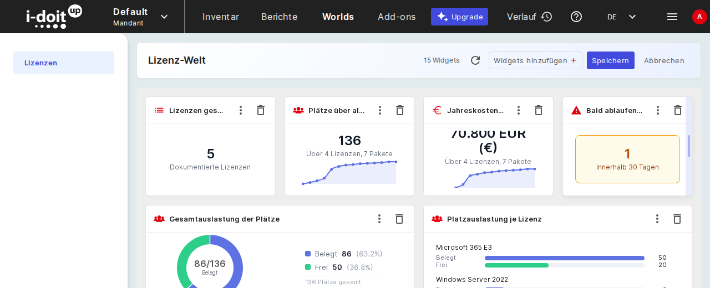
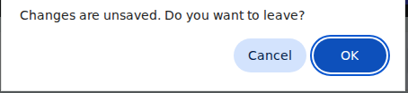
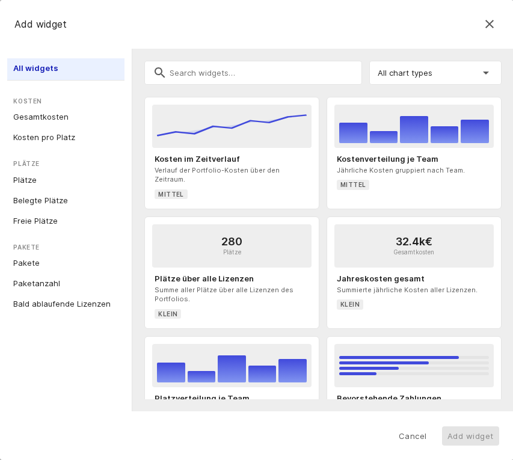
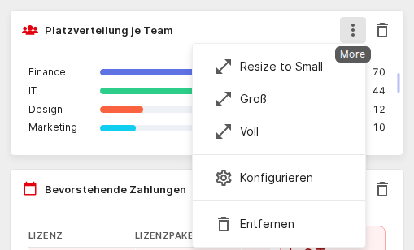
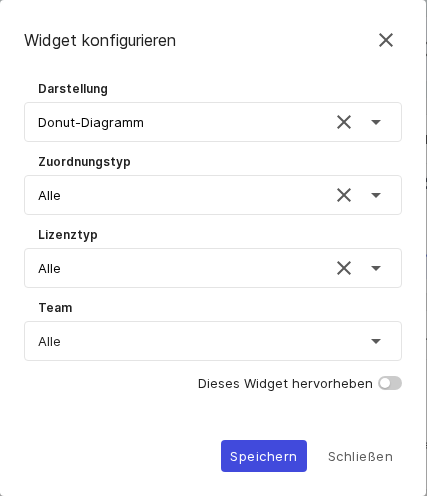
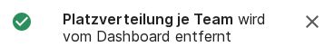

# Welten und Inseln

Welten und Inseln (Worlds and Islands) sind Dashboards mit Widgets, die Ihre Dokumentation zusammenfassen.

- Eine **Welt** sammelt Daten über alle Objekte eines Themas, zum Beispiel über alle Lizenzen Ihres Mandanten.
    Sie öffnen sie über die obere Navigation.
- Eine **Insel** ist ein Dashboard innerhalb eines einzelnen Objekts.
    Sie gehört zu einer oder mehreren Klassen und zeigt Daten des geöffneten Objekts.

In der deutschen Oberfläche heißen der Menüpunkt und die Gruppe derzeit noch englisch: **Worlds** und **Islands**.

i-doit up 3.3.0 bringt eine Welt und eine Insel mit, beide zum Thema Lizenzen.
Ihre Widgets und die Daten, die sie brauchen, beschreibt [Lizenz-Welt und Lizenz-Insel](license-world-and-island.md).
Add-ons können weitere Inseln hinzufügen, zum Beispiel die Insel **Documents** des DMS-Add-ons.

## Voraussetzungen

Welten und Inseln sind durch zwei Rechte geschützt: **Zugriff auf alle Welten** und **Zugriff auf alle Inseln**.
i-doit up vergibt diese Rechte nicht automatisch, auch nicht an den Administrator.
Ohne die Rechte erscheinen der Menüpunkt **Worlds** und die Gruppe **Islands** überhaupt nicht.

Bitten Sie Ihren Administrator, Ihnen die Rechte zu geben, oder vergeben Sie sie selbst, wenn Sie Rechte verwalten.
Siehe [Rechte für Welten und Inseln](../admin/rights-and-permissions.md#rechte-fur-welten-und-inseln).
Die Änderung wirkt, sobald Sie die Seite neu laden.

## Eine Welt öffnen

1. Klicken Sie in der oberen Navigation auf **Worlds**.
    i-doit up öffnet die erste Welt, auf die Sie Zugriff haben.
2. Wählen Sie in der linken Seitenleiste eine Welt, zum Beispiel **Lizenzen**.

Die Adresse einer Welt hat die Form `/worlds/<welt>/<ansicht>`, für die Lizenz-Welt `/worlds/license-world/license`.

## Eine Insel öffnen

1. Öffnen Sie ein Objekt, zum Beispiel ein Objekt der Klasse **Lizenz**.
2. Öffnen Sie in der linken Seitenleiste des Objekts die Gruppe **Islands**.
3. Klicken Sie auf die Insel, zum Beispiel **Lizenzen**.

Die Gruppe **Islands** zeigt nur die Inseln, die zur Klasse des Objekts gehören.
Die Lizenz-Insel erscheint nur bei Objekten der Klasse **Lizenz**.

## Mit dem Dashboard arbeiten

Eine Welt oder Insel öffnet sich in der **Ansicht**.
Der Kopf zeigt den Titel, die Zahl der Widgets und den Knopf **Bearbeiten**.
Klicken Sie auf **Bearbeiten**, um in den **Bearbeitungsmodus** zu wechseln.

Im Bearbeitungsmodus können Sie:

- Widgets an eine neue Position ziehen,
- die Größe eines Widgets ändern,
- mit **Widgets hinzufügen** Widgets hinzufügen,
- Widgets mit dem Papierkorb oder dem Menüeintrag **Entfernen** entfernen,
- das Layout mit dem runden Pfeil (**Standardlayout wiederherstellen**) zurücksetzen.

Änderungen im Bearbeitungsmodus bleiben offen, bis Sie auf **Speichern** klicken.
**Abbrechen** verwirft sie.
Nach dem Speichern meldet i-doit up "Dashboard wurde erfolgreich gespeichert".

Wenn Sie die Seite mit ungespeicherten Änderungen verlassen wollen, fragt Ihr Browser "Changes are unsaved. Do you want to leave?" (auch in der deutschen Oberfläche englisch).
Klicken Sie auf **Cancel** (oder **Abbrechen**, je nach Browser), um auf der Seite zu bleiben, und speichern Sie dann.

### Widgets hinzufügen

1. Klicken Sie auf **Bearbeiten**.
2. Klicken Sie auf **Widgets hinzufügen**.
3. Im Fenster **Add widget** finden Sie die Widgets links nach Themen sortiert, oder Sie suchen nach einem Widget.
    Mit **All chart types** zeigen Sie nur eine Diagrammart an.
4. Wählen Sie ein Widget und klicken Sie auf **Add widget**.

Das Fenster ist in der deutschen Oberfläche teilweise noch englisch beschriftet.
Jedes Widget zeigt eine Größenangabe (zum Beispiel **KLEIN** oder **MITTEL**).
Fahren Sie mit der Maus darüber, erscheint der Hinweis "Empfohlene Größe. Jederzeit anpassbar.".

### Die Größe eines Widgets ändern

Widgets gibt es in vier festen Größen: klein, mittel, groß und volle Breite.
Öffnen Sie im Bearbeitungsmodus das Menü eines Widgets (drei Punkte) und wählen Sie eine der angebotenen Größen, zum Beispiel **Groß** oder **Voll**.
Der Eintrag für die kleine Größe heißt auch in der deutschen Oberfläche **Resize to Small**.
Sie können auch den Griff zur Größenänderung des Widgets ziehen.
Ein Doppelklick auf den Griff lässt das Widget den freien Platz daneben füllen.

### Ein Widget konfigurieren

Öffnen Sie im Bearbeitungsmodus das Menü eines Widgets und klicken Sie auf **Konfigurieren**.
Der Dialog **Widget konfigurieren** zeigt nur die Einstellungen, die zum Widget passen, zum Beispiel:

- **Darstellung**: die Art des Diagramms, zum Beispiel **Donut-Diagramm**.
- **Trendlinie anzeigen**: ergänzt eine Trendlinie in einem Zeitverlauf.
- Filter wie **Zeitraum**, **Team**, **Lizenztyp** oder **Zuordnungstyp**.
    Siehe [Filter](license-world-and-island.md#filter).
- **Dieses Widget hervorheben**: hebt das Widget auf dem Dashboard hervor.

Schließen Sie den Dialog über das X oben rechts.
Die Einstellungen in diesem Dialog werden sofort gespeichert, **Speichern** ist dafür nicht nötig.

### Ein Widget entfernen

Klicken Sie im Bearbeitungsmodus auf den Papierkorb des Widgets oder auf den Menüeintrag **Entfernen**.
Ein Hinweis meldet, dass das Widget vom Dashboard entfernt wird.
Entfernt wird es, wenn Sie auf **Speichern** klicken.
Um es zu behalten, klicken Sie stattdessen auf **Abbrechen**.

### Das Standardlayout wiederherstellen

Klicken Sie im Bearbeitungsmodus auf den runden Pfeil neben der Widget-Zahl (**Standardlayout wiederherstellen**).
Das Dashboard kehrt zu dem Layout zurück, das i-doit up mitbringt.
Klicken Sie auf **Speichern**, um das Standardlayout zu behalten, oder auf **Abbrechen**, um zu Ihrem eigenen Layout zurückzukehren.

## Ihr Layout gehört Ihnen

- Jeder Benutzer hat für jede Welt und jede Insel ein eigenes Layout.
    i-doit up speichert es auf dem Server, es gilt also auch in anderen Browsern und auf anderen Geräten.
- Andere Benutzer sehen Ihre Änderungen nicht.
    Jeder Benutzer beginnt mit dem Standardlayout.
- Das Layout einer Insel gilt für alle Objekte derselben Klasse.
    Wenn Sie die Lizenz-Insel einer Lizenz ändern, sehen Sie dasselbe Layout bei jeder anderen Lizenz.

## Siehe auch

- [Lizenz-Welt und Lizenz-Insel](license-world-and-island.md)
- [Rechte für Welten und Inseln](../admin/rights-and-permissions.md#rechte-fur-welten-und-inseln)
- [Objekte](basics/objects.md)
