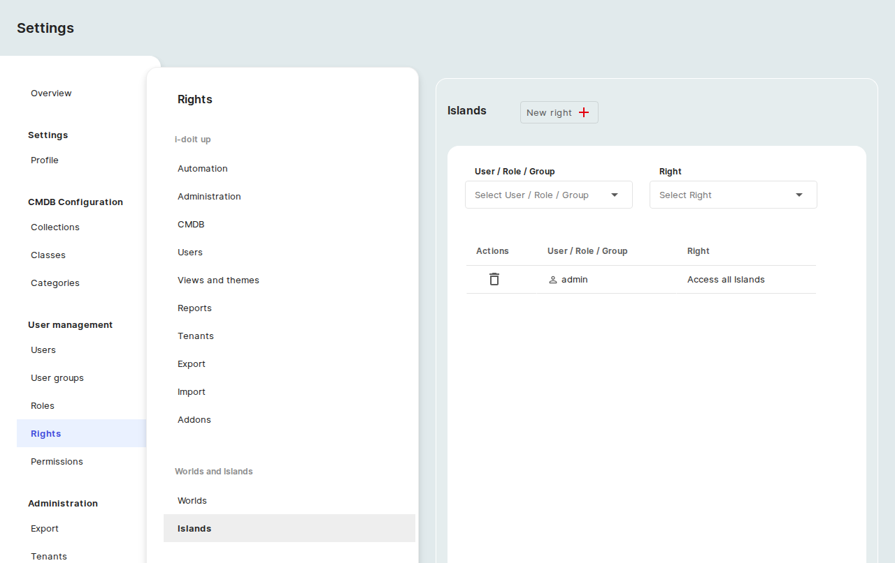

# DMS integration

The DMS add-on connects i-doit up with the document management system (DMS).
It embeds the DMS in i-doit up, adds a documents island and a documents widget to the object page, and signs i-doit up users in to the DMS without a separate login.
This page describes how the add-on works, what it needs, how to configure and register it, and what to check when it does not work.
For the user view, see [Documents (DMS)](../user/dms.md).

!!! info
    Available as of i-doit up 3.3.0.

## How the integration works

The integration is an external i-doit up add-on with the vendor `synetics` and the ID `dms`.
It consists of an add-on service that runs next to the DMS and a user interface that i-doit up loads from that service.

- i-doit up reads the add-on manifest from `<add-on URL>/addon.json` and calls the add-on when it is registered, updated, enabled, disabled, or unregistered.
- All requests from the browser go through i-doit up to the add-on under `/a/synetics/dms/`.
  The add-on delivers the DMS user interface there and forwards its API requests to the DMS.
  So the embedded DMS runs under the address of i-doit up, and the browser does not need to reach the DMS directly for the embedded views.
- When the add-on is registered, it registers the i-doit up instance with the DMS as a trusted sign-in source.
  Unregistering the add-on removes this registration, disabling the add-on blocks the sign-in.

**Sign-in**

The add-on identifies the user from the request of i-doit up and reads email, name, and tenants of the user from the i-doit up API.
It signs the user in to the DMS with a short-lived token.
The DMS creates the user on the first visit.

- Users from i-doit up get the DMS role *user*, also i-doit up administrators.
  **Manage in DMS** also signs in as this user.
- Rights from i-doit up are not transferred.
  The DMS checks access to each document itself.
- The add-on does not pass the language of the user to the DMS.

**Tenants and objects**

The DMS keeps the documents of each i-doit up instance and tenant in a separate workspace.
It creates the workspace automatically at the first sign-in from i-doit up.
An administrator who signs in to the DMS directly does not see the documents from i-doit up, see [DMS administration](dms/administration.md#administrator-account).
The views always show the tenant that is currently selected in i-doit up, as long as the user has access to it.
Documents are assigned to objects by the object ID.

## Prerequisites

The DMS add-on is available for i-doit up Cloud and On-Premises.
In i-doit up Cloud, add-on installation is handled by i-doit GmbH, see [Add-ons](addons.md#install-an-add-on).
If you run the add-on yourself, you need:

- A running DMS that you administer.
- i-doit up 3.3.0 or later, where you can register add-ons.
- i-doit up runs with HTTPS.
  Over HTTP the embedded DMS views stay empty.
- Docker and Docker Compose on the host of the add-on service.
- Network access:
    - from i-doit up to the add-on service,
    - from the add-on service to the i-doit up URL that i-doit up reports to the add-on,
    - from the add-on service to the DMS backend,
    - from the browser of the users to the public DMS address, for **Manage in DMS**.
- A MongoDB database for the add-on, for example the MongoDB of the DMS.

## Configure the add-on service

The add-on service is the container `i-doit-up-addon-backend` in the Docker Compose setup of the DMS.
It listens on port `3100` and is only exposed inside the Docker network.
Configure it with the following environment variables:

| Variable | Required | Description |
| --- | --- | --- |
| `PORT` | no | Port of the service, default `3100`. |
| `MONGODB_URI` | yes | MongoDB connection of the add-on, for example `mongodb://mongo:27017/dms_addon_i_doit_up`. |
| `IDOIT_UP_VENDOR` | no | Vendor of the add-on, default `synetics`. |
| `IDOIT_UP_ADDON_ID` | no | ID of the add-on, default `dms`. Vendor and ID form the path `/a/<vendor>/<ID>/` in i-doit up. |
| `ADDON_TITLE` | no | Title of the add-on in i-doit up, default `DMS Add-on`. |
| `ADDON_VERSION` | no | Version that the add-on reports to i-doit up. |
| `DMS_BACKEND_URL` | yes | Internal address of the DMS backend, for example `http://backend:3000`. |
| `DMS_PUBLIC_URL` | yes | Address of the DMS that the browsers of your users can reach. **Manage in DMS** opens this address. |
| `DMS_BACKEND_SERVICE_TOKEN` | yes | Personal API token (`dms_...`) of a DMS administrator. The add-on uses it to register i-doit up instances with the DMS. |
| `ADDON_SECRETS_KEY` | yes | Key that encrypts the stored registration secrets. Create it with `openssl rand -hex 32` and keep it. |
| `CORS_ORIGIN` | no | Not needed for i-doit up. Leave it empty. |

The DMS has no service accounts.
The add-on therefore acts with the token of the administrator who created it.
If this administrator loses the administrator role or deletes the token, new registrations fail.

The service offers the health checks `/health` and `/health/ready`.

If the DMS stores files on a local Docker volume, the upload volume must belong to the user and group `101:101`.
Otherwise uploads fail with *Internal server error*.

The add-on has no settings page in i-doit up.

## Register the add-on in i-doit up

1. In the DMS, create a personal API token as an administrator and enter it as `DMS_BACKEND_SERVICE_TOKEN`.
2. Start the add-on service and check that `/health` answers.
3. Register the add-on in i-doit up with the add-on URL that i-doit up can reach:

    ```bash
    docu:addons:register https://dms-addon.example.com
    ```

    i-doit up calls the add-on, and the add-on registers the instance with the DMS.

4. Open i-doit up and check that **DMS** appears in the navigation, group **Add-ons**.

### Rights for the Documents island

The island appears in the group **Islands** of the object sidebar.
Users need the island rights to see it.
Since i-doit up 3.3.0, the admin role receives **Access all Islands** automatically, on new installations and on updates.
All other roles, groups, and users need the right granted explicitly.
Without the right the island stays invisible.

1. Under **Settings** > **Rights** > **Worlds and Islands** > **Islands**, assign the right **Access all Islands** (internal keys `worlds-and-islands`, `islands`, `access-all-islands`) as described in [Rights and permissions](rights-and-permissions.md) to every role or user without the admin role.
2. Reload the page in the browser.
   The island appears without a new sign-in.

[](../img/screenshots/admin/dms/island_rights.png)

## Troubleshooting

**The DMS view or the Documents island stays empty**

Check that i-doit up runs with HTTPS.
Over HTTP the browser blocks the embedded DMS, and only the button **Manage in DMS** appears.

**The DMS view shows the error "Could not resolve the calling user"**

The add-on service cannot reach i-doit up.
It calls i-doit up under the URL that i-doit up reports, and `localhost` inside a container points to the container itself.
Make sure that this URL can be resolved and reached from the add-on container.

**The Documents island is missing**

Check the island rights, see [Rights for the Documents island](#rights-for-the-documents-island).
After assigning the right, reload the page.

**Uploads fail with "Internal server error"**

Check the owner of the upload volume of the DMS, see [Configure the add-on service](#configure-the-add-on-service).

**Manage in DMS opens a page that cannot be reached**

Check `DMS_PUBLIC_URL`.
It must be the address of the DMS as the browser of the user sees it, not the internal address.

## Known limitations

- Rights from i-doit up are not transferred to the DMS.
- Files that are attached to i-doit up objects outside the DMS are not synchronized.
- The menu entry **DMS**, the island **Documents**, and the widget **Documents** are English only.
- The assignment of a document to an object is only visible in i-doit up, not in the standalone DMS.
- The documents island and widget are available for all object classes.
- The DMS detects i-doit up instances only by the prefix `idoit-up-` of their instance ID.

## Further readings

- [Documents (DMS)](../user/dms.md)
- [DMS administration](dms/administration.md)
- [Add-ons](addons.md)
- [Rights and permissions](rights-and-permissions.md)
- [Suite+ bridge](suite-plus.md)
