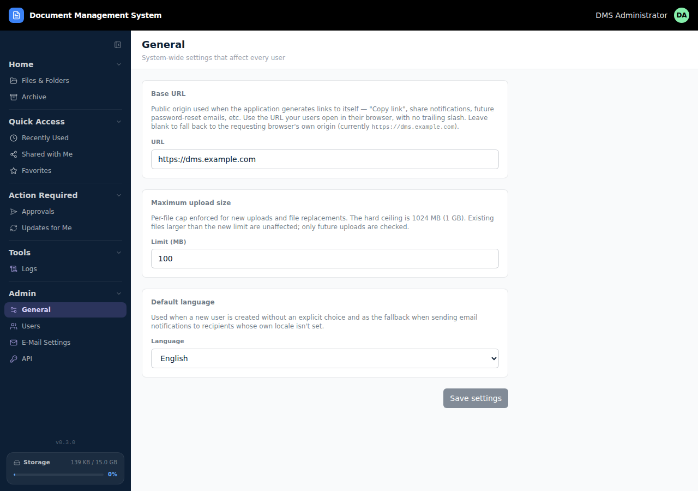
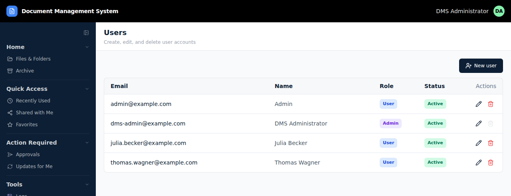

# DMS administration

This page describes the administration of the document management system (DMS) itself: the administrator account, the settings, users, email, API tokens, and storage.
How to connect the DMS with i-doit up is described in [DMS integration](../dms.md).

!!! info
    Available as of i-doit up 3.3.0.

## Administrator account

The DMS knows two roles: **Admin** and **User**.
Only users with the role **Admin** see the group **Admin** in the sidebar, with the pages **General**, **Users**, **E-Mail Settings**, and **API**.

Users who come from i-doit up always get the role **User**, also i-doit up administrators.
They do not see the group **Admin**.
So i-doit up users do not become DMS administrators.

To administer the DMS, sign in on the sign-in page of the DMS (`<DMS URL>/login`) with a local DMS administrator account.

The local administrator works in a separate workspace of the DMS.
This workspace is independent of the workspaces of your i-doit up tenants.
As a consequence:

- The local administrator does not see the documents of i-doit up users.
  The list **Files & Folders** of the administrator is empty unless the administrator creates documents there.
- In the root folder, the administrator only sees **Manage Access**, without **Upload** and **Folder**.
- **Tools** > **Logs** shows no events of i-doit up users to the local administrator.
  i-doit up users see their own events there.

## General

**Admin** > **General** contains:

| Setting | Description |
| --- | --- |
| **Base URL** | Public address of the DMS. If empty, the DMS uses the address that the browser shows. |
| **Maximum upload size** | Maximum size per file in MB, from 1 to 1024, default 100. |
| **Default language** | Default language of the DMS interface, English or Deutsch. |

The upload dialog shows the limit in decimal megabytes.
With the default of 100, users see **Up to 104.9 MB per file**.
Files above the limit are rejected with the message *File exceeds the configured upload limit*.

An approval can have up to 10 approvers.
This value cannot be changed in the user interface.

## Users

**Admin** > **Users** lists all DMS users with name, email address, role, and status.

- Users cannot register themselves.
  Local DMS users are created here by an administrator.
- Users from i-doit up are created automatically when they open the DMS from i-doit up for the first time.
  They also appear in this list.
- Each user has the role **User** or **Admin** and can be set to inactive with the flag **Active**.
- You can edit and delete users.
  You cannot delete your own account or change your own role.

## E-Mail Settings

The DMS sends emails when a document is shared, when an approver has to decide, and when an approval is completed.
For this, configure an SMTP server under **Admin** > **E-Mail Settings**:

| Field | Description |
| --- | --- |
| Host and port | SMTP server |
| Encryption | **STARTTLS** (port 587), **SSL/TLS** (port 465), or **None** |
| Username and password | Credentials for the SMTP server |
| From name and from email | Sender of the emails |
| Reply-to | Optional reply address |

Use **Send test** to check the settings.

## API tokens

**Admin** > **API** manages personal API tokens of the administrator.

1. Enter a name for the token.
2. Select when it expires: **Never**, **In 30 days**, **In 90 days**, or **In 1 year**.
3. Click **Create** and copy the token.
   The DMS shows the complete token only once.

The list shows name, prefix, creation date, last use, and expiry of each token.
**Revoke** makes a token invalid.
The link **Swagger documentation** opens the description of the DMS API.

The DMS add-on for i-doit up needs such a token, see [Configure the add-on service](../dms.md#configure-the-add-on-service).

## Storage and deleted documents

The sidebar of the DMS shows the used and the available storage under **Storage**.

In the Docker Compose setup of the DMS, files are stored on the local upload volume (`STORAGE_PROVIDER=local`).
The volume must belong to the user and group `101:101`, see [Configure the add-on service](../dms.md#configure-the-add-on-service).

Deleted documents are kept for a retention period and then removed permanently.
The DMS runs this cleanup every day at 03:00.
Set the retention period in days with the environment variable `DOC_PURGE_AFTER_DAYS` of the DMS backend.
The default is `30`.
The user interface has no trash, so users cannot restore deleted documents themselves.

## Health checks

The DMS backend offers the health checks `/health` and `/health/ready`.

## Further readings

- [DMS integration](../dms.md)
- [Working with the DMS](../../user/dms/basics.md)
- [Documents (DMS)](../../user/dms.md)
