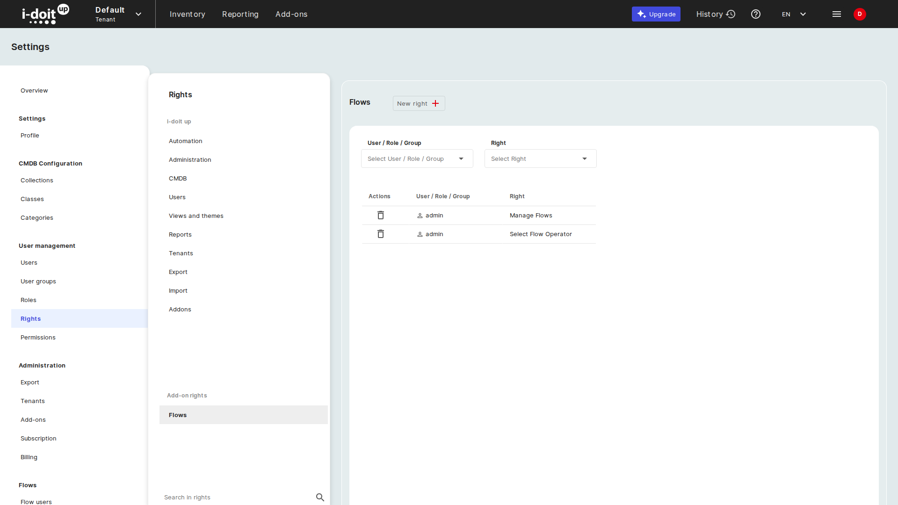
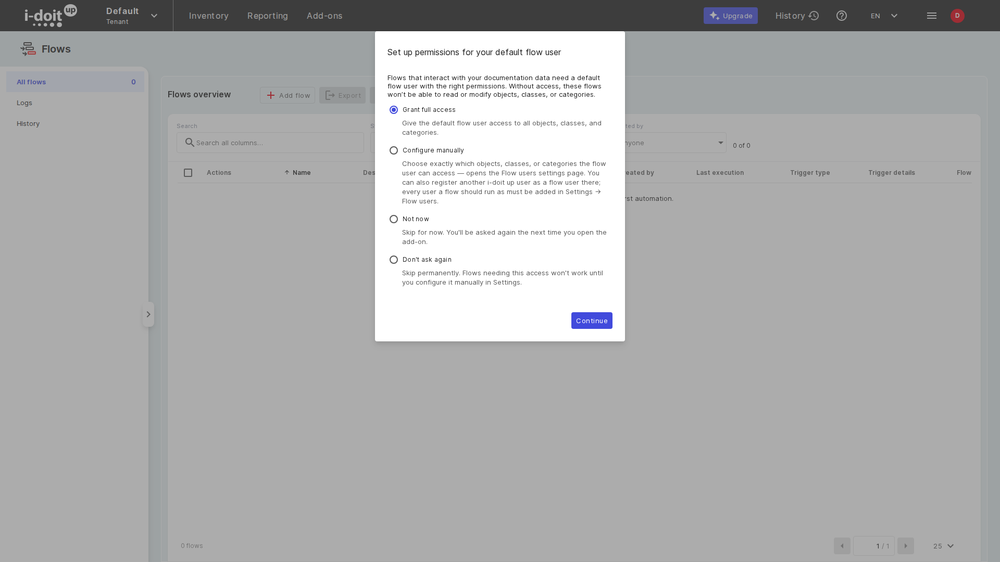
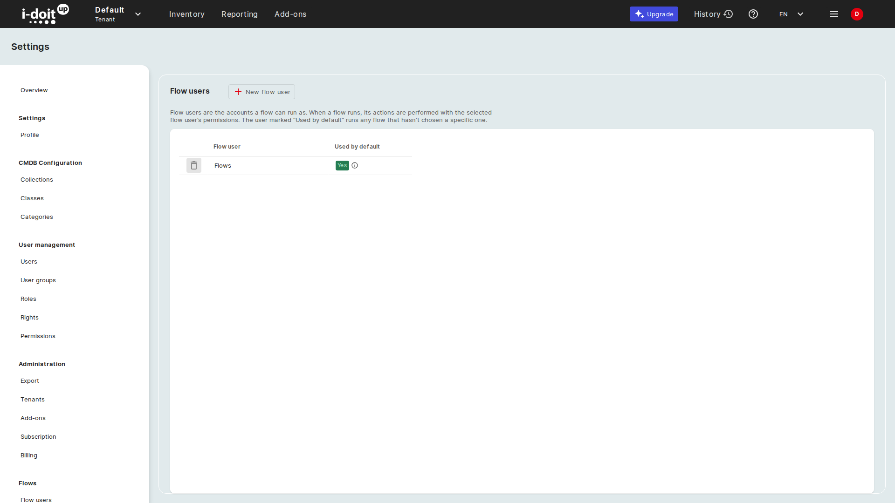

# Rights and flow users

Two add-on rights control who can use Flows and who can choose the user a flow runs as.
Flow users are the i-doit up users whose permissions the actions of a flow use.
This page describes both.

!!! info
    Available as of i-doit up 3.3.0.

## Add-on rights

Flows adds two add-on rights:

| Right | Effect |
| --- | --- |
| **Manage Flows** | Access to the add-on. Users without this right do not see **Flows** under **Add-ons**. |
| **Select Flow Operator** | Lets users choose a **Specific flow user** or a **Custom API key** for a flow, and open the **Flow users** page. |

To grant a right, open **Settings → Rights**, choose *Add-on rights → Flows*, and click **New right**.
Granting all rights of the add-on includes both rights.

The add-on tries to grant **Manage Flows** to the admin role when it is installed. If **Flows** does not appear under **Add-ons** afterwards, grant the right to the admin role as described here.

Users with **Manage Flows** but without **Select Flow Operator** can build flows.
Their flows keep the current Flow Operator or run as the default flow user.

The rights control access to the add-on interface.
They do not control whether a flow runs: an active flow runs whenever its trigger fires, no matter who clicked a button or changed an object.

## Flow users

A flow user is an i-doit up user a flow can run as.
The actions of the flow use the API token of this user, so a flow can never do more than this user is allowed to do.
Flows keeps a list of flow users.

### Default flow user

When the add-on is enabled, it creates the service user "Flows" and sets it as the default flow user.
Every flow runs as this user unless another Flow Operator is selected.

The add-on does not grant this user any access to objects.
The first time an administrator with the right **Select Flow Operator** opens Flows, the dialog **Set up permissions for your default flow user** appears:

- **Grant full access**: gives the default flow user access to all objects, classes, and categories.
- **Configure manually**: opens the **Flow users** page.
- **Not now**: the dialog appears again the next time.
- **Don't ask again**: the dialog does not appear again.
  Flows that need access do not work until you set it up.

Choose an option and click **Continue**.
Users who cannot manage permissions do not see the dialog.

### Manage flow users

Open **Flow users** in the settings, group **Flows**.
The page needs the right **Select Flow Operator**.

- **Used by default** marks the current default flow user.
  **Set as default** makes another flow user the default.
- **New flow user** adds an existing i-doit up user.
  The add-on creates an API token for this user and stores it encrypted.
  To add users, you need the right to manage users and create API tokens.
- **Remove** takes a user off the list and revokes the token the add-on created.
  The i-doit up user is not deleted.
  You cannot remove the default flow user.
  Flows that used a removed user run as the default flow user.

Tokens are never shown.

## Further readings

-   [Flows add-on](../flows.md)
-   [Rights and permissions](../rights-and-permissions.md)
-   [Create and edit flows](../../user/flows/create.md#flow-operator)
