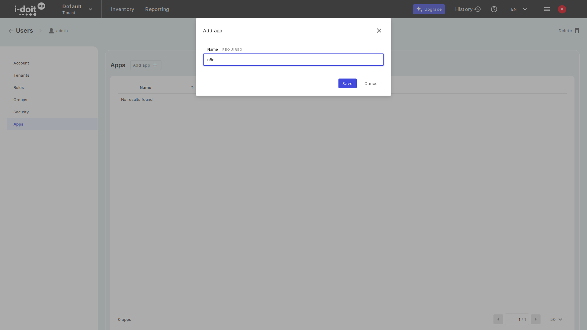
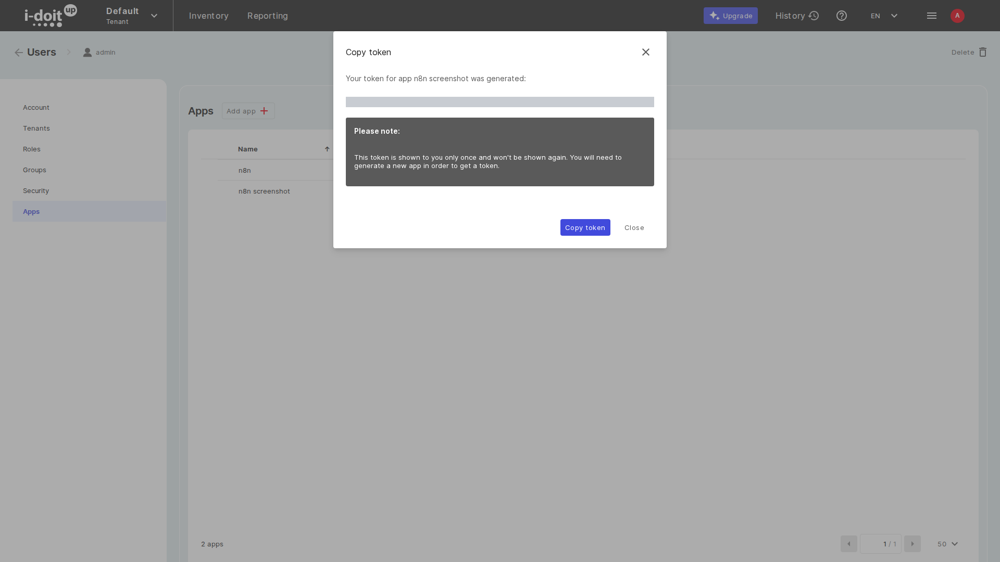
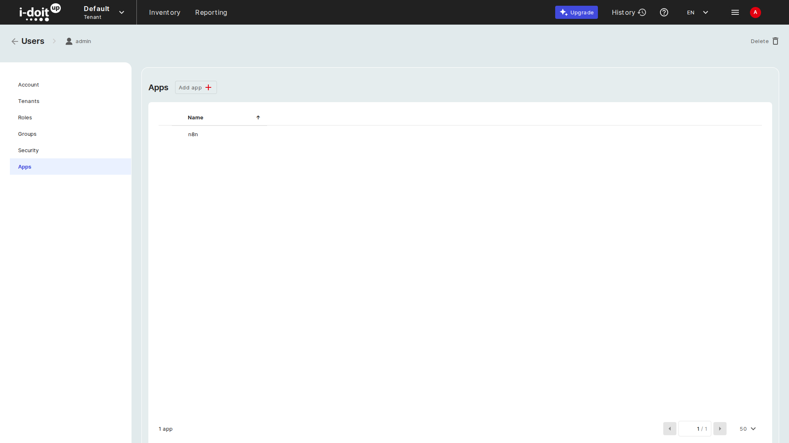
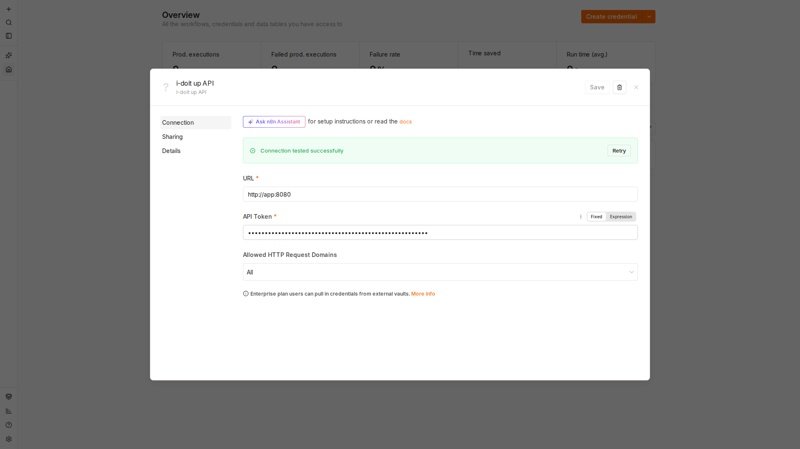

# n8n integration

[n8n](https://n8n.io) is a workflow automation tool that connects applications through visual workflows.
This page describes how to connect n8n with i-doit up: install the i-doit up nodes in n8n, create an app token, and set up the credential in n8n.

## What the integration does

The i-doit up nodes for n8n call the i-doit up API from a workflow, for example to push an object from another system into your CMDB.
Every call goes through the i-doit up API with an app token, so the workflow sees exactly the data and has exactly the rights of the user who owns the token.
The node **i-doit up Actions** offers the following actions:

- **Push Object** creates or updates an object.
- **Find objects** searches objects.
- **Get tenants** lists the tenants that the token user can access.
- **Create user** creates an i-doit up user.

## Prerequisites

- An existing self-hosted n8n instance that you administer, for example n8n in Docker.
  The i-doit up nodes are currently not available in n8n Cloud.
- Node.js 22 or later with npm on the machine where you build the node package.
- Network access from n8n to your i-doit up URL.
- An i-doit up user whose rights cover what the workflow should do, see [Rights and permissions](rights-and-permissions.md).

## Install the i-doit up nodes in n8n

The i-doit up nodes are an n8n node package called `i-n8n-nodes`.
n8n loads the package as a custom extension from a folder that the environment variable `N8N_CUSTOM_EXTENSIONS` points to.

1. Build the package in the package folder with `npm ci`, `npm run build`, and `npm pack`.
   The result is the file `i-n8n-nodes-1.0.0.tgz`.
2. Extract the file into a folder that n8n can read, for example `/home/node/i-n8n-nodes`.
   The archive contains a folder `package`, whose content belongs into that folder.
3. Set the environment variable `N8N_CUSTOM_EXTENSIONS` to that folder.
4. Restart n8n.

For n8n in Docker, build your own image based on the official n8n image.
Save the following Dockerfile next to the file `i-n8n-nodes-1.0.0.tgz`.
Replace `stable` with the n8n version that you currently run.

```dockerfile
FROM n8nio/n8n:stable
USER root
COPY i-n8n-nodes-1.0.0.tgz /tmp/i-n8n-nodes.tgz
RUN tar -xzf /tmp/i-n8n-nodes.tgz -C /tmp \
 && mv /tmp/package /home/node/i-n8n-nodes \
 && chown -R node:node /home/node/i-n8n-nodes \
 && rm /tmp/i-n8n-nodes.tgz
USER node
ENV N8N_CUSTOM_EXTENSIONS=/home/node/i-n8n-nodes
```

Build the image with `docker build -t n8n-idoit-up .` in that folder.
Then start the new image with the same volume and the same environment variables as your existing n8n container, so that your workflows and credentials are kept.

After the restart, search for *i-doit up* in the n8n node panel.
The panel lists the node as **i-doit up Action Selector**, and on the canvas it is called **i-doit up Actions**.
The credential type is called **i-doit up API**.

## Create an app token

n8n authenticates with an i-doit up **app token**.
A token belongs to one user and carries that user's rights, so create it on the account that n8n should act as.

1. Open the user menu at the top right and select **Settings**.
2. Select **User management → Users** and click **Open** on the user that n8n should act as.
3. Select **Apps** in the left navigation of the user and click **Add app**.
4. Enter a name, for example *n8n*, and click **Save**.
5. Click **Copy token** in the dialog *Copy token* and store the token in a safe place.





The token is shown **only once**.
If you lose it, delete the app and create a new one.

To revoke access for n8n later, hover over the app on the **Apps** page, click the trash icon, and click **Yes, delete** in the dialog *Delete Application*.



Because the token carries the user's rights, prefer a dedicated user with only the rights the workflow needs over an administrator account.

## Create the credential in n8n

1. In n8n, click **+** at the top left and select **New credential**.
   Alternatively, open **Overview**, switch to the **Credentials** tab, and click **Create credential**.
   On a new n8n instance, the **Credentials** tab only appears after the first workflow or credential exists.
2. Search for **i-doit up API**, select it, and click **Continue**.
3. In **URL**, enter the base URL of your i-doit up instance without a trailing slash, for example `https://your-instance.example.com`.
4. In **API Token**, paste the app token.
5. Click **Save**.

n8n tests the credential when you save it.
The test reads one tenant from the i-doit up API, and n8n shows *Connection tested successfully* when the URL and the token are correct.
If the test fails, n8n shows *Couldn't connect with these settings*, and **More details** shows the error message.

The screenshot shows the address of a test system in the **URL** field.
Enter the URL of your own i-doit up instance there instead.



The node sends the token in the `X-API-TOKEN` header of every request.

## Troubleshooting

| Symptom | Cause and solution |
|---|---|
| The credential test fails with *Unauthorized*. | The token is wrong or the app was deleted. Create a new app and paste the new token. |
| The credential test fails with *Not Found* or *ERR_INVALID_URL*. | The URL is wrong. Enter only the base URL of your i-doit up instance including the protocol, for example `https://your-instance.example.com`, without an API path. |
| The credential test fails with a connection error such as *EHOSTUNREACH*, *ENOTFOUND*, *ECONNREFUSED*, or *ETIMEDOUT*. | n8n cannot reach your i-doit up instance. Check the host name and the port in the URL, and check that no firewall or proxy blocks the connection from the n8n server to your i-doit up URL. |
| The credential test succeeds, but the i-doit up nodes fail with *The resource you are requesting could not be found*. | The URL points to a different service or ends with more than one slash. Enter the base URL of your i-doit up instance without a trailing slash. |
| The i-doit up nodes do not appear in the node panel. | n8n did not load the package. Check that `N8N_CUSTOM_EXTENSIONS` points to the folder that contains the file `package.json` of the package, and restart n8n. |

## Further readings

- [API](../dev/api.md), authentication and the built-in API reference of your instance.
- [User management](user-management.md), where the app token is created on a user account.
- [Rights and permissions](rights-and-permissions.md), control what the token user and therefore the workflow can do.
- [Model Context Protocol (MCP)](mcp.md), another integration that uses app tokens.
- [n8n documentation](https://docs.n8n.io), how to build, publish, and run workflows in n8n.
