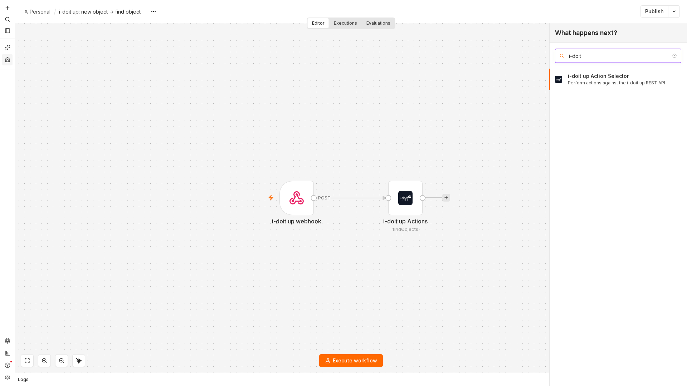
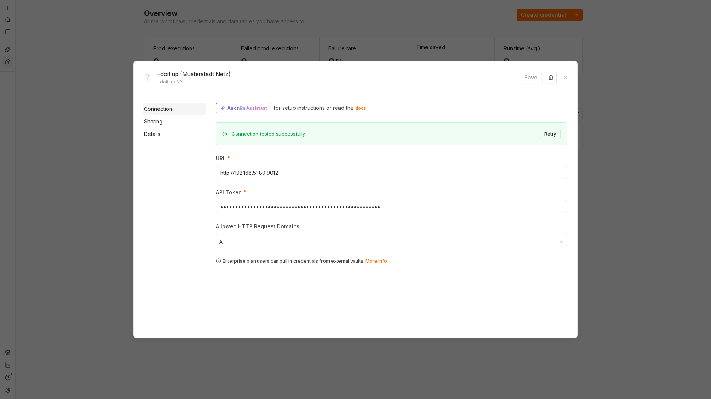
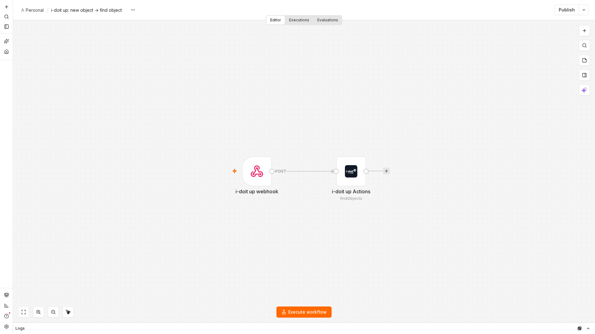

# n8n integration

[n8n](https://n8n.io) is a workflow automation tool that connects applications with each other.
The i-doit up integration consists of two parts:

- **Webhooks in i-doit up** call a URL of your choice whenever something happens in your CMDB, for example when an object is created.
    They start a workflow in n8n.
- **The i-doit up node for n8n** reads and writes CMDB data from within a workflow, for example to search objects, to create or update an object, or to create a user.

Together they let you fill i-doit up from other sources and let i-doit up kick off processes elsewhere, without writing a custom integration.

This page describes how to install the node, how to connect it to your instance, which actions it offers, and how to start a workflow from an i-doit up webhook.

## Requirements

- A running n8n instance that can reach the URL of your i-doit up instance.
    The integration was tested with n8n 2.41.
- For webhooks, i-doit up must reach the webhook URL of your n8n instance.
- An [app token](user-management.md) of the i-doit up user the workflows should act as.
    The node inherits the [rights and permissions](rights-and-permissions.md) of that user.

## Install the i-doit up node

The node is delivered as the package `i-n8n-nodes`.
n8n loads it as a custom extension:

1. Place the package directory, containing `package.json` and the `dist` folder, where your n8n instance can read it, for example in the data directory of n8n.
2. Point the environment variable `N8N_CUSTOM_EXTENSIONS` of n8n to that directory.
3. Restart n8n.

Example for an n8n instance in Docker Compose:

```yaml
services:
    n8n:
        image: docker.n8n.io/n8nio/n8n:2.41.4
        environment:
            - N8N_CUSTOM_EXTENSIONS=/home/node/.n8n/i-n8n-nodes
        volumes:
            - n8n_data:/home/node/.n8n
```

After the restart, the node **i-doit up Action Selector** appears in the node panel when you search for _i-doit_.



## Connect the node to i-doit up

The node authenticates with the credential **i-doit up API**.
Create it once and reuse it in all workflows:

1. In n8n, open **Credentials** and click **Create credential**, or choose **Create new credential** in the credential field of the node.
2. Select **i-doit up API**.
3. Enter the **URL** of your i-doit up instance without a trailing slash, for example `https://cmdb.example.com`.
4. Paste the [app token](user-management.md) into **API Token**.
5. Click **Save**.
    n8n tests the connection against the instance and reports _Connection tested successfully_.



The token is sent as the HTTP header `X-API-TOKEN` with every request, see [API](../dev/api.md).
To revoke the access, delete the app under **Settings > Users > Apps** in i-doit up.

## Actions of the node

Add the node **i-doit up Action Selector** to a workflow and choose an **Action**.
The fields below the action change with the selection.


### Find objects

Searches objects of the active tenant through the object API.

| Field | Meaning |
|---|---|
| **Categories** | One or more category identifiers whose data is returned with each object, for example `cmdb.general`. An unknown identifier stops the node with _Unknown category_. |
| **Criteria** | Filter as JSON, for example `{"type":"eq","field":"id","value":"d3830ec9RZPXwu6o"}`. Leave `{}` to return all objects. |
| **Offset** | Number of objects to skip. |
| **Per Page** | Number of objects to return, 1 to 1,000. |
| **Sort** | Sort field and direction, for example `title:asc`. |

The node returns one item per object.
Each item carries the object with its category data and a `_paging` field with `offset`, `perPage`, and `total`, so a loop can fetch the next page.

### Get tenants

Returns the tenants the user of the token may access.

| Field | Meaning |
|---|---|
| **Limit** | Number of tenants to return. |
| **Offset** | Number of tenants to skip. |
| **ID** | Return only the tenant with this ID. |
| **Sort By** | Sort field and direction, for example `title:asc`. |
| **Filter** | Filter as JSON. |

### Push Object

Creates an object, or updates it when an object with the same reference already exists.
The reference consists of a **Reference ID** and a **Reference Type** of your choice, for example the ID of a record in the source system and the name of that system.
Running the workflow twice with the same reference therefore updates the object instead of creating a duplicate.

| Field | Meaning |
|---|---|
| **Title** | Title of the object. |
| **Class** | Identifier of the [class](../user/basics/classes.md), for example `server`. |
| **Reference ID** | External ID that identifies the object in the source system. |
| **Reference Type** | Name of the source system or another qualifier of the reference ID. |
| **Data** | Category data as JSON, keyed by category identifier. |

The **Data** field holds one entry per category.
Each entry names a strategy and the entries to write, keyed by a reference ID of the entry:

```json
{
    "cmdb.general": {
        "strategy": "overwrite",
        "data": {
            "main": {
                "title": "web-01",
                "description": "Imported from the inventory tool"
            }
        }
    }
}
```

### Create user

Creates a user account in i-doit up.

| Field | Meaning |
|---|---|
| **Username** | Login name. |
| **Name** | Display name. |
| **Email** | Email address. |
| **Password**, **Password Confirmation** | 8 to 64 characters with at least one lowercase letter, one uppercase letter, and one digit. |
| **User Status** | _Enabled_ or _Disabled_. |
| **Role** | _User_ or _Admin_. |

See [User management](user-management.md).

## Start a workflow from i-doit up

i-doit up has no node of its own that waits for events.
Instead, i-doit up calls a **webhook** URL, and the **Webhook** node of n8n receives the call.

### Register a webhook in i-doit up

Webhooks are managed through the [API](../dev/api.md).
Send the request as the user whose app token the workflow uses and with the `x-tenant` header of the tenant to watch:

```bash
curl --request POST https://cmdb.example.com/api/v2/webhook \
    --header "X-API-TOKEN: YOUR_APP_TOKEN" \
    --header "x-tenant: YOUR_TENANT_ID" \
    --header "Content-Type: application/json" \
    --data '{
        "title": "n8n: object created",
        "webhookUrl": "https://n8n.example.com/webhook/idoit-up-object-created",
        "enabled": true,
        "triggerInfo": { "type": "cmdb.object.created", "class": null, "tenant": null }
    }'
```

The response contains the ID of the webhook and a **secret**.
Store the secret, it is shown only once and lets your workflow verify that a call really came from i-doit up.

`triggerInfo` selects the event.
The object and entry events accept an optional list of class identifiers under `class` to react only to objects of those classes.
The entry events additionally take the `category` to watch.

| `type` | Fires when |
|---|---|
| `cmdb.object.created` | an object was created |
| `cmdb.object.deleted` | an object was deleted |
| `cmdb.entry.created` | a category entry was created, `category` names the category |
| `cmdb.entry.updated` | a category entry was changed, `category` names the category |
| `system.user.created`, `system.user.updated`, `system.user.deleted` | a user account was created, changed, or deleted |
| `system.tenant.created`, `system.tenant.updated`, `system.tenant.deleted` | a tenant was created, changed, or deleted |

`GET /api/v2/webhook` lists the webhooks of the tenant, `PUT /api/v2/webhook/{id}` changes one, and `DELETE /api/v2/webhook/{id}` removes it.
Every call is recorded with its result, `GET /api/v2/webhook-log` returns these records.

### What i-doit up sends

i-doit up sends a `POST` request with a JSON body to the webhook URL.
The body names the event in `type` and carries the data of the event, for an object for example its `id`, `title`, `class`, `tenantId`, and `time`.

The header `X-Signature` contains an HMAC-SHA256 signature of the body, calculated with the secret of the webhook.
Verify it in the workflow, for example in a Code node, before you act on the data.

### Example workflow

1. Add a **Webhook** node, set **HTTP Method** to _POST_, and give it a **Path**, for example `idoit-up-object-created`.
    The node shows the production URL you register in i-doit up.
2. Add the node **i-doit up Action Selector**, select the credential, and choose the action **Find objects**.
3. Enter `cmdb.general` under **Categories** and the following expression under **Criteria**, so the node loads the object that triggered the call:

    ```text
    {{ JSON.stringify({ type: "eq", field: "id", value: $json.body.id }) }}
    ```

4. Add the nodes that process the object, for example a mail or ticket node.
5. Publish the workflow.



Whenever an object is created in the watched tenant, i-doit up calls the webhook, n8n runs the workflow, and the i-doit up node returns the full object with its category data.

## Further readings

- [User management](user-management.md), where the app token the node authenticates with is created on the **Apps** tab of a user.
- [API](../dev/api.md), the REST API the node and the webhooks use.
- [Rights and permissions](rights-and-permissions.md), what the user behind the token may read and change.
- [Tenants](tenants.md), webhooks and the node act within one tenant.
- [n8n documentation](https://docs.n8n.io), workflows, the Webhook node, and expressions.
