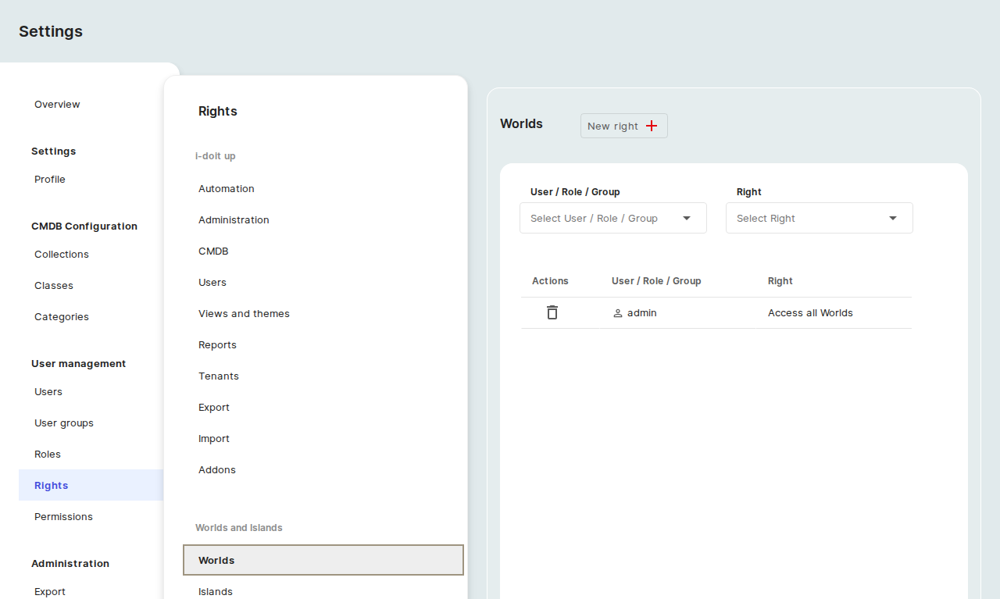
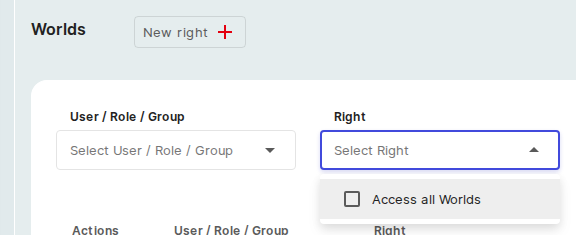
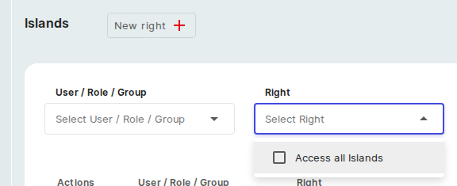

# Rights and permissions

i-doit up uses two complementary concepts to control what users can do.

- **Rights** are global flags that decide which UI surfaces and bulk actions a user can reach.
    Examples: *Manage Users*, *Manage Tenants*, *Manage Categories*, *Edit configuration*.
    They are assigned to roles, groups, or individual users.
- **Permissions** are object- and class-level rules that decide what a user can read, edit, archive, or delete on the data itself.
    They are evaluated at every action and combined with rights.

## Where to manage them

Both surfaces live under **Settings ▸ User management** in the sidebar (open via the user menu at the top right):

| Page | Purpose |
|---|---|
| Users | Create, edit, deactivate users; assign roles, groups, default tenant. |
| User groups | Bundles of users; rights granted on a group apply to every member. |
| Roles | Reusable named rights bundles. Assigning a role to a user (directly or via a group) grants every right in the role. |
| Rights | The flat list of all rights in the instance. Use it to grant single rights to a role or directly to a user. |
| Permissions | Per-scope rules (e.g. *user X can read Object lifecycle on All Objects*), the granular per-object permission table. |

See [User management](user-management.md) for day-to-day workflows.

## How they combine

A user is allowed to do something if **all** the following are true:

1. The user has the **right** that gates the action (for example *Manage Categories* to open Category Builder).
2. The relevant **permission** allows the action on the affected object scope (for example *Read* on the *All Objects* scope or on the specific object).

Rights are additive, they accumulate from direct assignments, group memberships, and roles.
There is no deny override.

## Inheritance example

User *Jane* is a member of group *Network engineers*, which is assigned the role *Admin*.
Jane inherits every right of *Admin* through *Network engineers*.
No direct right assignment is needed.

## Tenant scope

Permissions and rights are evaluated within the **currently active tenant**: see [Tenants](tenants.md) and [Switch between tenants](../user/basics/tenant-switcher.md).
A user with rights in tenant A does not automatically have the same rights in tenant B.

## Rights for Worlds and Islands

[Worlds and Islands](../user/worlds-and-islands.md) are protected by two rights in the topic **Worlds and Islands**:

| Method | Right | Grants |
|---|---|---|
| Worlds | Access all Worlds | The menu item **Worlds** and every World, for example the License World. |
| Islands | Access all Islands | The group **Islands** in the object sidebar and every Island, for example the License Island. |

There are no rights for single Worlds or single Islands.
A user with **Access all Islands** sees every Island that belongs to the class of the opened object, including Islands of add-ons.

!!! info "Only the admin role has the rights by default"
    Since i-doit up 3.3.0, the admin role receives both rights automatically.
    This applies to new installations and to updates.
    Grant the rights to every other role, group, or user that works with Worlds and Islands.

To grant a right:

1. Open **Settings** from the user menu and go to **User management** > **Rights**.
2. Under **Worlds and Islands**, click **Worlds** or **Islands**.
3. Click **New right**.
4. Select the user, role, or group in **User / Role / Group**.
5. Select the right in **Right**.

The list **Right** offers only one right per method.

Granting and removing these rights takes effect when the user reloads the page.
A new login is not necessary.
Without **Access all Worlds**, the menu item **Worlds** disappears and a World page shows a message that starts with "You shall not see!".
Without **Access all Islands**, the group **Islands** disappears from the object sidebar.

## Further readings

- [User management](user-management.md)
- [Tenants](tenants.md)
- [Switch between tenants](../user/basics/tenant-switcher.md)
- [Worlds and Islands](../user/worlds-and-islands.md)
