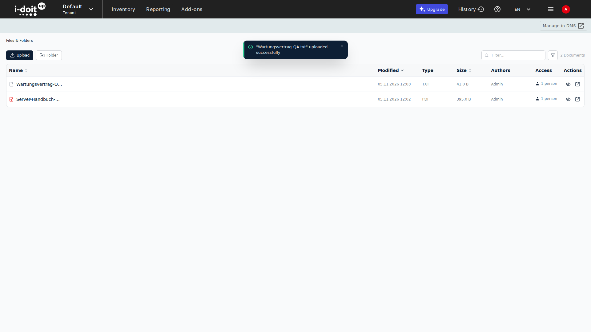
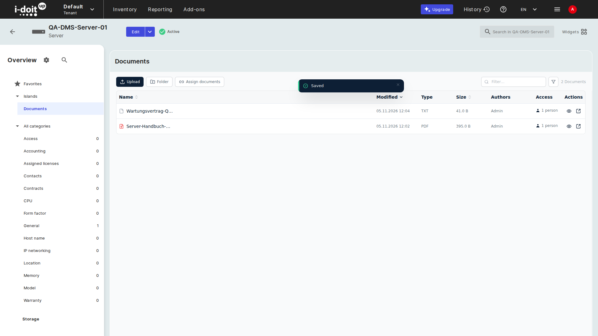
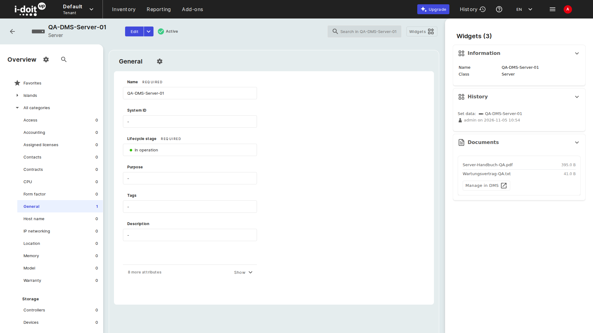

# Documents (DMS)

The DMS add-on brings the document management system (DMS) into i-doit up.
You can browse the whole DMS inside i-doit up, see and attach the documents of an object directly on the object page, and jump to the standalone DMS when you need more tools.
This page describes what you see as a user and how to work with documents on objects.
For installation and configuration, see [DMS integration](../admin/dms.md).

!!! info
    Available as of i-doit up 3.3.0.

!!! todo "TODO (open question 1)"
    The i-doit up version is confirmed (3.3.0).
    Confirm the DMS version that contains the add-on and add it as a prerequisite.

## What the DMS add-on offers

After an administrator has installed the add-on, i-doit up shows the DMS in three places:

- **DMS** in the navigation, group **Add-ons**: the complete DMS inside i-doit up.
- **Documents** island on the object page: all documents assigned to the object, with upload and assignment.
- **Documents** widget on the object page: a short list of the documents assigned to the object.

All three open the DMS with your i-doit up account.
You do not need a separate DMS login.
The first time you open the DMS from i-doit up, the DMS creates your user account automatically.

The texts of the add-on are in English.

!!! todo "TODO (open questions 5 and 6)"
    Confirm whether the add-on and the embedded DMS get German texts (the add-on does not pass the user language to the DMS yet).
    The test of the 3.3.0 line showed English texts only; the German user interface was not tested.
    Confirm the final names "DMS", "Documents", and "Manage in DMS".

## Open the DMS in i-doit up

Select **DMS** in the navigation, group **Add-ons**.
i-doit up shows the DMS with its folders and documents in the main area.
You work with folders and documents the same way as in the standalone DMS.

i-doit up remembers the folder that you have open in the address of the page.
If you reload the page or bookmark it, the same folder opens again.

## Open the standalone DMS

Some DMS functions are only available in the standalone DMS.
Click **Manage in DMS** at the top of the DMS view or in the widget to open the standalone DMS in a new browser tab.
You are signed in automatically with your i-doit up account.
While the link is being prepared, the button shows **Opening DMS…**.

The sign-in link is only valid for about two minutes, so i-doit up creates it at the moment you click.

## Documents on an object

### The Documents island

1. Open an object.
2. Select **Documents** in the left sidebar of the object, group **Islands**.

The island shows all documents that are assigned to this object.
Here you can:

- upload new documents, which are assigned to the object right away,
- create folders,
- assign existing DMS documents to the object with **Assign documents**.

The table shows name, modification date, type, size, authors, and access of each document.
The **Actions** column has two icons: **View details** and **Manage in DMS**, which opens the document in the standalone DMS.
Documents you have no access to show no actions.

To upload, click **Upload** and select the files in the dialog **Upload Files**.
A file may be up to 104.9 MB.

The assignment to the object is only visible in i-doit up.
The standalone DMS shows the document, but not the object it belongs to.

!!! note
    If the island is missing, you may lack the island rights.
    Ask your administrator, see [DMS integration](../admin/dms.md#rights-for-the-documents-island).

### Assign existing documents

1. Click **Assign documents** in the island.
2. In the dialog **Documents for this object**, select the documents that belong to the object.
3. Click **Save**. i-doit up confirms with *Saved*.

If you lack access to some of the selected documents, the DMS saves the others and reports how many were skipped.

### The Documents widget

The widget **Documents** is available on the object page of every object class.
Open it with **Widgets** at the top right of the object page.
It lists up to 25 documents of the object with title and size.
Click a title to open the file in a new tab.
PDF files, images, and text files open in the browser, other files are downloaded.

If no documents are assigned, the widget shows *No documents assigned to this object.*
Below the list, **Manage in DMS** opens the standalone DMS.
On a page without an object, the widget only shows the button **Manage in DMS**.

!!! todo "TODO (open question 10)"
    The test checked the object class Server only.
    Confirm whether the widget and the island stay available for all object classes or whether this becomes configurable.

## Who sees which documents

i-doit up tells the DMS who you are and which tenant you are working in.
The DMS itself decides what you may do with a document.
Your rights in i-doit up are not transferred to the DMS.

- The documents of an object are shared by everyone who works in the same tenant.
- The list of an object shows **all** documents that are assigned to it, also documents of other users.
- To open, download, or change a document you need access to it in the DMS.
  Documents without access are shown with their title, grayed out, marked **No access**, and without a link or actions.

When you switch the tenant in i-doit up, the DMS views switch to the documents of that tenant.

!!! todo "TODO (open question 8)"
    The test confirmed this behavior.
    Confirm that it is intended that users see the titles of documents they have no access to.

!!! todo "TODO (open question 7)"
    Confirm whether documents attached to the same object in Suite+ also appear here.
    The current development state can link tenants and objects of Suite+ and i-doit up, but this is a proof of concept.

## Known limitations

- If your DMS session has expired while you upload a file in the island, the upload is not repeated.
  Upload the file again.
- If the embedded DMS session has expired, the DMS shows the message *This embedded session has expired.* (English only).
  Click **Try again** or open the view again.
- Files that are attached to i-doit up objects outside the DMS are not synchronized with the DMS.

## Further readings

- [DMS integration](../admin/dms.md) for administrators
- [Add-ons](../admin/addons.md)
- [Suite+ bridge](../admin/suite-plus.md)
