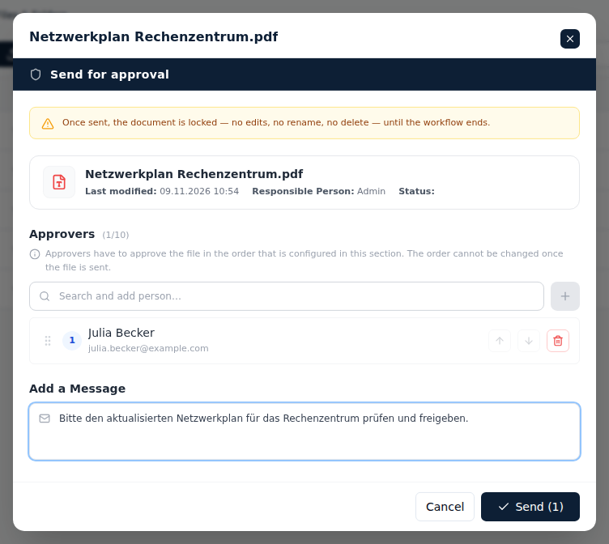
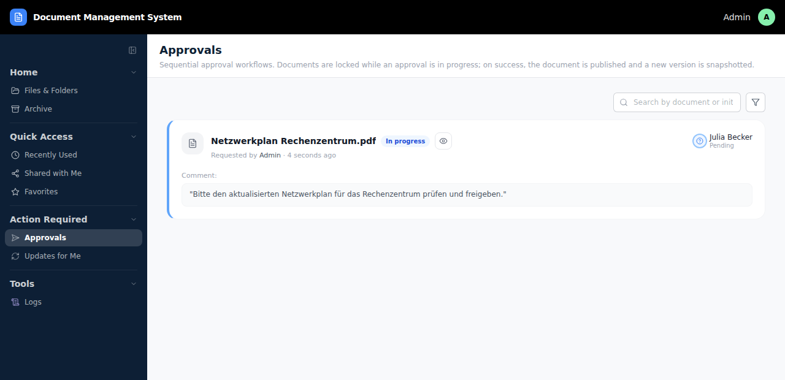

# Approvals

With an approval, one or more people check a document and approve or reject it.
The result is shown as the status of the document.

!!! info
    Available as of i-doit up 3.3.0.

## Status of a document

| Status | Meaning |
| --- | --- |
| no status | New documents have no status. |
| **In progress** | An approval is running. The document is locked. |
| **Approved** | All approvers have approved the document. |
| **Rejected** | An approver has rejected the document. |
| **Draft** | The document is a draft. |

While a document is **In progress**, nobody can edit, rename, move, replace, archive, or delete it.

## Send a document for approval

You need the role **Owner** for the document.
Approvals are available for files, not for folders.

1. In the actions menu of the document, select **Send for Approval**.
2. Add the approvers with **Search and add person…**.
   The counter **Approvers** shows how many you have added and how many are allowed, by default 10.
3. Optionally enter a message for the approvers under **Add a Message**.
4. Send the request.

The approvers decide one after the other in the order you added them.
If your DMS administrator has configured email, each approver gets an email when it is their turn, and you get an email when the approval is completed.

When you cancel a running approval, the document is unlocked and has no status again.

## Approve or reject

**Action Required** > **Approvals** in the sidebar lists the approvals you are involved in, with document, requester, approver, message, and state.
Use the search field and the filter button above the list to find an approval.

Open the approval and select **Approve** or **Reject**.
You can add a comment.
When you reject, the comment is required.

## Changes after approval

If someone replaces the file of an approved document, the document loses the status **Approved**.
Send it for approval again if needed.

## Further readings

- [Files and folders](files.md)
- [Editing and versions](editing.md)
- [Sharing and access](sharing.md)
