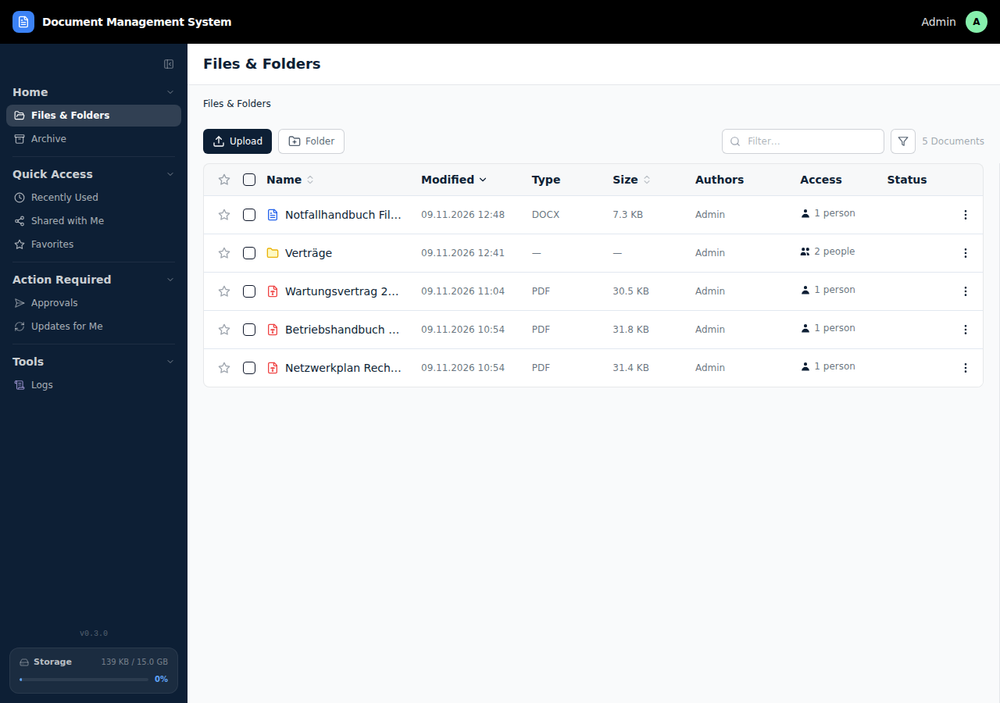
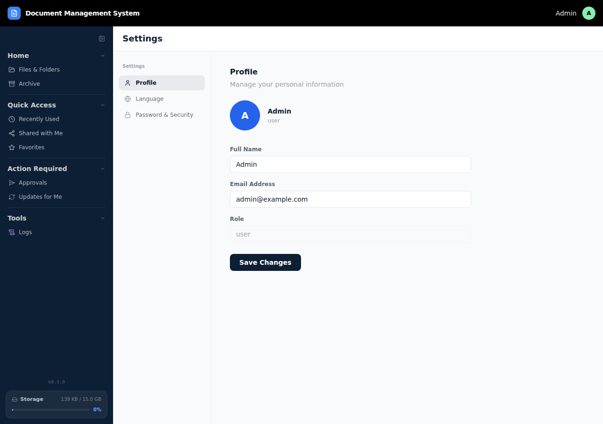

# Working with the DMS

The document management system (DMS) stores and organizes your documents.
This page explains how to open the standalone DMS, how its screen is organized, and how to change your personal settings.
How to work with the DMS inside i-doit up and with the documents of an object is described in [DMS in i-doit up](../dms.md).

!!! info
    Available as of i-doit up 3.3.0.

## Open the DMS

Click **Manage in DMS** in i-doit up, see [Open the standalone DMS](../dms.md#open-the-standalone-dms).
The DMS opens in a new browser tab, and you are signed in with your i-doit up account.
You see the documents of the i-doit up tenant that you are working in.

You do not need a separate DMS password.
The local sign-in page of the DMS is meant for the DMS administrator, see [DMS administration](../../admin/dms/administration.md).

## The screen

The header shows the title **Document Management System** and your avatar.
The avatar menu has the entries **Settings** and **Sign Out**.

The sidebar on the left has the following groups:

| Group | Entry | Content |
| --- | --- | --- |
| **Home** | **Files & Folders** | All folders and documents you have access to, see [Files and folders](files.md) |
| | **Archive** | Archived documents and folders |
| **Quick Access** | **Recently Used** | Documents you have used recently |
| | **Shared with Me** | Documents and folders that other users have shared with you |
| | **Favorites** | Documents and folders you have marked as favorites |
| **Action Required** | **Approvals** | Approvals you are involved in, see [Approvals](approvals.md) |
| | **Updates for Me** | Changes that concern you, for example new shares or approval steps |
| **Tools** | **Logs** | Your own activities in the DMS |

The entries **Approvals** and **Updates for Me** show a counter with the number of open items.
At the bottom, the sidebar shows the version of the DMS and the bar **Storage** with the used and the available storage.

## Favorites

To mark a document or folder as favorite, click the star in front of its name, or select **Add to Favorites** in the actions menu of the row.
**Remove from Favorites** or a second click on the star removes it again.
**Favorites** in the sidebar lists all your favorites.

## Logs

**Tools** > **Logs** lists the events of the documents you have worked with, for example uploads, shares, access changes, and renames.
The list has the columns **Date and time**, **Document**, **Type**, **Action**, **Description**, and **User**.
As a user, you see only your own events.

## Personal settings

Select **Settings** in the avatar menu.
The page has three tabs:

- **Profile**: your full name, your email address, and your DMS role.
  To change your email address, you need your current password.
- **Language**: the language of the DMS interface, English or Deutsch.
- **Password & Security**: change your DMS password.
  A password needs at least 8 characters.
  If you only open the DMS from i-doit up, you do not need a DMS password.

The avatar menu itself is always in English.

## Sign out

Select **Sign Out** in the avatar menu.

## Further readings

- [DMS in i-doit up](../dms.md)
- [Files and folders](files.md)
- [Editing and versions](editing.md)
- [Sharing and access](sharing.md)
- [Approvals](approvals.md)
