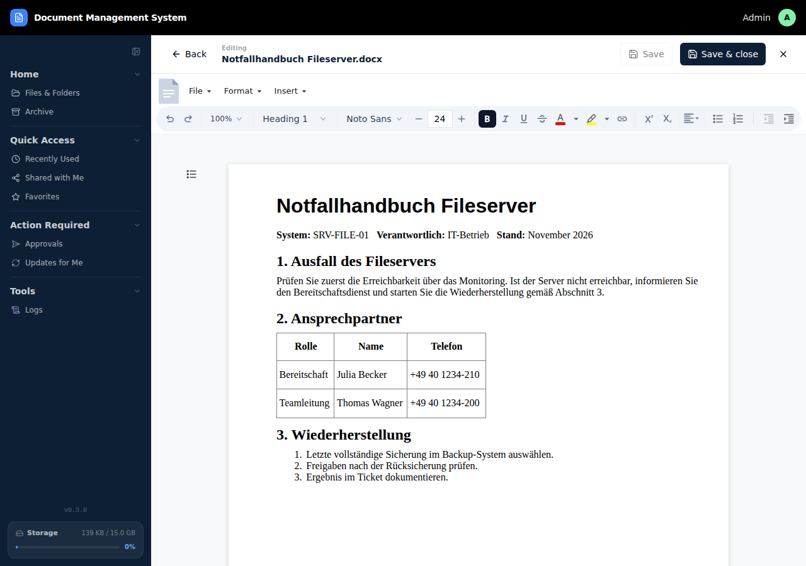
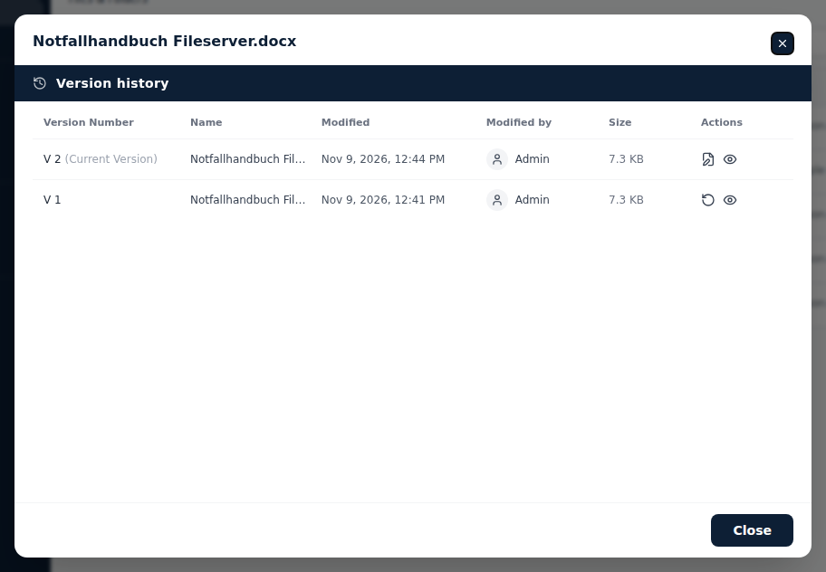

# Editing and versions

The DMS keeps every change of a file as a version.
You can edit Word documents in the browser, replace any file with a new one, and go back to an older version.
You need the role **Edit** or **Owner** for the document, see [Sharing and access](sharing.md#roles).

!!! info
    Available as of i-doit up 3.3.0.

## Edit a Word document in the browser

Only Word documents in the format `.docx` can be edited in the browser.

1. In the actions menu of the document, select **Open File** > **Open in Editor**.
2. Edit the document.
3. Click **Save** to keep editing, or **Save & close** to return to the list.

Each save creates a new version of the document.

To edit other file types, download the file, edit it on your computer, and upload it again with **Replace File**.

## Replace a file

1. In the actions menu of the document, select **Replace File**.
2. Select the new file.

The DMS stores the new file as a new version.
The document takes the name of the new file.
If you want to keep the old name, rename the document afterwards with **Rename**.

If the document had the status **Approved**, replacing the file removes this status.

## Version history

Select **Version History** in the actions menu of a file.
The dialog lists all versions with number, name, modification date, and the user who made the change.

In the column **Actions** you can open a version or restore it.
Restoring does not delete newer versions.
The DMS adds the restored state as a new, current version.

## Further readings

- [Files and folders](files.md)
- [Approvals](approvals.md)
