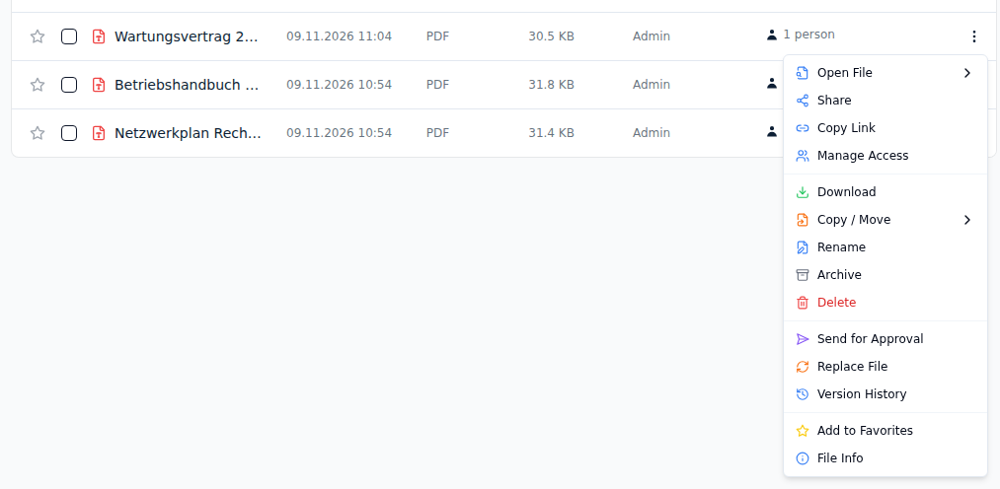
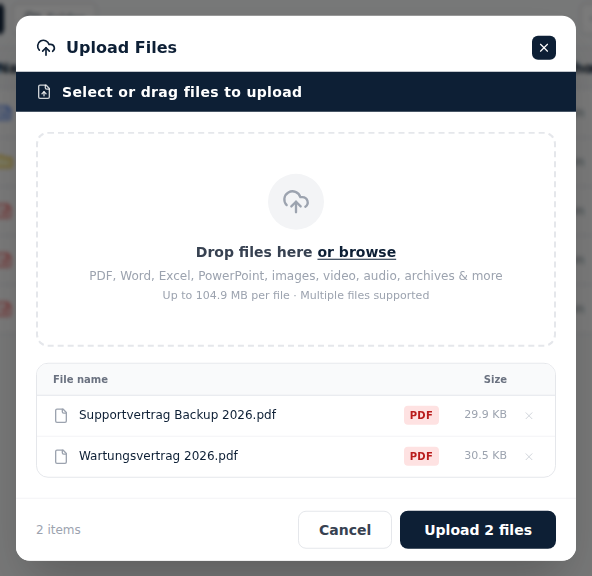
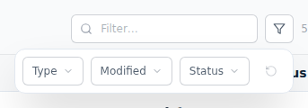
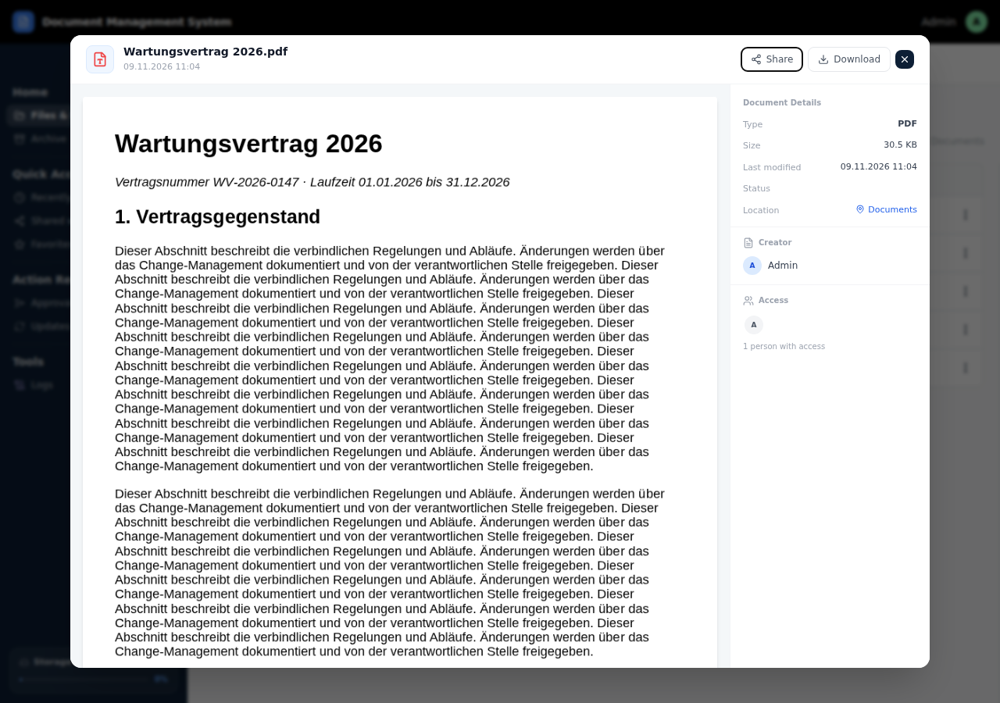
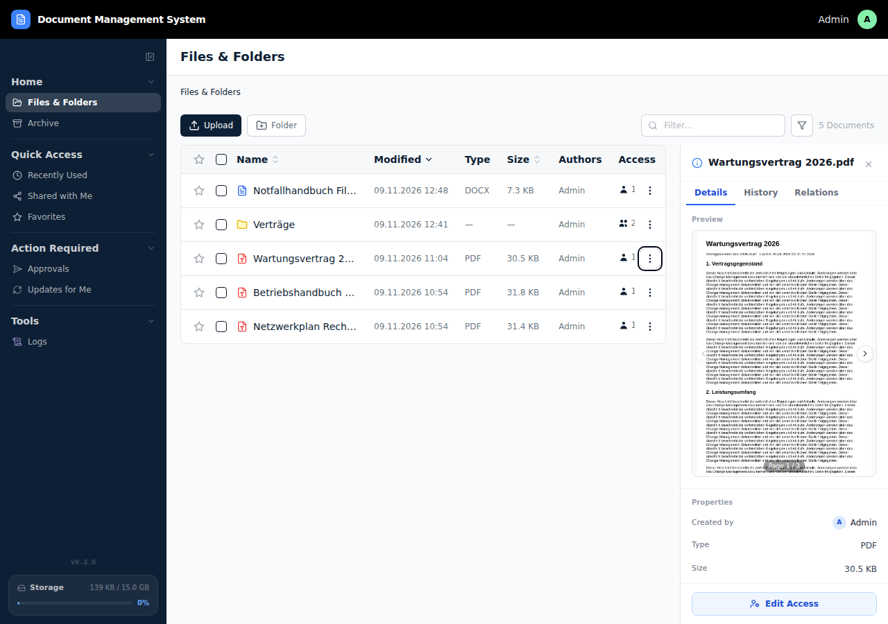

# Files and folders

In **Files & Folders** you upload, find, open, and organize your documents.
What you may do with a document depends on your role for it, see [Sharing and access](sharing.md#roles).

!!! info
    Available as of i-doit up 3.3.0.

## The list

**Files & Folders** shows the folders and documents of the current folder.
For each entry, the list shows name, modification date, type, size, authors, access, and status.
The column **Access** shows how many people have access.
Click a folder to open it.

Each row has an actions menu (**⋮**) at the right end.
It only shows the actions that your role allows.

## Upload files

You can upload files and create folders where you have the role **Edit** or **Owner**.
If you lack this role, the buttons **Upload** and **Folder** are missing.

1. Open the folder that should contain the files.
2. Click **Upload**.
3. Drop the files into the dialog **Upload Files**, or click **or browse** and select them.
   You can select several files at once.
4. Click **Upload _n_ files**.

The dialog shows the maximum size per file.
With the default setting it shows **Up to 104.9 MB per file**.
Your DMS administrator sets this limit.

The DMS accepts, among others, these file types:

| Kind | Extensions |
| --- | --- |
| Office | pdf, doc, docx, xls, xlsx, ppt, pptx, odt, ods, odp, odg, odf |
| Text | txt, csv, tsv, rtf, xml, json, yaml, yml, html, htm, md |
| Images | jpg, jpeg, png, gif, bmp, tiff, tif, webp, svg, ico |
| Video | mp4, mov, avi, mkv, wmv, flv, webm |
| Audio | mp3, wav, aac, ogg, flac, m4a |
| Archives | zip, rar, 7z, tar, gz |

## Create a folder

1. Open the folder in which the new folder should be created.
2. Click **Folder** and enter a name.

Everyone who has access to a folder also has access to its content, see [Sharing and access](sharing.md#folders).

## Find documents

Type into the field **Filter** above the list to show only entries whose name contains the text.
Upper and lower case do not matter.
The filter searches the names only, not the content of the documents.

The filter button next to the field narrows the list by **Type**, **Modified**, and **Status**.
**Reset** clears the filters.

## Open and download

In the actions menu, **Open File** has two entries:

- **Preview** shows the document in the browser.
- **Open in Editor** opens a Word document for editing, see [Editing and versions](editing.md).

The preview supports these file types:

| Kind | Extensions | Preview |
| --- | --- | --- |
| PDF | pdf | Pages of the document |
| Images | png, jpg, jpeg, gif, webp, svg, bmp, ico, tiff, tif | Image |
| Text | txt, md, xml, json, html, htm, log, yaml, yml, toml, ini, env | Text |
| Tables | csv, tsv | Table |
| Word | docx, doc, odt | Document, read-only |
| Excel | xlsx, xls, ods | Spreadsheet |

PowerPoint files and other file types have no preview.
Instead, the preview offers a download.

**Download** in the actions menu saves the file on your computer.

## File info

**File Info** in the actions menu opens a side panel with the tabs **Details**, **History**, and **Relations**.
**Details** shows a preview and the properties of the document, for example who created it, type, size, and access.
**History** lists what happened to the document.

## Organize documents and folders

| Action | Where | Required role |
| --- | --- | --- |
| Rename | **Rename** | Edit |
| Copy to another folder | **Copy / Move** > **Copy** | Edit |
| Create a copy in the same folder | **Copy / Move** > **Duplicate** | Edit |
| Move to another folder | **Copy / Move** > **Move** | Owner |
| Archive | **Archive** | Owner |
| Delete | **Delete** | Owner |

While a document is in an approval, it is locked.
You cannot rename, move, replace, archive, or delete it until the approval is finished, see [Approvals](approvals.md).

To work on several entries at once, select their checkboxes.
A bar appears with **Copy**, **Move**, **Share**, **Archive**, **Delete**, and **Clear selection**.

### Archive

Archived documents and folders disappear from **Files & Folders**.
**Archive** in the sidebar lists them.
Select **Restore** there to bring an entry back.

### Delete

Deleted documents and folders disappear from all views.
The DMS has no trash that you can open.
The DMS removes deleted items permanently after a retention period, by default 30 days.
If you might need a document again, archive it instead of deleting it.

## Further readings

- [Working with the DMS](basics.md)
- [Editing and versions](editing.md)
- [Sharing and access](sharing.md)
- [Approvals](approvals.md)
