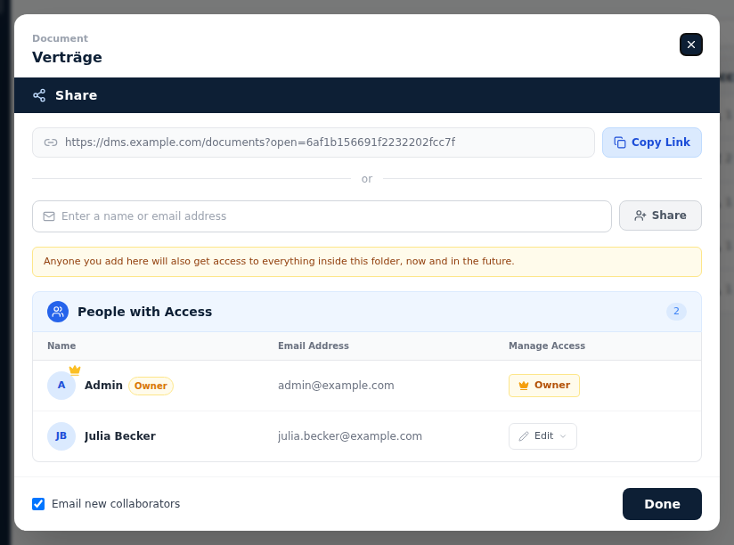
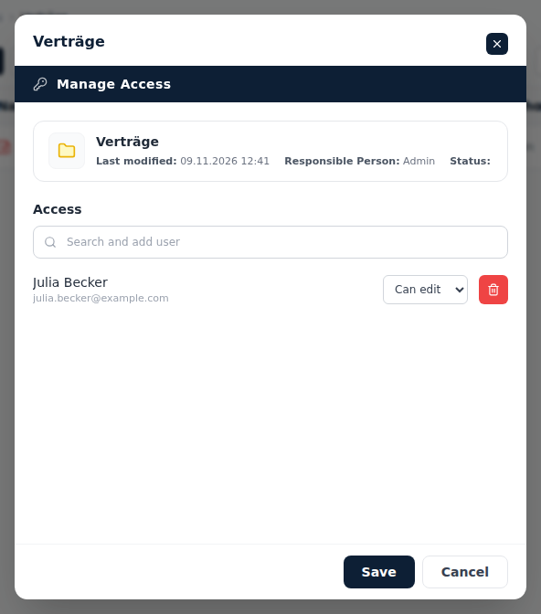

# Sharing and access

Each document and folder in the DMS has its own list of people who may access it.
Rights from i-doit up are not transferred to the DMS.

!!! info
    Available as of i-doit up 3.3.0.

## Roles

| Role | Allows |
| --- | --- |
| **View** | open, preview, and download the document |
| **Edit** | in addition: rename, copy, duplicate, replace the file, edit Word documents, upload into a folder |
| **Owner** | in addition: share, manage access, move, archive, delete, send for approval |

The dialog **Manage Access** names the roles **Can view**, **Can edit**, and **Owner**.
The dialog **Share** names them **View**, **Edit**, and **Owner**.

## Share a document or folder

You need the role **Owner**.

1. In the actions menu of the document or folder, select **Share**.
2. Search for a person by name or email address and add them.
3. Select the role of each person.
4. Leave **Email new collaborators** selected if the new people should get an email.
   Your DMS administrator must have configured email for this.

To take access away, select **Remove Access** as the role of the person.

The people you add see the document under **Shared with Me**.
There are no public links: only people with access can open a document.

## Manage access

You need the role **Owner**.
Select **Manage Access** in the actions menu, or click **Manage Access** in the toolbar of an opened folder.
The dialog lists everyone who has access, with their role.
Change a role or remove a person there.

## Folders

Access to a folder also applies to everything inside it, now and in the future.
The dialog **Share** of a folder shows a hint about this.

The dialog **Manage Access** of a document lists only the people who have access to this document directly.
People who have access through a parent folder are not listed there.

## Further readings

- [Files and folders](files.md)
- [Who sees which documents](../dms.md#who-sees-which-documents)
