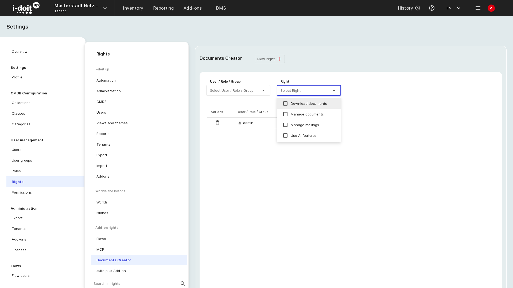
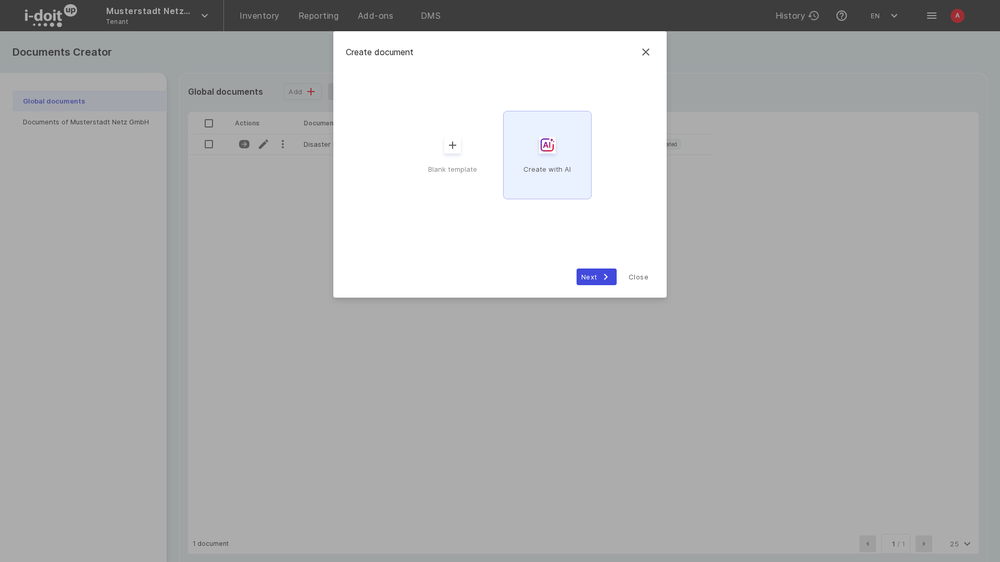
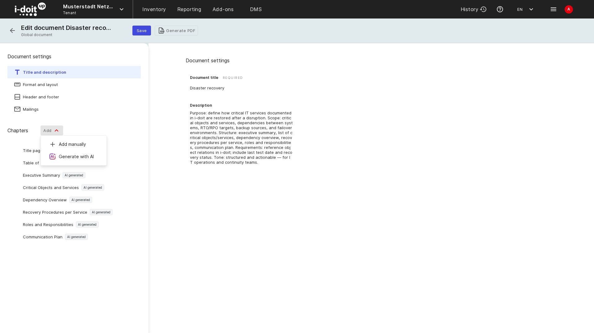

# Documents Creator with AI

The [Documents Creator](documents-creator.md) can use an AI model to draft a whole document from a short description, to add a chapter to an existing document, and to improve a text you already wrote.
The generated chapters are regular chapters with Markdown sections, so you edit, reorder, and export them like any other content.
Everything the AI wrote stays marked as such, in the document overview, in the editor, and in the PDF.

This page describes the three AI functions, how AI-generated content is marked, what you need to use the functions, and how usage limits work.

## What the AI functions do

- **Create a document with AI** builds the structure and the chapters of a new document from your description.
- **Generate a chapter with AI** adds one chapter with content to an existing document.
- **Improve with AI** rewrites the text of a Markdown section according to your instruction, for example more concise or more formal.

The AI reads the classes and categories of your CMDB to write Markdown sections that query your objects, so the generated tables and lists are filled from your data when the PDF is generated.
The AI never changes CMDB data.

## Requirements

The AI functions appear only when both conditions are met:

- **AI is available for your instance.**
    In i-doit up cloud, AI is part of your plan.
    On a self-hosted instance, the Documents Creator service is configured with an OpenAI-compatible endpoint, see [Configure AI on a self-hosted instance](#configure-ai-on-a-self-hosted-instance).
- **You hold the right _Use AI features_** of the Documents Creator.

Without AI, the **Add** button creates a blank document directly, and the **Generate with AI** and **Improve** buttons are not shown.

### Grant the right

1. Open the user menu (avatar at the top right) and choose **Settings**.
2. Go to **User management > Rights**.
3. Under _Add-on rights_, choose **Documents Creator** and click **New right**.
4. Select the user, role, or group, select the right **Use AI features**, and save.

The rights _Download_, _Manage documents_, and _Manage mailing_ keep their meaning, see [Documents Creator](documents-creator.md#rights).
A user who may use AI but may not manage documents cannot create or change documents, so grant _Manage documents_ as well.

### Configure AI on a self-hosted instance

On a self-hosted instance, the Documents Creator runs as its own service next to i-doit up.
Set three environment variables on that service:

| Variable | Value |
|---|---|
| `AI_MODEL_BASE_URL` | Base URL of an OpenAI-compatible chat completions API |
| `AI_MODEL_KEY` | API key for that endpoint |
| `AI_MODEL_NAME` | Name of the model to use |

All three are required.
As long as one of them is empty, the service reports AI as unavailable and the AI functions stay hidden.
The key never reaches the browser.

## Create a document with AI

1. Open **Reporting > Documents Creator** and choose **Global documents** or the documents of a tenant.
2. Click **Add**.
    The dialog **Create document** offers **Blank template** and **Create with AI**.

    

3. Select **Create with AI** and click **Next**.
4. Enter a **Document title**.
5. Describe the document under **What do you want to create?**.
    The field takes up to 3,000 characters.
    Name the purpose, the scope, the structure, requirements such as standards, and the tone.
    Alternatively click one of the suggestions below the field, for example _Disaster recovery plan_ or _IT onboarding guide_, which fills in a complete description that you can adapt.

    

6. Click **Generate**.

The AI first plans the structure and then writes the chapters one by one.
The dialog shows the progress.
When the generation is finished, the new document opens in the editor.
The description you entered is stored as the document description.

Each generated chapter contains a headline and a Markdown section.
Where it makes sense, the Markdown contains a query that reads objects from your CMDB, for example a table of all services with their purpose and status.
Review the chapters, change the texts, and remove what you do not need, as you would with a manually created document.

## Generate a chapter with AI

1. Open a document in the editor.
2. Next to **Chapters**, click **Add** and choose **Generate with AI**.

    

3. Describe in up to 300 characters what the chapter should cover.

    

4. Click **Generate**.

The chapter is appended to the end of the chapter list.
Move it with **Change order** like any other chapter.

## Improve a text with AI

1. Open a chapter in the editor.
2. In a **Markdown** section, click **Improve**.
    The dialog **Improve with AI** shows the current text under **Original**.

    

3. Click one of the chips, for example **Make it more concise**, or write your own instruction with up to 1,000 characters.
4. Click **Generate**.
    The rewritten text appears under **Result**.
5. Click **Save** to take over the result, or **Close** to keep the original.

**Improve** rewrites the text only.
Queries and placeholders in the Markdown stay as they are.
The function is available for Markdown sections, not for object details or custom tables.

## How AI-generated content is marked

The Documents Creator records for every chapter and every section whether the AI wrote it:

- **AI generated** marks content the AI wrote and nobody changed since.
- **AI assisted** marks content the AI wrote and a user edited afterwards.

The badges appear in the **AI** column of the document list, next to the chapters in the editor, and under each section.
Hover over a badge for the reasoning: the EU AI Act requires that AI-generated content is marked as such.

A document counts as _AI generated_ when all its content came from the AI, and as _AI assisted_ when AI content and user content are mixed.
The generated PDF carries a corresponding note.
Content you write yourself carries no badge.

## Markdown sections with CMDB queries

Chapters that the AI writes use the **Markdown** section.
Besides Markdown, this section understands a template syntax with which you read objects from the CMDB when the document is generated:

- Variables such as the document title, the creator, and the creation date.
- The object query builder `object.find`, which selects objects by class or category and reads the fields you need.
- Filter helpers such as `f.eq` or `f.and` to narrow the result.

Click **Syntax help** in a Markdown section for the complete reference with examples, for example a table of all servers with their CPU details.
Click **Markdown editor** to edit the section with a toolbar and a preview, where **edit query** opens a visual editor for the query.

## Usage limits

In i-doit up cloud, the AI functions are metered by requests and tokens per day and per week.
The document overview shows your current usage under **AI usage** as soon as limits apply.

When a limit is reached, the dialog **AI usage limit reached** appears instead of the AI function.
Daily limits reset at midnight, weekly limits on Monday.
On a self-hosted instance, the limits of your AI provider apply.

## Further readings

- [Documents Creator](documents-creator.md), chapters, sections, mailings, and the rights of the add-on.
- [Rights and permissions](../admin/rights-and-permissions.md), where the right _Use AI features_ is granted.
- [Add-ons](../admin/addons.md), the Documents Creator is an add-on of your i-doit up instance.
- [Model Context Protocol (MCP)](../admin/mcp.md), connect an AI client that reads and writes your CMDB.
