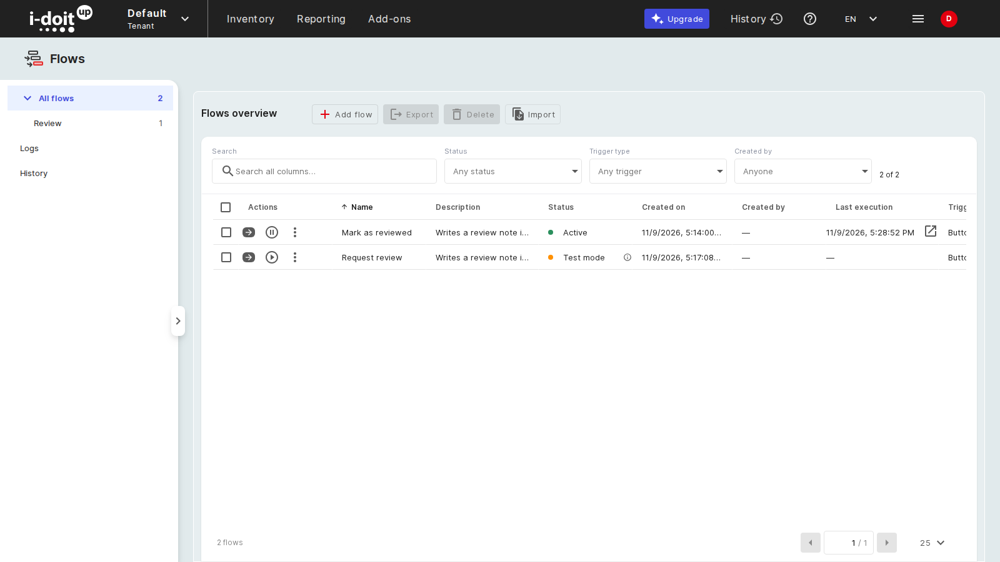

# Flows

The Flows add-on automates repetitive tasks in i-doit up.
A flow reacts to a trigger, for example a button on an object, a schedule, or a change in the CMDB, and then runs one or more actions, for example creating an object or sending an e-mail.
This page explains the building blocks of a flow and how to find and manage your flows.
Installation and rights are described in [Flows add-on](../admin/flows.md).

!!! info
    Available as of i-doit up 3.3.0.

## Building blocks of a flow

Every flow consists of three parts:

1. **Trigger**: what starts the flow. A flow needs exactly one trigger.
2. **Conditions**: additional requirements that must be met. Conditions are optional.
3. **Actions**: what the flow does. A flow needs at least one action.

Every flow runs as a **Flow Operator**, an i-doit up user whose permissions the actions use.
A flow can never do more than its Flow Operator is allowed to do.

A flow has one of three states:

- **Active**: the flow runs whenever its trigger occurs.
- **Test mode**: the trigger is evaluated and the conditions are checked, but the actions are only simulated and written to the logs.
- **Inactive**: the flow does not run.

You do not start flows by hand from the list.
An active flow runs on its own when its trigger occurs.

## Language

The user interface of the add-on follows the language you set in i-doit up, English or German.
The add-on has no language setting of its own.
Your own content, such as flow names, descriptions, and object names, is shown as you entered it.

## Open Flows

After an administrator has installed the add-on, **Flows** appears in the navigation under **Add-ons**.
To open it, you need the right **Manage Flows**, see [Rights and flow users](../admin/flows/rights.md).

The left panel of Flows shows:

- **All flows** with the total number of flows. Click it to see every flow.
- Your **flow groups**, indented below **All flows**, each with its own number of flows.
- **Logs**: the history of flow runs, see [Logs and history](flows/logs-history.md).
- **History**: the record of changes to flows, see [Logs and history](flows/logs-history.md#history).

The address in the browser reflects the current view.
You can bookmark or share a link to the overview, a flow group, the logs, or a single flow.

## Flows overview

The overview lists your flows with these columns: **Name**, **Description**, **Status**, **Created on**, **Created by**, **Last execution**, **Trigger**, and **Flow groups**.

- **Status** is green for **Active**, amber for **Test mode**, and red for **Inactive**.
- **Last execution** shows when the flow last ran.
    An icon next to the time opens the matching log entry.
- **Flow groups** can be edited directly in the table: click the cell, select or create groups, and confirm with the check mark.

Above the table, a filter bar offers a **Search** field and the filters **Status**, **Trigger type**, and **Created by**.
All filters must match.
**Clear filters** resets them.
The overview keeps your filters and sorting while you move between views in the same session.
A full page reload resets them.

Below the table, choose how many flows to show per page: 10, 25, 50, 100, 500, or 1000.

## Actions on a flow

Each row has these actions:

- **Open**: shows the flow, see [Create and edit flows](flows/create.md).
- **Activate** or **Deactivate**: switches the flow on or off.
    **Activate** is only available when the flow has a trigger and an action.
- The **More actions** menu (⋮) with **Edit**, **Duplicate**, and **Switch to test mode** or **Deactivate**, depending on the status.

**Duplicate** opens the form for a new flow, filled in with the configuration of the original flow and the name "*name of the flow* (Copy)".
The copy is created only when you click **Save**.
It starts as **Inactive**.
Logs and history of the original flow are not copied.

To act on several flows at once, select them with the check boxes and click **Delete**, **Deactivate**, or **Export**.
The check box in the table header selects all flows on the current page.
There is no bulk activation: you activate flows one at a time.

**Add flow** creates a new flow.
**Import** loads flows from a file, see [Export and import](flows/export-import.md).

## Flow groups

Flow groups organize your flows.
A flow can belong to no group, one group, or several groups.
You assign groups in the flow itself or in the **Flow groups** column of the overview.

- Click a group in the left panel to see only its flows.
    If you click **Add flow** while a group is open, the new flow is assigned to that group.
- When a group is open, a pencil icon next to its name renames the group and a trash icon deletes it.
    Deleting a group removes it from all its flows.
    The flows themselves are kept.
- A group stays in the left panel even if no flow uses it anymore.

The number next to **All flows** is the total number of flows, not the sum of the group numbers.

## Further readings

-   [Create and edit flows](flows/create.md)
-   [Triggers](flows/triggers.md)
-   [Conditions](flows/conditions.md)
-   [Actions and placeholders](flows/actions.md)
-   [Logs and history](flows/logs-history.md)
-   [Export and import](flows/export-import.md)
-   [Flows add-on](../admin/flows.md)
