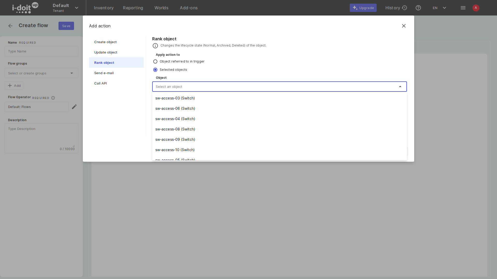
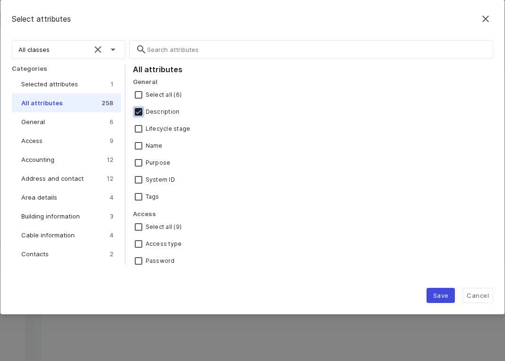
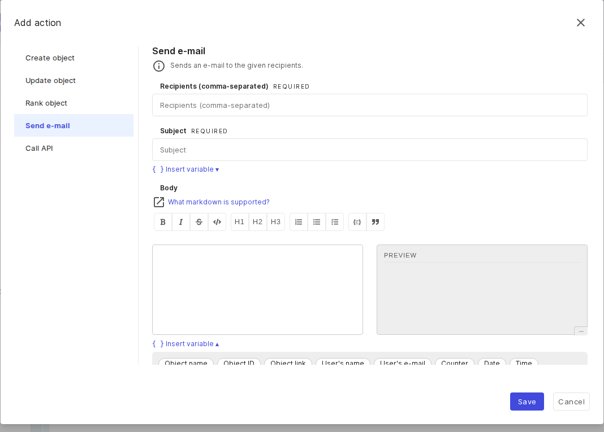

# Actions and placeholders

Actions are what a flow does.
A flow needs at least one action.
This page describes the five action types and the placeholders you can use in their fields.

!!! info
    Available as of i-doit up 3.3.0.

## Action types

| Action | What it does |
| --- | --- |
| **Create object** | Creates a new object of the selected class and sets its attributes. |
| **Update object** | Updates attributes on the trigger object or a selected object. |
| **Rank object** | Changes the lifecycle state (Normal, Archived, Deleted) of the object. |
| **Send e-mail** | Sends an e-mail to the given recipients. |
| **Call API** | Sends an HTTP request to an external API. |

To add an action, open the flow and click **Add action**.
A flow can have several actions.
They run in order, from top to bottom.

Every action runs with the permissions of the [Flow Operator](create.md#flow-operator).

## Create object

1. Select the **Object class**.
2. Enter the **Object title**.
    It can contain [placeholders](#placeholders), for example `{{object-name}}-{{counter}}`.
3. Click **Add attributes** to choose which attributes the action sets, see [Select attributes](#select-attributes).
4. Enter a value for each selected attribute.

## Update object

Under **Apply action to**, choose the object:

- **Object referred to in trigger**: the object that started the flow.
    This is the default.
- **Selected objects**: an object you select.

Then choose the attributes with **Add attributes** and enter the values, see [Select attributes](#select-attributes).

For a single-value category, the action changes the existing entry.
For a multi-value category, every run adds a new entry.

## Rank object

The action changes the lifecycle state (Normal, Archived, Deleted) of an object.

1. Under **Apply action to**, choose the object:
    - **Object referred to in trigger**: the object that started the flow.
        This is the default.
    - **Selected objects**: an object you select in the field **Object**.
2. Under **Set state to**, choose **Normal**, **Archived**, or **Deleted**.
    The default is **Archived**.

## Send e-mail

- **Recipients (comma-separated)**: required.
- **Subject**: required.
- **Body**: the message in Markdown.
    The **Preview** next to the editor shows the result.
    **What markdown is supported?** explains the syntax.

The add-on sends e-mails with the mail server your administrator configured.
There are no mail settings in the flow.

## Call API

- **Method**: GET, POST, PUT, PATCH, or DELETE.
    The default is POST.
- **URL**: the address of the external API.
- **Body (optional)**: the request body.

## Select attributes

**Add attributes** opens the attribute picker:

- The sidebar shows **Selected attributes**, **All attributes**, and all categories with the number of their attributes.
- The class filter at the top limits the categories to one object class.
    For **Create object**, it starts with the object class of the action.
    The filter only changes what you see, not the action.
- Select attributes with the check boxes.
    **Select all** selects all attributes of a category.

Only attributes a flow can write are listed.

After you click **Save**, the selected attributes appear grouped by category.
You can collapse a category, remove a single attribute or a whole category, and open **Add attributes** again.
Values you already entered are kept.

Each attribute uses the same field type as on the object, for example a date picker or a dropdown list.
For date fields, **Use date of execution** writes the date of the run instead of a fixed date.
File and image fields are plain text fields here.

## Placeholders

Placeholders are replaced with current values when the flow runs.
You can combine them with each other and with your own text, for example `Ticket for {{object-name}} (#{{object-id}})`.

| Placeholder | Value |
| --- | --- |
| `{{object-name}}` | Name of the object the flow acts on |
| `{{object-id}}` | ID of this object |
| `{{object-link}}` | Link to the overview page of this object |
| `{{users-name}}` | First and last name of the user who triggered the flow |
| `{{users-e-mail}}` | E-mail address of this user |
| `{{counter}}` | A number that increases by one each time it is used. It starts at 1. |
| `{{date}}` | Date of the run |
| `{{time}}` | Time of the run |
| `{{date-time}}` | Date and time of the run |

Placeholders work in these fields:

- **Object title** of **Create object**
- text values of **Update object**
- **Subject** and **Body** of **Send e-mail**
- **Body** of **Call API**

Below each of these fields, **Insert variable** lists the placeholders.
Click a placeholder to insert it at the cursor position.
**What do these mean?** explains each placeholder with an example.

Flows has no Twig syntax and no action to run commands.

## Further readings

-   [Triggers](triggers.md)
-   [Conditions](conditions.md)
-   [Logs and history](logs-history.md)
