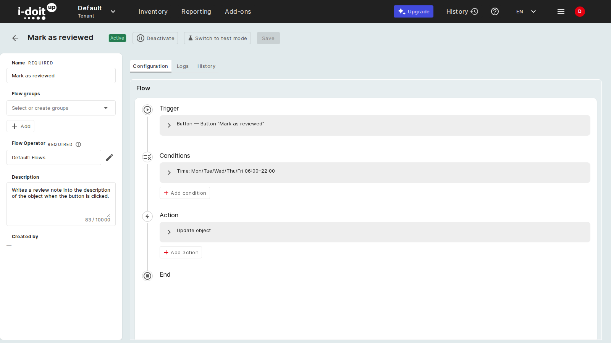
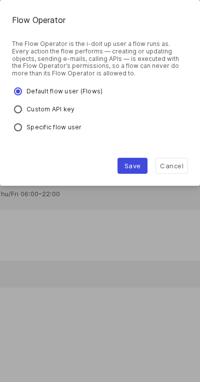

# Create and edit flows

This page describes how to create a flow, how the flow screen is built, and how to switch a flow between the states **Active**, **Test mode**, and **Inactive**.
For the parts of a flow, see [Triggers](triggers.md), [Conditions](conditions.md), and [Actions and placeholders](actions.md).

!!! info
    Available as of i-doit up 3.3.0.

## Create a flow

1. In the overview, click **Add flow**.
2. Enter a **Name**.
   **Description** (up to 10,000 characters) and **Flow groups** are optional.
3. Add a trigger with **Add trigger**, optionally conditions with **Add condition**, and one or more actions with **Add action**.
   Each button opens a dialog with the available types on the left and the form on the right.
4. Click **Save**.

You can save a flow that is not finished yet.
It is saved as **Inactive**.
Required fields are checked when you click **Save**: an empty required field is marked with a red outline and a short message.

When you save an inactive flow that has a trigger and at least one action, a dialog asks what to do next: **Activate now**, **Test**, or leave the flow inactive.

A new flow runs as the **Default flow user**.
To change this, see [Flow Operator](#flow-operator).

## The flow screen

**Open** in the overview and **Edit** in the **More actions** menu both open the same screen.
There is no separate edit page.

- On the left, the flow settings: **Name**, **Flow groups**, **Description**, **Flow Operator**, and **Created by**.
- At the top, the status of the flow and the buttons to change it.
- On the right, the tabs **Configuration**, **Logs**, and **History**.
  **Configuration** shows the flow as **Trigger → Conditions → Action → End**.
  **Logs** and **History** show the runs and changes of this flow only, see [Logs and history](logs-history.md).

Every trigger, condition, and action is shown as a card.
Click the card header to expand it and see all details.
Hover over a card to show **Edit** and **Remove**.

## Save changes

Nothing is saved automatically.
All changes on the flow screen, including removing a trigger, condition, or action, stay pending until you click **Save** at the top of the screen.
**Save** is only enabled when something has changed.

If you leave the flow with unsaved changes, i-doit up asks you to confirm with **Leave anyway** or **Keep editing**.
The same applies when you close a dialog in which you changed something.

If you remove the trigger or the last action from an active flow or a flow in test mode and then save, the flow is set to **Inactive**.
A message tells you about this.

## Flow Operator

The Flow Operator is the user a flow runs as.
The actions of the flow use the permissions of this user.
To change it, click the edit button next to **Flow Operator** and choose one of these options:

- **Default flow user**: the service user "Flows" that the add-on creates automatically.
  This is the default for new flows.
- **Specific flow user**: a user from the list of flow users.
  This option needs the right **Select Flow Operator**.
- **Custom API key**: the flow uses an API key you enter.
  This option needs the right **Select Flow Operator** and is only available after the flow has been saved.
  The key is stored encrypted and is not shown again.
  A custom API key takes precedence over the flow user.

Changes in this dialog only take effect when you click **Save**.
Flow users and the rights are described in [Rights and flow users](../../admin/flows/rights.md).

## Activate a flow

A flow only runs when it is **Active**.
To activate it, click **Activate** in the overview or on the flow screen, or **Activate now** in the dialog after saving.
i-doit up asks for confirmation (**Activate flow?**), because an active flow runs its actions as soon as its trigger fires.

**Activate** is only available when the flow has a trigger and at least one action.
Activating on the flow screen also saves pending changes.

To switch a flow off, click **Deactivate** and confirm **Deactivate flow?**.

## Test mode

Use test mode to check a flow without changing data.
While a flow is in test mode:

- its trigger fires as usual,
- its conditions are checked as usual,
- its actions are only simulated: nothing is created, updated, ranked, sent, or called,
- every run is written to the logs with a description of what would have happened, for example "Would create object …".

To switch a flow to test mode, choose **Switch to test mode** in the **More actions** menu of an active or inactive flow, or **Test** in the dialog after saving, and confirm **Switch flow to test mode?**.
From test mode, you can activate the flow or deactivate it.

## Further readings

-   [Flows](../flows.md)
-   [Triggers](triggers.md)
-   [Logs and history](logs-history.md)
