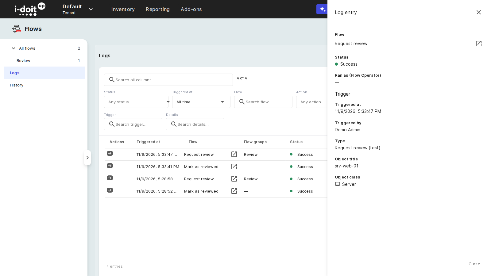
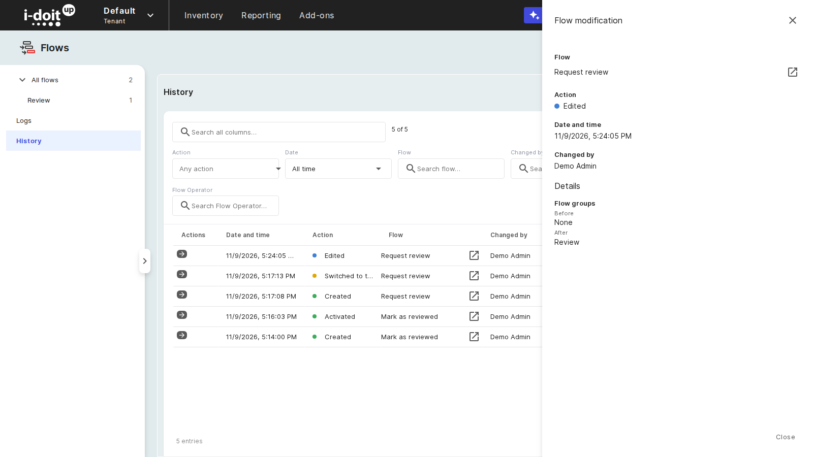

# Logs and history

Flows records every run of a flow in the **Logs** and every change to a flow in the **History**.
This page describes both views.

!!! info
    Available as of i-doit up 3.3.0.

## Logs

**Logs** in the left panel lists the runs of all flows, newest first.
Each run shows when it was triggered, the flow and its groups, the status, the action, who triggered it, the trigger, and details of what happened.

The status of a run is one of:

- **Success**: the actions ran.
- **Skipped**: a condition was not met.
- **Error**: an action failed.

Runs in test mode describe what would have happened, for example "Would create object …".

The filter bar offers a search field and filters for **Status**, **Action**, **Triggered at** (today, this week, this month, or a date range), **Flow**, **Triggered by**, **Trigger**, and **Details**.
Filters in the logs are reset when you leave the view.

**Open** (→) in a row opens the log entry on the right.
It shows the flow, the status, **Ran as (Flow Operator)**, and the trigger with **Triggered at**, **Triggered by**, the trigger type, and the title and type of the trigger object.
If a flow has been deleted, its name is marked as **Deleted**.

To see the runs of a single flow, open the flow and select the **Logs** tab.

## Delayed runs

When a large number of runs is triggered at once, for example by a bulk import that fires many event triggers, Flows queues the extra runs and carries them out shortly afterwards.
The runs are not lost, they appear in the logs a little later.

Button clicks are not delayed.
If a very large number of button clicks arrives within a minute, Flows shows a message and you can click again a moment later.

## History

**History** in the left panel lists all changes to flows, newest first.
It shows changes of these kinds: **Created**, **Imported**, **Edited**, **Deleted**, **Activated**, **Deactivated**, and **Switched to test mode**.
Every save creates its own entry.

Each entry shows the date and time, the kind of change, the flow, **Changed by**, the flow groups, and the Flow Operator after the change.

**Open** (→) in a row opens the details of the change:

- for a created flow, its first configuration,
- for an edited flow, the changed fields with their values before and after,
- for a deleted flow, its last configuration.

The history is kept after a flow is deleted.

The filter bar offers a search field and filters for the kind of change, **Date**, **Flow**, **Changed by**, flow group, and Flow Operator.

To see the changes of a single flow, open the flow and select the **History** tab.

## Further readings

-   [Flows](../flows.md)
-   [Create and edit flows](create.md)
