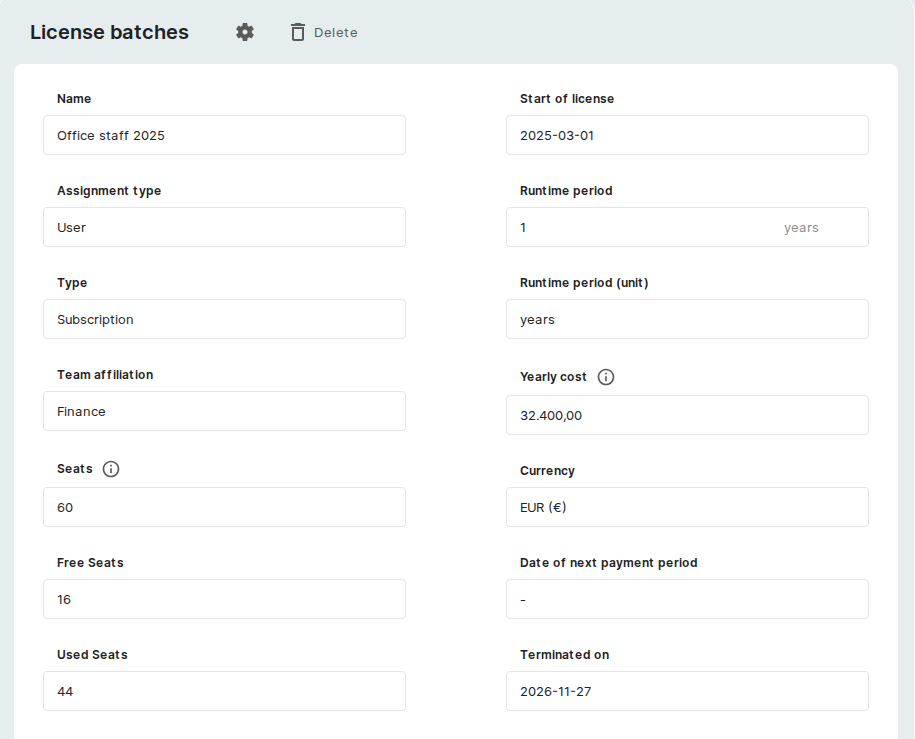
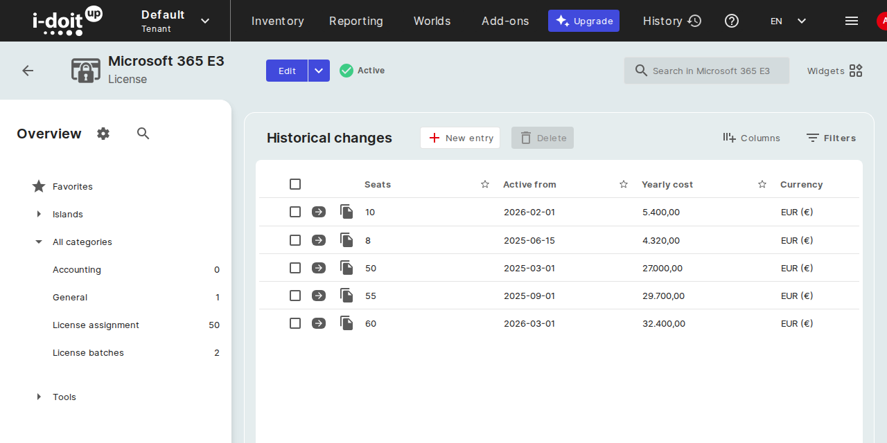
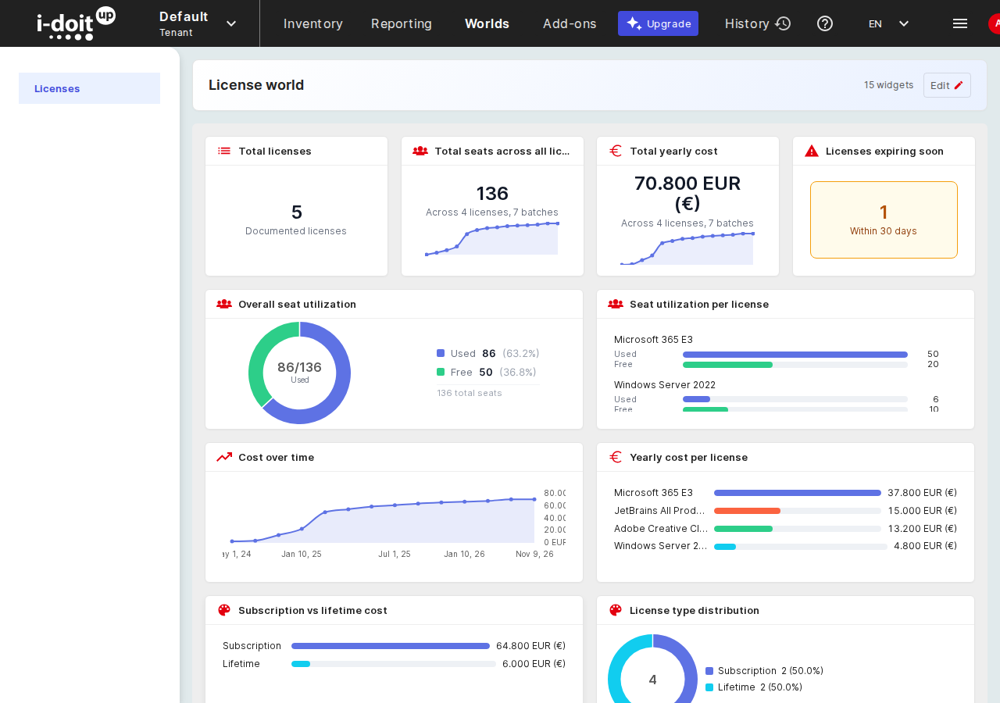
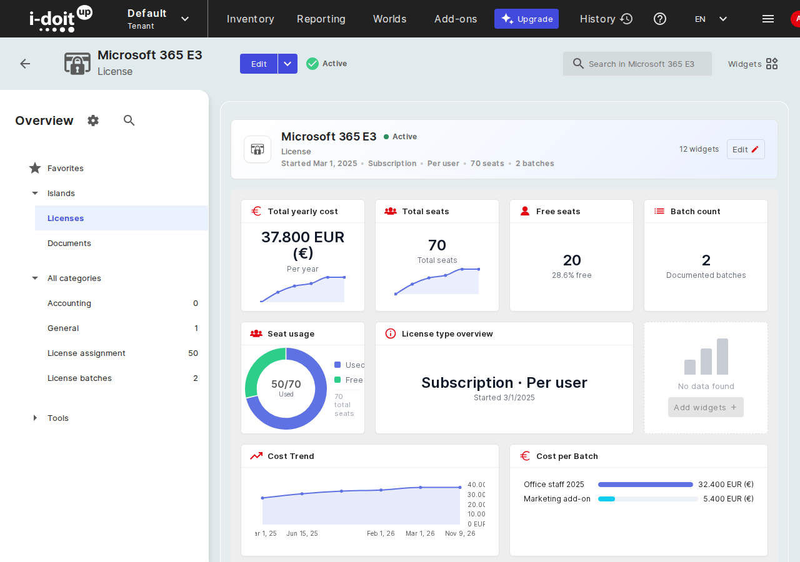
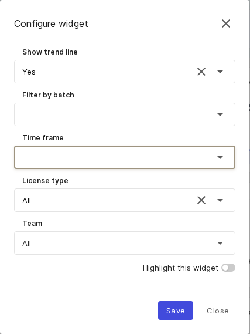
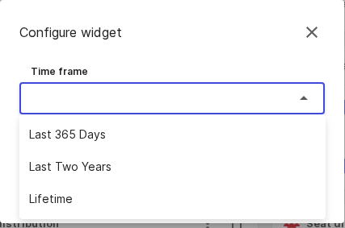

# License World and License Island

The **License World** gives you an overview of all licenses in your tenant: seats, costs, and upcoming dates.
The **License Island** shows the same kind of information for a single license object.

How to open them, edit the layout, and add or remove widgets is described in [Worlds and Islands](worlds-and-islands.md).
To see them, you need the rights **Access all Worlds** and **Access all Islands**, see [Rights for Worlds and Islands](../admin/rights-and-permissions.md#rights-for-worlds-and-islands).

## Data the widgets use

The widgets read the following data of your license objects.

### Class and batches

A license is an object of the class **License**.
Each license has one or more batches in the category **License batches**.
A batch describes one purchase, for example 60 seats bought for one year.

| Field | Meaning |
|---|---|
| Name | Name of the batch, for example *Office staff 2025*. |
| State | **Active** or **Inactive**. |
| Assignment type | **Installation** or **User**. |
| Type | **Subscription** or **Lifetime**. |
| Team affiliation | The team the batch belongs to. Team widgets and the team filter use it. |
| Seats | Number of seats bought. |
| Free Seats, Used Seats | Calculated by i-doit up, see below. |
| Start of license | Start date of the batch. |
| Runtime period, Runtime period (unit) | Duration of one payment period, for example 1 years. |
| Yearly cost, Currency | Cost per year of the batch. |
| Date of next payment period | Date of the next payment. You enter it yourself. |
| Terminated on | Date on which the batch ends. |

**Used Seats** is the number of entries in the category **License assignment** that point to this batch.
You add these entries on the objects that use the license.
**Free Seats** is **Seats** minus **Used Seats**.

A license without batches counts in **Total licenses**, but not in the batch counts.

### Cost and seat history

The category **Historical changes** of a license object keeps the history of seats and costs.
i-doit up adds an entry automatically when you change a batch.
To add an entry yourself, click **New entry** and enter **Seats**, **Active from**, **Yearly cost**, and **Currency**.
The widgets **Cost over time** and **Cost Trend** draw their curves from this history.

## License World

Open **Worlds** in the top navigation and click **Licenses** in the left sidebar.
The page is titled **License world**.

The License World uses all objects of every class that has the category **License batches**.

The default layout contains these 15 widgets.
The column "German UI" shows the title in the German interface.

| Widget | German UI | Shows | Default size |
|---|---|---|---|
| Total licenses | Lizenzen gesamt | Number of license objects | Small |
| Total seats across all licenses | Plätze über alle Lizenzen | Sum of all seats, with the number of licenses and batches | Small |
| Total yearly cost | Jahreskosten gesamt | Sum of the yearly cost | Small |
| Licenses expiring soon | Bald ablaufende Lizenzen | Batches that end within the next 30 days | Small |
| Overall seat utilization | Gesamtauslastung der Plätze | Used and free seats across all licenses | Medium |
| Seat utilization per license | Platzauslastung je Lizenz | Used and free seats per license | Medium |
| Cost over time | Kosten im Zeitverlauf | Cost history across all licenses | Medium |
| Yearly cost per license | Jahreskosten je Lizenz | Yearly cost per license | Medium |
| Subscription vs lifetime cost | Subscription vs. Lifetime | Cost split by license type | Medium |
| License type distribution | Verteilung Lizenztyp | Number of subscription and lifetime licenses | Medium |
| Assignment type distribution | Verteilung Zuordnungstyp | Per installation compared to per user | Medium |
| Seat distribution per team | Platzverteilung je Team | Seats per team | Medium |
| Cost distribution per team | Kostenverteilung je Team | Cost per team | Medium |
| Upcoming payments | Bevorstehende Zahlungen | Next payment dates | Medium |
| Upcoming terminations | Bevorstehende Kündigungen | Next termination dates | Medium |

## License Island

Open an object of the class **License** and click **Licenses** in the group **Islands** of the left sidebar.
The header shows the name and state of the license, its class, and a summary, for example *Started Mar 1, 2025 · Subscription · Per user · 70 seats · 2 batches*.

The License Island uses the license object you have opened and its batches.

The default layout contains these 12 widgets.

| Widget | German UI | Shows | Default size |
|---|---|---|---|
| Seat usage | Platznutzung | Used and free seats | Small |
| Seat Number per Batch | Sitzplätze pro Batch | Used and free seats per batch | Medium |
| Total seats | Gesamtplätze | Sum of the seats of all batches | Small |
| Free seats | Freie Plätze | Seats not assigned, with the share of free seats, for example *28.6% free* | Small |
| Total yearly cost | Jahresgesamtkosten | Sum of the yearly cost | Small |
| Cost per Batch | Kosten pro Batch | Yearly cost per batch | Medium |
| Seat usage per team | Platznutzung pro Team | Seats per team | Medium |
| License type overview | Lizenztyp-Übersicht | License type and assignment type with the start date, for example *Subscription · Per user*; *Mixed across batches* if the batches differ | Medium |
| Upcoming payment dates | Bevorstehende Zahlungstermine | Next payment dates | Medium |
| Upcoming terminations | Bevorstehende Kündigungen | Next termination dates | Medium |
| Cost Trend | Kostenentwicklung | Cost history of the license | Medium |
| Batch count | Paketanzahl | Number of batches | Small |

An empty field in the grid shows **No data found** and the button **Add widgets**.
It marks free space for another widget.

## Date lists

The widgets with upcoming payments and terminations list the next dates:

- dates within 30 days are shown in red,
- dates within 60 days are shown in amber,
- terminations in the past are not listed.

## Filters

Many widgets have filters.
You set them per widget in the dialog **Configure widget** (in edit mode, menu of the widget, **Configure**).
A filter applies only to this widget and is saved with your personal layout.

| Filter | Options |
|---|---|
| Time frame | **Last 365 Days**, **Last Two Years**, **Lifetime**. No option is selected by default. |
| Team | One or more teams from the field **Team affiliation** of the batches. Default: all teams. |
| License type | **All**, **Subscription**, **Lifetime**. |
| Assignment type | **All**, **Per installation**, **Per user**. |
| Filter by batch | Batches of the license. |

Which filters a widget offers depends on the widget, for example:

- **Overall seat utilization**: Assignment type, License type, Team.
- **Cost over time**: Filter by batch, Time frame, License type, Team.
- **Upcoming payments** and **Upcoming terminations**: Time frame only.

On **Upcoming payments** and **Upcoming terminations**, the time frame counts forward from today.
**Last 365 Days** shows the dates of the next 365 days.

## Further readings

- [Worlds and Islands](worlds-and-islands.md)
- [Rights for Worlds and Islands](../admin/rights-and-permissions.md#rights-for-worlds-and-islands)
- [Categories and attributes](basics/categories-and-attributes.md)
