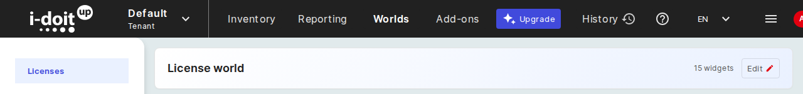
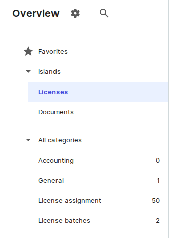
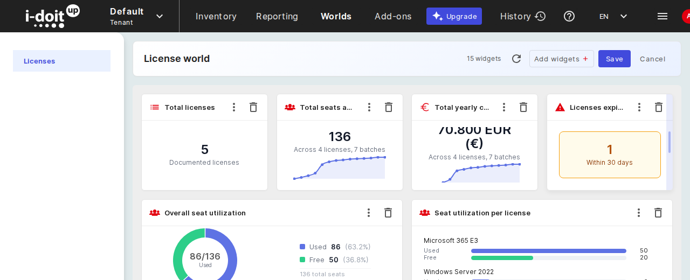
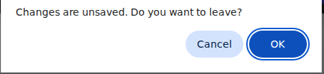
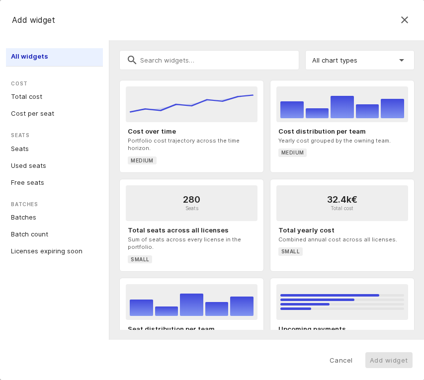
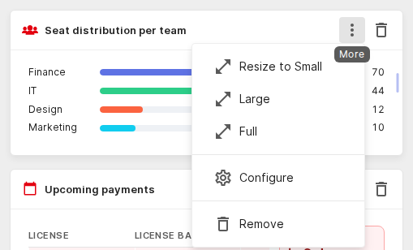
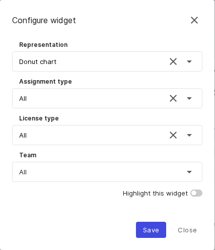
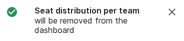

# Worlds and Islands

Worlds and Islands are dashboards with widgets that summarize your documentation.

- A **World** collects data across all objects of one topic, for example all licenses of your tenant.
    You open it from the top navigation.
- An **Island** is a dashboard inside a single object.
    It belongs to one or more classes and shows data of the object you have opened.

i-doit up 3.3.0 ships one World and one Island, both about licenses.
See [License World and License Island](license-world-and-island.md) for their widgets and the data they need.
Add-ons can add further Islands, for example the island **Documents** of the DMS add-on.

## Before you start

Worlds and Islands are protected by two rights: **Access all Worlds** and **Access all Islands**.
i-doit up does not grant these rights automatically, not even to the administrator.
Without the rights, the menu item **Worlds** and the group **Islands** do not appear at all.

Ask your administrator to grant the rights, or grant them yourself if you manage rights.
See [Rights for Worlds and Islands](../admin/rights-and-permissions.md#rights-for-worlds-and-islands).
The change takes effect when you reload the page.

## Open a World

1. Click **Worlds** in the top navigation.
    i-doit up opens the first World you have access to.
2. Pick a World in the left sidebar, for example **Licenses**.

The address of a World has the form `/worlds/<world>/<view>`, for the License World `/worlds/license-world/license`.

## Open an Island

1. Open an object, for example an object of the class **License**.
2. In the left sidebar of the object, open the group **Islands**.
3. Click the island, for example **Licenses**.

The group **Islands** only lists the islands that belong to the class of the object.
The License Island appears on objects of the class **License** only.

## Work with the dashboard

A World or Island opens in **view mode**.
The header shows the title, the number of widgets, and the button **Edit**.
Click **Edit** to switch to **edit mode**.

In edit mode you can:

- drag widgets to a new position,
- change the size of a widget,
- add widgets with **Add widgets**,
- remove widgets with the trash icon or the menu entry **Remove**,
- reset the layout with the round arrow icon (**Reset to default layout**).

Changes in edit mode stay pending until you click **Save**.
**Cancel** discards them.
i-doit up confirms a successful save with "Dashboard saved successfully".

If you try to leave the page with unsaved changes, your browser asks "Changes are unsaved. Do you want to leave?".
Click **Cancel** to stay on the page, then save.

### Add widgets

1. Click **Edit**.
2. Click **Add widgets**.
3. In the panel **Add widget**, browse the widgets by topic in the list on the left, or search for a widget.
    Use **All chart types** to show only one kind of chart.
4. Select a widget and click **Add widget**.

Each widget shows a size badge (for example **SMALL** or **MEDIUM**).
Hover over the badge to see the hint "Recommended size. Resizable anytime.".

### Change the size of a widget

Widgets come in four fixed sizes: **Small**, **Medium**, **Large**, and **Full**.
In edit mode, open the menu of a widget (three dots) and pick one of the **Resize to** entries.
You can also drag the resize handle of the widget.
A double click on the handle makes the widget fill the free space next to it.

### Configure a widget

In edit mode, open the menu of a widget and click **Configure**.
The dialog **Configure widget** shows only the settings that fit the widget, for example:

- **Representation**: the kind of chart, for example **Donut chart**.
- **Show trend line**: adds a trend line to a chart over time.
- Filters such as **Time frame**, **Team**, **License type**, or **Assignment type**.
    See [Filters](license-world-and-island.md#filters).
- **Highlight this widget**: makes the widget stand out on the dashboard.

Click **Close** to close the dialog.
The settings of this dialog are saved right away; you do not need **Save** for them.

### Remove a widget

In edit mode, click the trash icon of the widget or the menu entry **Remove**.
A notice tells you that the widget will be removed from the dashboard.
The widget is removed when you click **Save**.
To keep it, click **Cancel** instead.

### Reset to the default layout

In edit mode, click the round arrow icon next to the widget counter (**Reset to default layout**).
The dashboard returns to the layout i-doit up ships with.
Click **Save** to keep the default layout, or **Cancel** to return to your own layout.

## Your layout is personal

- Each user has an own layout for every World and Island.
    i-doit up stores it on the server, so it follows you to other browsers and devices.
- Other users do not see your changes.
    Every user starts with the default layout.
- The layout of an Island applies to all objects of the same class.
    If you change the License Island of one license, you see the same layout on every other license.

## Further readings

- [License World and License Island](license-world-and-island.md)
- [Rights for Worlds and Islands](../admin/rights-and-permissions.md#rights-for-worlds-and-islands)
- [Objects](basics/objects.md)
